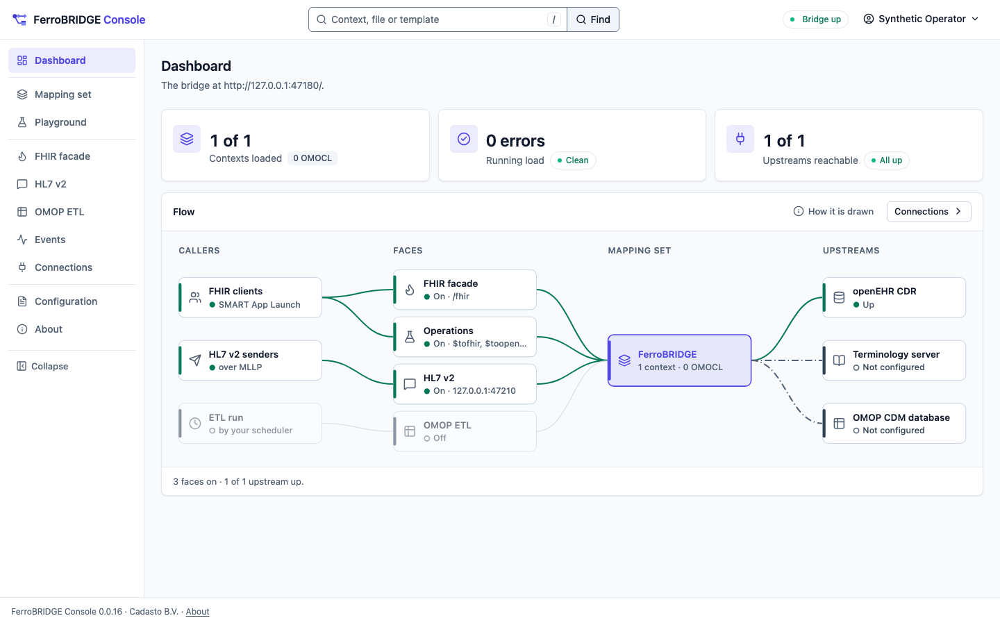

<!-- SPDX-FileCopyrightText: Cadasto B.V. -->
<!-- SPDX-License-Identifier: BUSL-1.1 -->
<div align="center">


**The bridge from openEHR health records to HL7 FHIR and the OMOP research model, driven by mapping files.**

[Documentation](https://ferrobridge.eu/docs/) ·
[Quick start](#quick-start) ·
[What it implements](#what-it-implements) ·
[Licensing](https://ferrobridge.eu/docs/evaluate/licensing.html)

<!-- badges:begin -->
**Project**<br>
[](https://github.com/FerroHEALTH/FerroBRIDGE/releases/latest)
[](https://github.com/FerroHEALTH/FerroBRIDGE/actions/workflows/ci.yml)
[](LICENSE)
[](https://ferrobridge.eu/docs/)
[](https://github.com/FerroHEALTH/FerroBRIDGE/pkgs/container/ferrobridge)

**Quality and security**<br>
[](https://scorecard.dev/viewer/?uri=github.com/FerroHEALTH/FerroBRIDGE)
[](https://sonarcloud.io/summary/overall?id=FerroHEALTH_FerroBRIDGE)
[](https://sonarcloud.io/summary/new_code?id=FerroHEALTH_FerroBRIDGE)
[](https://github.com/FerroHEALTH/FerroBRIDGE/actions/workflows/codeql.yml)
[](SECURITY.md#verifying-a-release)
[](SECURITY.md#verifying-a-release)

**Conformance and compliance**<br>
[](conformance/fhirconnect-mapping-lib/pass-list.txt)
[](conformance/rest-api/pass-list.txt)
[](conformance/omocl/pass-list.txt)
[](conformance/fhir-stu3/pass-list.txt)
[](conformance/fhir-r4/pass-list.txt)
[](conformance/fhir-r4b/pass-list.txt)
[](conformance/fhir-r5/pass-list.txt)
[](conformance/fhir-r6/pass-list.txt)
[](conformance/roundtrip/pass-list.txt)
[](conformance/fhir-r4-facade/pass-list.txt)
[](conformance/fhirpath-r4/pass-list.txt)
[](conformance/fhirpath-r4-stu3/pass-list.txt)
[](conformance/validator-agreement/pass-list.txt)
[](conformance/hl7v2/pass-list.txt)
[](conformance/hl7v2-smoke/pass-list.txt)
<br>
[](https://ferrobridge.eu/docs/evaluate/cra-user-information.html)

<details>
<summary>HL7 v2 by message family and by version, across both corpora</summary>

[](conformance/hl7v2/pass-list.txt)
[](conformance/hl7v2/pass-list.txt)
[](conformance/hl7v2/pass-list.txt)
[](conformance/hl7v2/pass-list.txt)
[](conformance/hl7v2/pass-list.txt)
[](conformance/hl7v2/pass-list.txt)
[](conformance/hl7v2/pass-list.txt)
[](conformance/hl7v2/pass-list.txt)
[](conformance/hl7v2/pass-list.txt)
[](conformance/hl7v2/pass-list.txt)
[](conformance/hl7v2/pass-list.txt)
[](conformance/hl7v2/pass-list.txt)
[](conformance/hl7v2/pass-list.txt)
[](conformance/hl7v2/pass-list.txt)
[](conformance/hl7v2/pass-list.txt)
[](conformance/hl7v2/pass-list.txt)
[](conformance/hl7v2/pass-list.txt)
[](conformance/hl7v2/pass-list.txt)
[](conformance/hl7v2/pass-list.txt)
[](conformance/hl7v2/pass-list.txt)
[](conformance/hl7v2/pass-list.txt)
[](conformance/hl7v2/pass-list.txt)
[](conformance/hl7v2/pass-list.txt)
[](conformance/hl7v2/pass-list.txt)

</details>
<!-- badges:end -->

</div>


## What FerroBRIDGE is

Health data rarely lives in one format. A hospital may keep its records in
openEHR, an open standard for structured health records, while the apps that
need them speak HL7 FHIR, the exchange format most modern health software
uses, and the researchers who study them work in OMOP, the common data model
of the international OHDSI research network.

FerroBRIDGE translates between them, in pure Rust. It reads records from any
openEHR CDR it reaches over the ITS-REST API and offers them as FHIR, so a
FHIR app reads and writes them without knowing openEHR. It copies records
into an OMOP CDM database, so studies run over them. HL7 v2 messages, the
format many hospital systems send, come in through it as well. It stores no
clinical data of its own: the record stays in the CDR.

Every translation is a mapping file, written in one of two published
languages: FHIRconnect for FHIR and OMOCL for OMOP. A clinical informatician
reads and changes a mapping without a programmer, and FerroBRIDGE checks each
file against the published schema when it loads it. Nothing is hand-coded per
FHIR resource or per OMOP table.

It is for hospitals and regions that keep records in openEHR and share them
with FHIR apps, national exchanges or partners; for research groups and data
offices that want openEHR data in an OMOP database; and for vendors and
integrators that build FHIR applications over an openEHR back end or use its
FHIR and HL7 v2 libraries on their own.

<picture>
  <source media="(prefers-color-scheme: dark)" srcset="website/book/src/operate/img/console/dashboard-dark.png">
  
</picture>

## What it implements

| Lane | Specifications | What it does |
|---|---|---|
| [The FHIR facade](https://ferrobridge.eu/docs/integrate/fhir-facade.html) | FHIRconnect 1.0.0, HL7 FHIR R4, SMART App Launch 2 | A FHIR R4 server over the CDR: read, vread, create, update, search, transaction, batch, `$validate` and `Composition/$document`, every request driven by the mappings and every access token checked against the SMART v2 scope its interaction needs |
| [The FHIRconnect operations](https://ferrobridge.eu/docs/integrate/operations.html) | FHIRconnect REST API | `$tofhir` and `$toopenehr`, which run a mapping as a pure transformation with no CDR |
| [The OMOP ETL](https://ferrobridge.eu/docs/integrate/omop-etl.html) | OMOCL 1.0.0, OMOP CDM v5.4 | `cdm init` creates a CDM v5.4 database and `etl run` fills it from the CDR over AQL, with [concept resolution](https://ferrobridge.eu/docs/integrate/omop-etl.html#concept-resolution-is-sql-not-terminology) as SQL over the OHDSI vocabulary you load, and [FHIR R4 loaded with no CDR](https://ferrobridge.eu/docs/integrate/omop-etl.html#loading-fhir-with-no-cdr) |
| [The HL7 v2 face](https://ferrobridge.eu/docs/operate/hl7v2-face.html) | HL7 v2 over MLLP, the HL7 v2-to-FHIR guide | An MLLP listener that maps each message through the guide's ConceptMaps and writes it into the CDR as one transaction, acknowledged once the CDR commits or refuses it |
| [The change feed](https://ferrobridge.eu/docs/integrate/change-feed.html) | openEHR ITS-REST 1.1.0 | Hands each commit of the CDR to [the events lane](https://ferrobridge.eu/docs/integrate/events.html), the incremental OMOP load and [the outbound FHIR lane](https://ferrobridge.eu/docs/integrate/fhir-outbound.html), which posts one transaction Bundle per changed composition |
| [The interoperability component](https://ferrobridge.eu/docs/evaluate/interoperability-component.html) | Regulation (EU) 2025/327 | The `eehrxf` crate: the European exchange format in FHIR R4 for prescriptions and dispensations, laboratory, imaging and discharge reports, mapped from openEHR through FHIRconnect |

[Writing and loading mappings](https://ferrobridge.eu/docs/integrate/mappings.html)
covers the model, extension and context files, `ferrobridge mapping check`,
and the operator API that reloads a running bridge.
[The operator console](https://ferrobridge.eu/docs/operate/operator-console.html)
shows the running mapping set, edits and checks a draft, and runs a mapping
in a playground.

## Quick start

The quickstart runs the published image with every lane off. You need
Docker Compose 2.23.1 or newer and `curl`, and no checkout. Every release
attaches the quickstart as one self-contained `compose.yaml`; download the
latest release's into an empty directory:

```sh
curl -fsSLO https://github.com/FerroHEALTH/FerroBRIDGE/releases/latest/download/compose.yaml
```

Create the secret files it reads, empty for a lane you leave off:

<!-- tour:secrets -->
```sh
mkdir -p secrets && umask 077
touch secrets/cdm_url secrets/cdm_password secrets/cdr_password \
  secrets/terminology_password secrets/console_oidc_client_secret
```

Start the bridge and ask for liveness:

<!-- tour:start -->
```sh
docker compose up --wait
curl --fail-with-body -s http://127.0.0.1:8080/health/liveness
```

Every command above is a step of
[`scripts/quickstart/tour.sh`](scripts/quickstart/tour.sh), which CI runs
against `compose.yaml`. Turn a lane on by setting its variable:
`FERROBRIDGE__CDR__ENDPOINT__URL` reaches your openEHR CDR and
`FERROBRIDGE__TERMINOLOGY__ENDPOINT__URL` your terminology server. The header
of `compose.yaml` names every setting, and the `cdm` and `console` profiles
add an OMOP database and the operator console.
[Configuring the server](https://ferrobridge.eu/docs/operate/configuration.html)
continues from here.

## Deploy it

Every release publishes, from one tag:

- the bridge image `ghcr.io/ferrohealth/ferrobridge` and the console image
  `ghcr.io/ferrohealth/ferrobridge-console`, for `linux/amd64` and
  `linux/arm64`, on a distroless base;
- the static `ferrobridge` binary for Linux and the quickstart
  `compose.yaml` on the [GitHub release](https://github.com/FerroHEALTH/FerroBRIDGE/releases);
- the library crates whose version moved, on crates.io.

The latest release is [v0.0.24](https://github.com/FerroHEALTH/FerroBRIDGE/releases/tag/v0.0.24), cut on 2026-11-11.
Its image is `ghcr.io/ferrohealth/ferrobridge:0.0.24`.
The bridge runs beside an openEHR CDR over ITS-REST, a FHIR terminology
server and, for the OMOP side, a CDM v5.4 database with the OHDSI vocabulary
loaded ([What FerroBRIDGE runs beside](https://ferrobridge.eu/docs/operate/deployment-shape.html)).
[The container image](https://ferrobridge.eu/docs/operate/container.html)
covers the images, the probes and the compose profiles.

## Security and conformance

- **Who may call it:** the facade and the operator API are a SMART App
  Launch 2 resource server, and every access is written to the
  [access record](https://ferrobridge.eu/docs/operate/access-record.html)
  of Regulation (EU) 2025/327.
- **How it fails:** an upstream failure is reported with its status, never
  turned into an empty answer
  ([Failure and identity behaviour](https://ferrobridge.eu/docs/operate/failure-and-identity.html)).
- **What you install:** every release is signed and carries an SBOM and
  SLSA Build Level 3 provenance, and every scan finding an OpenVEX
  judgement ([verifying a release](SECURITY.md#verifying-a-release)).
- **Conformance:** each conformance badge above links to its pass list, the
  cases that pass against the published FHIRconnect and OMOCL mapping
  libraries, the HL7 FHIR examples per version, the HL7 FHIRPath test suite
  and the HL7 v2 message sets
  ([Checks and gates](https://ferrobridge.eu/docs/contribute/checks-and-gates.html)).

The source is public and every feature is in this repository; there is no
paid edition with extra functions.

## Crates

The mapping languages, the FHIR and HL7 v2 models and the clients the
bridge is built from are published as Rust crates. Pin a crate exactly:
every change moves it one patch
([Crate versions](https://ferrobridge.eu/docs/contribute/crate-versions.html)).

| Crate | What it does | Version | Docs | Downloads |
|---|---|---|---|---|
| [`fhir-types`](https://crates.io/crates/fhir-types) | The FHIR model for STU3, R4, R4B, R5 and R6, generated from the HL7 packages (Apache-2.0) | [](https://crates.io/crates/fhir-types) | [](https://docs.rs/fhir-types) | [](https://crates.io/crates/fhir-types) |
| [`hl7v2-types`](https://crates.io/crates/hl7v2-types) | The HL7 v2 message structures, segments and data types, generated (Apache-2.0) | [](https://crates.io/crates/hl7v2-types) | [](https://docs.rs/hl7v2-types) | [](https://crates.io/crates/hl7v2-types) |
| [`openehr-mapping-core`](https://crates.io/crates/openehr-mapping-core) | The mapping header, loader and registry that FHIRconnect and OMOCL share | [](https://crates.io/crates/openehr-mapping-core) | [](https://docs.rs/openehr-mapping-core) | [](https://crates.io/crates/openehr-mapping-core) |
| [`fhirconnect`](https://crates.io/crates/fhirconnect) | The FHIRconnect mapping language: file model, validation, compiler and engine | [](https://crates.io/crates/fhirconnect) | [](https://docs.rs/fhirconnect) | [](https://crates.io/crates/fhirconnect) |
| [`omocl`](https://crates.io/crates/omocl) | The OMOCL mapping language and its engine, from openEHR to OMOP CDM rows | [](https://crates.io/crates/omocl) | [](https://docs.rs/omocl) | [](https://crates.io/crates/omocl) |
| [`omop-cdm`](https://crates.io/crates/omop-cdm) | The OMOP CDM v5.4 row types, the OHDSI DDL, the vocabulary loader and the writer | [](https://crates.io/crates/omop-cdm) | [](https://docs.rs/omop-cdm) | [](https://crates.io/crates/omop-cdm) |
| [`ferrobridge-term`](https://crates.io/crates/ferrobridge-term) | The FHIR terminology client: $lookup, $translate, $validate-code, $expand and $subsumes | [](https://crates.io/crates/ferrobridge-term) | [](https://docs.rs/ferrobridge-term) | [](https://crates.io/crates/ferrobridge-term) |
| [`ferrobridge-hl7v2`](https://crates.io/crates/ferrobridge-hl7v2) | The HL7 v2 face: MLLP, parsing, acknowledgments and the v2-to-FHIR map | [](https://crates.io/crates/ferrobridge-hl7v2) | [](https://docs.rs/ferrobridge-hl7v2) | [](https://crates.io/crates/ferrobridge-hl7v2) |
| [`ferrobridge-fhirpath`](https://crates.io/crates/ferrobridge-fhirpath) | A FHIRPath 2.0.0 evaluator with the FHIR R4 additions | [](https://crates.io/crates/ferrobridge-fhirpath) | [](https://docs.rs/ferrobridge-fhirpath) | [](https://crates.io/crates/ferrobridge-fhirpath) |
| [`ferrobridge-validator`](https://crates.io/crates/ferrobridge-validator) | A FHIR R4 and STU3 profile validator over packages read offline | [](https://crates.io/crates/ferrobridge-validator) | [](https://docs.rs/ferrobridge-validator) | [](https://crates.io/crates/ferrobridge-validator) |
| [`fhir-search`](https://crates.io/crates/fhir-search) | The FHIR R4 search value grammar: escaped value lists, tokens, string matching and dates with their prefixes and ranges | [](https://crates.io/crates/fhir-search) | [](https://docs.rs/fhir-search) | [](https://crates.io/crates/fhir-search) |
| [`eehrxf`](https://crates.io/crates/eehrxf) | The European interoperability component of an EHR system under the EHDS Regulation: the exchange format in FHIR R4, mapped from openEHR | [](https://crates.io/crates/eehrxf) | [](https://docs.rs/eehrxf) | [](https://crates.io/crates/eehrxf) |
| [`ferrobridge-operator-api`](https://crates.io/crates/ferrobridge-operator-api) | The health and operator documents the bridge and its console share | [](https://crates.io/crates/ferrobridge-operator-api) | [](https://docs.rs/ferrobridge-operator-api) | [](https://crates.io/crates/ferrobridge-operator-api) |

## Part of FerroHEALTH

FerroBRIDGE is one of five [FerroHEALTH](https://ferrohealth.eu) servers.
Each does one job and reaches the others only over published standards:
FerroEHR stores the record, FerroBRIDGE translates it to FHIR and the OMOP
research model, FerroFED connects records across organisations and borders,
FerroPIX matches patient identities, and FerroTERM serves the code systems.
FerroBRIDGE works with any openEHR CDR and any FHIR terminology server.

## Documentation

- [The FerroBRIDGE book](https://ferrobridge.eu/docs/): evaluate,
  integrate, operate and contribute, and the
  [FerroHEALTH book](https://ferrohealth.eu/docs/) for what the family
  shares
- [Architecture](https://ferrobridge.eu/docs/evaluate/architecture.html) and
  [the two mapping specifications](https://ferrobridge.eu/docs/evaluate/mapping-specifications.html)
- [Releases](https://ferrobridge.eu/docs/operate/releases.html), the
  [changelog](CHANGELOG.md) and the
  [GitHub releases](https://github.com/FerroHEALTH/FerroBRIDGE/releases)

## Support and contributing

- [Support](SUPPORT.md) and the [security policy](SECURITY.md)
- [Contributing](CONTRIBUTING.md), [code of conduct](CODE_OF_CONDUCT.md),
  [governance](GOVERNANCE.md), [maintainers](MAINTAINERS.md) and the
  [AI statement](AI_STATEMENT.md)

## Licence

Business Source License 1.1 ([LICENSE](LICENSE)): free outside production
and for non-commercial production use, a commercial licence from Cadasto
B.V. for other production use, and Apache License 2.0 four years after each
version; `fhir-types` and `hl7v2-types` are Apache-2.0 today. The
[licensing page](https://ferrobridge.eu/docs/evaluate/licensing.html) says
which applies to you.
