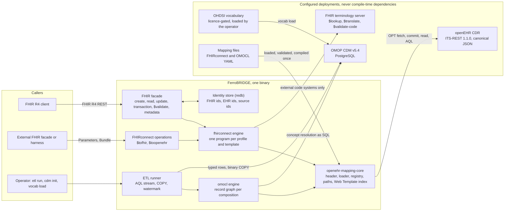
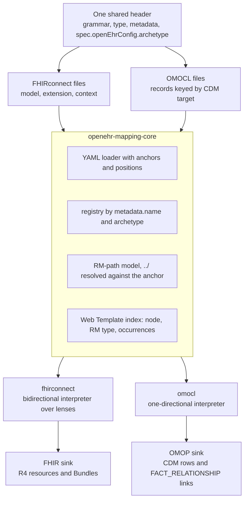
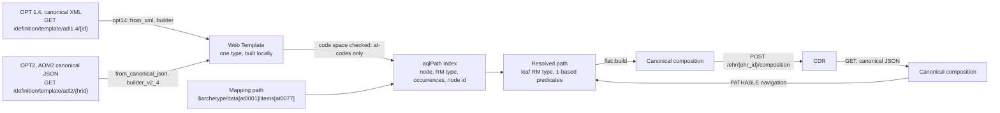
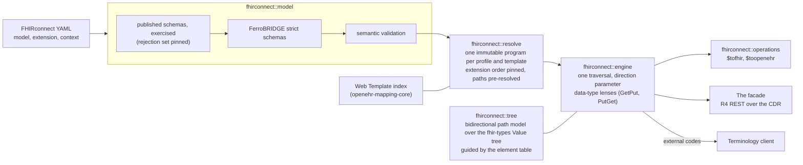
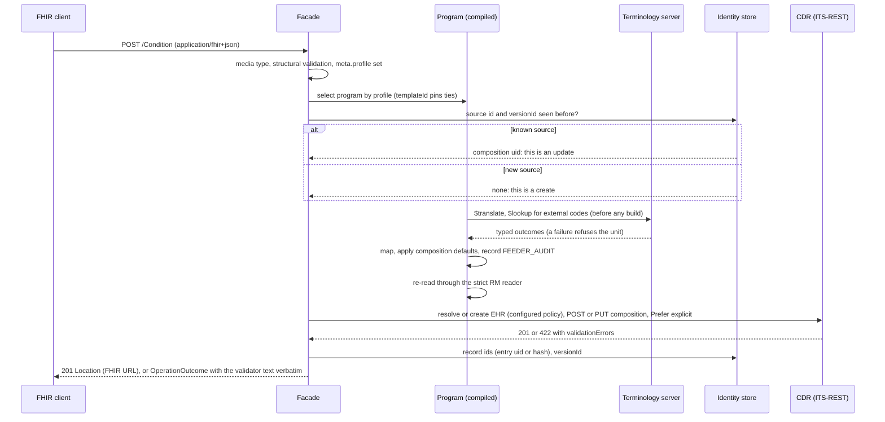
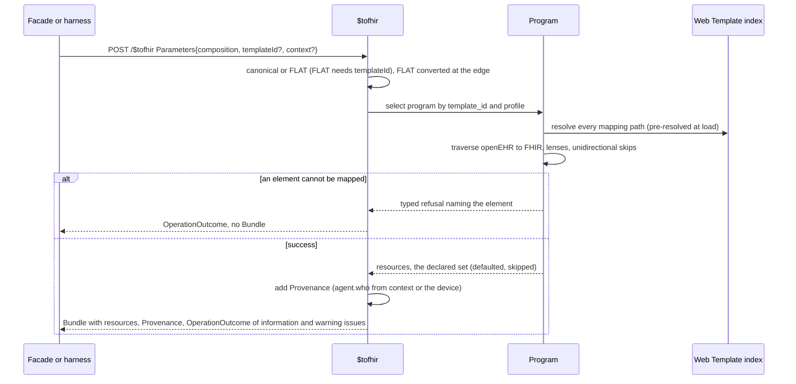
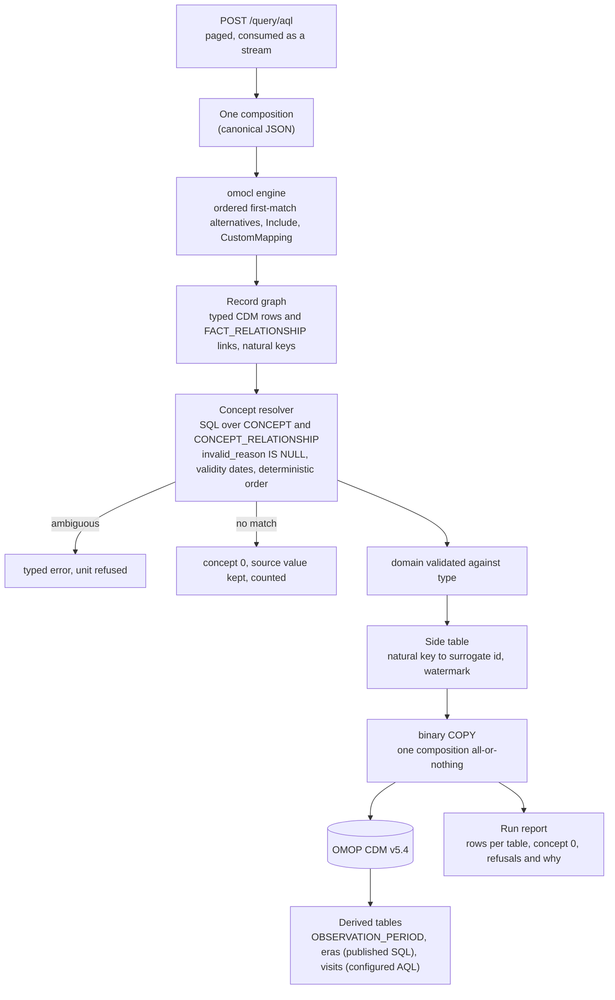
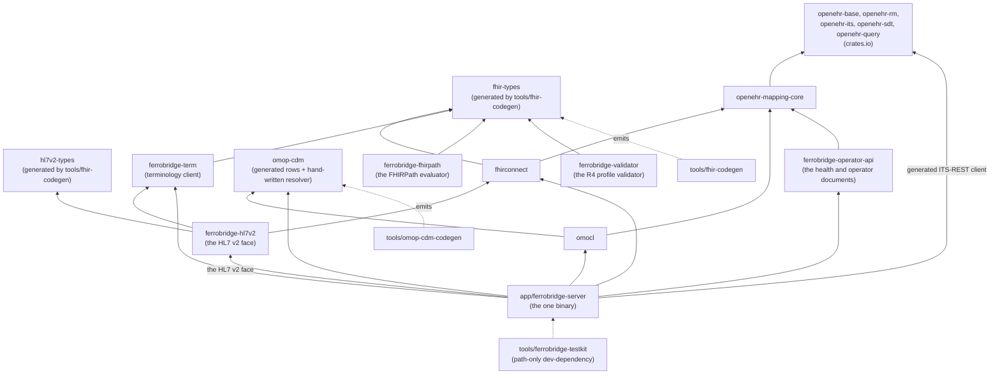
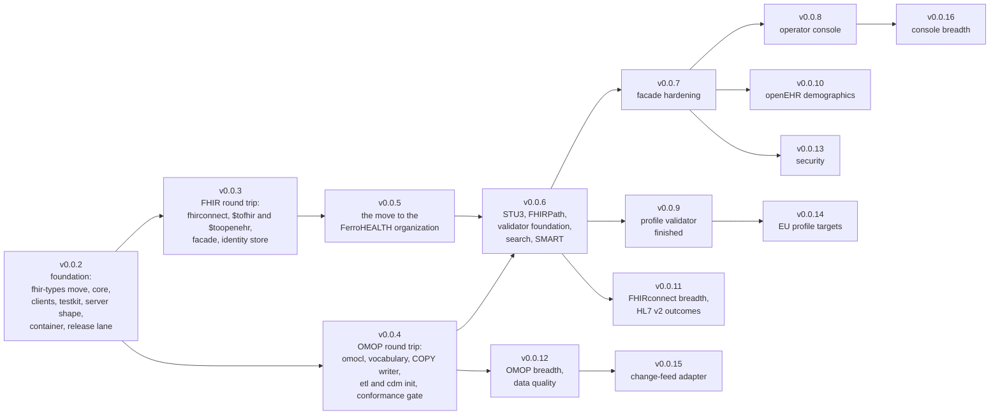

<!-- SPDX-FileCopyrightText: Cadasto B.V. -->
<!-- SPDX-License-Identifier: BUSL-1.1 -->

# Architecture

FerroBRIDGE is a standalone bridge between openEHR and two interoperability
targets: HL7 FHIR, driven by the FHIRconnect specification, and the OMOP Common
Data Model, driven by the OMOCL specification. It runs beside an openEHR CDR
that it reaches only over the openEHR ITS-REST API. This document is the design
of record. It is the output of three research passes over the primary sources,
on 2026-09-03, 2026-09-05 and 2026-09-12, whose full reports are recorded on
issue #1. Every decision below names its ground. Where a specification is
silent, the decision is labelled as FerroBRIDGE's own. Where a specification
contradicts itself or another specification, the contradiction is named and
carried as an `upstream-report` issue.

The third pass re-read every pin and both sibling servers a week after the
second, and changed seven things:

1. **The FHIR model move has not started, and its premise moved.** The
   sibling terminology server still generates and publishes `fhir-types`; the
   crate went from 0.1.43 to 0.1.97 in the week, has no cargo features, keeps
   a lexical-precision `Value` of its own instead of `serde_json::Value`, and
   its element table is an XML-codec input without cardinality. The decision
   to move stands; its scope is restated in section 4.1 and section 10, and
   the crate line floor is re-baselined.
2. **FHIRconnect has a REST API.** The REST API chapter (specification pull
   request #93, merged 2026-10-06) defines `$tofhir` and `$toopenehr` as FHIR
   operations, and the reference engine implements it (openFHIR 3.0.0,
   2026-09-04). FerroBRIDGE adopts it as its engine surface beside the facade
   (section 4.7), at the pinned specification commit.
3. **The identity recommendation is changing upstream.** Pull request #94
   replaces "a hash of the Composition UID and the Entry Path" with
   `LOCATABLE.uid` of the entries. Section 9 takes the entry `uid` first and
   keeps the hash as the fallback.
4. **The reference engine moved under the design.** openFHIR 3.0.0 rewrote
   condition evaluation (plural keys, OR semantics across target attributes),
   preserves time-zone offsets, always emits `Provenance`, reports partial
   results as `OperationOutcome` warnings, and invents two extension URLs for
   `DV_PROPORTION`. Section 4.4 records what FerroBRIDGE takes and what it
   refuses.
5. **The CDR's own FHIR connector is retiring into this project.** The
   reference CDR decided (its issue #3080) to remove its in-tree FHIR
   connector once FerroBRIDGE ships its first round trip. Section 12 is the
   carry-over register: every decided behaviour, test invariant and known
   defect of that connector, with a disposition, so nothing is lost silently
   and nothing wrong is copied.
6. **The profile targets have a name.** The EHDS regulation fixes six
   priority categories; the HL7 Europe implementation guides are the current
   proxy for their exchange format, all on FHIR R4, and the FHIRconnect
   library already carries one EEHRxF context. Section 4.8 sets the planned
   targets and their order; the reference CDR's decision to author no profile
   mapping (its issue #3206) is inherited here, where the mappings belong.
7. **The pins moved where the crates did.** The `openehr-*` crates are at
   0.0.100 (0.0.65 to 0.0.67 changed only the copyright holder in every
   source header; 0.0.68 split the Simplified Data Template engines out of
   `openehr-its` into `openehr-sdt`, 0.0.69 is the first lockstep publish
   of the nine, 0.0.71 adds the `rest` and `rest-client` features to
   `openehr-its`, and 0.0.72 gives that client the commit headers, the `4xx`
   error bodies and `SecretString` credentials; 0.0.87 is the line the
   federation gateway pinned when `fhirconnect` first published on it, and
   0.0.89 adds the `openehr-sdt` party builder, the caller's `rm_version`
   and the BASE 1.3.0 archetype id grammar; 0.0.90 is the line
   `ferrohealth-smart` 0.3.1 pins; 0.0.99 adds `FromStr` for `ArchetypeHrid`,
   `TerminologyId::new`, the named `openehr-term` change-type and lifecycle
   concepts, and the FLAT builder's `|raw` on the root attributes and the
   `_` families; 0.0.100 reads the ADL 1.4 term constraints of an
   archetype read in the ADL 1.4 dialect in the ADL 2 builder); the specification corpora did not move (every pinned commit is
   still the head of its default branch); OMOP CDM v5.5.0 shipped and stays
   tracked, never assumed; Eos, the OMOCL reference engine, has had no commit
   since 2026-03-09.

Sections 2, 4, 6, 9, 10, 12, 13, 14 and 15 carry the changes.

## 0. The picture

The bridge is one process beside a CDR. Everything it reads or writes crosses
one of five edges, and no clinical data rests inside it.



The change-feed adapter (section 5.1) is a sixth edge that arrives later, as
FerroBRIDGE's own extension.

## 1. The two specifications are two languages

FHIRconnect and OMOCL are written by the same author and share one header
(`grammar`, `type`, `metadata.name` and `metadata.version`, `spec` with
`spec.openEhrConfig.archetype`; the FHIRconnect header page states the header
"is standardized for both FHIRconnect and OMOCL"). Below the header they share
RM paths, archetype-keyed model files, an include mechanism (`slotArchetype`
in FHIRconnect, `Include` in OMOCL), an external-code escape hatch
(`mappingCode`, `CustomMapping`) and a code-translation concept (`conceptmap`,
`conceptMap`). Both also use a `../` parent step inside a path. That step is
the mapping languages' own operator: the openEHR path grammar (BASE Release
1.2.0 §Paths and Locators, <https://specifications.openehr.org/releases/BASE/Release-1.2.0/architecture_overview.html#_paths_and_locators>)
defines absolute paths, relative paths, predicates and the XPath `//` pattern,
and no parent step. FHIRconnect's claim that "`../` is used in openEHR" is
unsupported and is reported upstream. The engine resolves `../` against the
mapping's anchor before any path reaches a CDR.

Nothing else is common:

- **FHIRconnect** (<https://sevkohler.github.io/FHIRconnect-spec/build/site/FHIRconnect/v1.0.0/index.html>)
  is bidirectional. A mapping is a tree of entries pairing a FHIR path with an
  openEHR path (`with`), typed from the instances, with `followedBy` nesting
  that concatenates paths onto the parent, AND-combined conditions applied to
  the input side only, `manual` literals, `reference` resources, `hierarchy`
  realignment and `unidirectional` markers. Three file types: `model`
  (archetype to unprofiled resource, the shared layer), `extension`
  (profile and template adaptation, executed after the model), `context` (the
  entry point: profile, template, archetypes, extensions, `start`).
- **OMOCL** (<https://github.com/SevKohler/OMOCL>) is unidirectional openEHR to
  OMOP by construction. A mapping is a flat list of records, each keyed by a
  `type` naming a CDM target (`Measurement`, `ConditionOccurrence`, `Person`,
  seven more) or one of two structural types (`Include`, `CustomMapping`).
  A record's keys are OMOCL's own column vocabulary (`concept_id`, `value`,
  `unit`, `measurement_date`, `gender_concept`), each taking ordered
  `alternatives` of an RM `path`, a literal `code` (an OMOP `concept_id`; `0`
  is the CDM's "no matching concept"), an inline `conceptMap`, or a
  `multiplication`, plus `optional`. The projection from an OMOCL key to CDM
  columns (`value` to `value_as_number`, `unit` to `unit_concept_id`,
  `concept_id` to `measurement_concept_id` and `measurement_source_concept_id`)
  is stated nowhere in OMOCL; four of the ten targets have a published syntax
  table, and the library is the only evidence for the rest. The published
  files use YAML anchors and aliases (57 of 208 files define one).

**Decision:** one shared foundation, two interpreters, two sinks. A single
intermediate representation over both grammars would be the union of two
dissimilar languages and would be wrong the first time either specification
moved. The second pass confirmed the split from the other side: the OMOCL
library's semantics (ordered first-match alternatives, a five-attribute
projection out of one `DV_QUANTITY` node, dates taken from an enclosing
context) have no counterpart in FHIRconnect, and FHIRconnect's recurrence
model has none in OMOCL.



## 2. Pinned versions

The pins live in `docs/VERSIONS.md`; this table records the ground for each.
A corpus is pinned by commit, never by a moving tag or a `latest` URL. Every
corpus commit below was re-checked on 2026-09-12 and is still the head of its
default branch.

| Component | Pin | Ground |
|---|---|---|
| FHIRconnect | v1.0.0 (specification source `SevKohler/FHIRconnect-spec` at `e587164102921c73eea262a18f3457b18e4a2a40` (2026-10-08); `model-mapping.schema.json` sha256 `f92c4902e6b779eecfd40ca4ea774441609db8ffb7163832efc99b562cdfeba4`; `contextual-mapping.schema.json` sha256 `0402888b08a1ddfd457eb0e3c3f6c4bdac7f2339762b9553fce4c096c88f25d2`) | the only released version; both published draft-07 schemas are the machine-readable half of the authority and are vendored verbatim from the rendered v1.0.0 site (`build/site/FHIRconnect/v1.0.0/_attachments/`, the bytes the hashes name); upstream re-rendered both after the release, adding `spec.unidirectional` to the model schema and `operational` to the context schema, two keys the prose already defined; the bridge adopts the new render, because the published v1.0.0 is what the site now serves, and records the in-place change as #856; the repository source at the same commit carries newer copies with the sub-context keys (`slotContext`, `scope`, `contexts`) that are vendored beside them as evidence of movement, never as the pin; the published schemas are defective in seven places (section 4.2), so they are exercised as evidence, never as the sole validator |
| FHIRconnect REST API | the REST API chapter (`engine/rest-api.adoc`) and the `ToFhir` and `ToOpenEhr` FSH operation definitions (`rest/`) at the specification source commit above, merged as specification pull request #93 on 2026-10-06 | part of the specification source, no longer a pin of its own; the reference engine implements it (openFHIR 3.0.0), and FerroBRIDGE implements both operations and the direct form (section 4.7) |
| FHIRconnect mapping library | `SevKohler/FHIRconnect-mapping-lib` at `6bd4c19a2f96821c04fbeed3c6f6c190fd85825b` (2026-06-05), 107 YAML mapping files (52 `model`, 55 `projects`) | the conformance corpus, never an oracle: 24 files fail the published schema, 5 cross-references dangle, 6 files share one `metadata.name`; the 12 German KDS contexts pin profile version 2025.0.0 and every module has moved past it; the one EEHRxF context pins Laboratory 0.1.1 against a published 2.0.0 and declares a `sem_ver` its own OPT contradicts (section 4.8) |
| FHIR | R4 (4.0.1), package `hl7.fhir.r4.core` 4.0.1 (CC0) | the only value the FHIRconnect schemas admit for `spec.version`; the mapping library targets R4; every EHDS-category HL7 Europe guide has an R4 line (section 4.8) |
| FHIR STU3, the model only | 3.0.2, package `hl7.fhir.r3.core` 3.0.2 (CC0, registry shasum `173cc0eec749a68bff90cccae7631f2c72a4f2ac`) | the `stu3` module of `fhir-types` (section 4.1, #452); the facade and FHIRconnect stay on R4, because FHIRconnect v1.0.0 admits only R4 |
| OMOCL | v1.0.0 (grammar `OMOCL/v1.0.0`; corpus `SevKohler/OMOCL` at `c082db8ed81a062a574a2c058366045f600c2ed7`, 2026-09-19, 208 files, Apache-2.0) | the only released grammar. The git tag `v1.0.0` carries pre-grammar files headed `engine: EOS/v0.0.62`; the grammar string first appears at tag `v1.0.1`, so the corpus is pinned by commit. No JSON schema is published; the grammar is two railroad images and four syntax tables |
| OMOP CDM | v5.4 (`OHDSI/CommonDataModel` tag `v5.4.3`, 2026-08-04; licence Apache License 2.0 per `DESCRIPTION`, the repository has no `LICENSE` file) | the only version OMOCL files declare (`spec.system: OMOP`, `spec.version: 5.4`) and the only one the reference engine supports; the CSV table and field definitions and the rendered PostgreSQL DDL are the machine-readable input. v5.5.0 shipped 2026-08-25 and is tracked, never assumed |
| OHDSI Data Quality Dashboard | v2.9.0 (`OHDSI/DataQualityDashboard` tag `v2.9.0`, commit `b9d2a9b4a4736f7ea81415d974c72119b6f0bd11`, 2026-10-06; licence Apache License 2.0 per `DESCRIPTION`, the repository has no `LICENSE` file) | the newest release and the OMOP acceptance gate of section 11. Its CDM v5.4 check catalogue, thresholds and SQL templates are the oracle of the Rust port; the templates are SQL Server dialect, so their PostgreSQL form is FerroBRIDGE's own translation. Its v5.4 field thresholds disagree with the CDM v5.4.3 definitions on primary keys, foreign keys and concept domains, and the vendored CDM DDL sides with the CDM, so the field set comes from the CDM definitions and the thresholds from the Dashboard |
| HL7 v2-to-FHIR guide | `hl7.fhir.uv.v2mappings` 1.0.0 (FHIR 4.0.1; package CC0-1.0, repository `HL7/v2-to-fhir` Apache-2.0, tag `1.0.0` at `873b331b`) | the machine-readable v2-to-R4 corpus (263 ConceptMaps) the HL7 v2 face executes (#251); vendored as the sixth FHIR package (#252) |
| HL7 v2 definitions | `HL7/v2ig` `input/sourceOfTruth` at `3adcdbfff654ccbff5cd33aa34bd909a087e8e19` (1694 files, v2.9.1-derived logical StructureDefinitions; no LICENSE, the v2+ page licenses copying "for internal purposes only") | the generator input for the v2 message-structure table (#253); fetched at build time into an ignored directory and never committed, per the redistribution rule; the owner holds the HL7 membership condition |
| HL7 v2 legacy tables | `usnistgov/igamt-hl7Tools-service` `src/main/resources/hl7db` at `83322dffdac18cb129a1bd80149f5439cf5686fd` (169 files, the NIST IGAMT export of HL7's v2 database for versions 2.1 to 2.8.2; no LICENSE, HL7's content) | the generator input for the structures v2.9.1 withdrew (#303); fetched at build time into an ignored directory and never committed, on the same terms as the definitions |
| openEHR ITS-REST | 1.1.0 (OpenAPI at `openEHR/specifications-ITS-REST` tag `Release-1.1.0`, commit `24058992`; each document declares CC-BY-ND-3.0 in `info.license` while the repository's `LICENSE` file is Apache-2.0, both recorded in the provenance; modules Overview, System, EHR, Query and Definition, `STABLE`, and Demographic, `DEVELOPMENT`) | the released REST API a conformant CDR speaks; Admin and Demographic are `x-status: DEVELOPMENT` in the same release; the bridge reaches Demographic only behind `[cdr] demographic`, off by default and labelled DEVELOPMENT (section 15, #894), and does not vendor Admin; every tagged OAS file says `info.version: latest`, so provenance records tag and blob |
| openEHR RM | 1.1.0 (Release 1.1.0, <https://specifications.openehr.org/releases/RM/Release-1.1.0/>; the code compiles against the `openehr_rm::v1_2` development generation) | the newest published RM release and the conformance target; ITS-REST 1.1.0 links its RM types to `releases/RM/latest`. openEHR has published no Release 1.2.0, and `openehr-rm` documents `v1_2` as specification version 1.2.0, the development baseline (<https://specifications.openehr.org/releases/RM/development/>). The code compiles against `v1_2` because `openehr-sdt` builds only against it and the canonical codecs and ITS-REST types of `openehr-its` are generated over it; `scripts/checks/versions.sh` fails a hand-written `openehr_rm::v1_N` path that names another generation. Against Release 1.1.0, `v1_2` adds `EHR.tags`, widens `GENERIC_ENTRY.data` from `ITEM_TREE` to `ITEM` (SPECRM-18), and removes `PARTY.reverse_relationships` (SPECRM-124), so a Release 1.1.0 `PARTY` carrying that attribute is refused by the strict reader (#845). The `ARCHETYPED.rm_version` stamp names Release 1.1.0 wherever the object conforms to it (section 3, #844) |
| `openehr-base` | 0.0.100 (minor line 0.0; Apache-2.0) | the RM foundation types, including partial ISO 8601 dates (section 3); the line moved from 0.0.61 to 0.0.64 between passes, to 0.0.69 on 2026-09-24, to 0.0.71 on 2026-09-25 and to 0.0.72 the same day, to 0.0.84 on 2026-10-05, to 0.0.86 on 2026-10-15, to 0.0.87 on 2026-10-16, the line the federation gateway pins, and to 0.0.89 on 2026-10-19, which adds the `v1_3` generation with its `Hrid` and the BASE 1.3.0 `ARCHETYPE_ID` grammar, and to 0.0.90 on 2026-10-20, and to 0.0.99 on 2026-10-25, and to 0.0.100 on 2026-10-26 |
| `openehr-rm` | 0.0.100 (Apache-2.0) | the RM model in two generations, `v1_1` (Release 1.1.0) and `v1_2` (the development baseline the bridge compiles against, see the openEHR RM row), its canonical JSON codec and the BASE path parser |
| `openehr-its` | 0.0.100 (Apache-2.0) | the ITS wire layer: the OPT 1.4 codec, the canonical JSON and XML codecs, the ITS-REST 1.1.0 data types; the bridge takes `default-features = false` with `opt14`, `json` and `rest` (the DTOs without axum), and #285 adds `rest-client`, whose 0.0.72 commit headers, `4xx` error bodies and `SecretString` credentials the CDR client takes as they stand (#293) |
| `openehr-sdt` | 0.0.100 (BUSL-1.1) | the Simplified Data Template engines split out of `openehr-its` at 0.0.68: the Web Template builder, the FLAT and STRUCTURED codecs, the composition builder (`flat::build`) and the RM-instance validation (`rm_instance`); the bridge takes `default-features = false` with `flat`, leaving the `moka` cache out |
| `openehr-query` | 0.0.100 (BUSL-1.1) | the AQL 1.1.0 parser and canonical printer. `openehr-lang` arrives transitively |
| `openehr-term` | 0.0.100 (Apache-2.0 AND CC-BY-SA-3.0) | the openEHR terminology; the server names its `audit_change_type` and `version_lifecycle_state` concepts (`codes`) for the `change_type` and `lifecycle_state` a commit carries |
| `openehr-am` | 0.0.100 (Apache-2.0) | the generated AM 2.4 model: the AOM2 `OPERATIONAL_TEMPLATE` and `ARCHETYPE_HRID` types an ADL 2 template decodes into (section 3); taken directly because the bridge names those types |
| `openehr-adl` | not taken in the first cut (0.0.100, BUSL-1.1) | the ADL 2 text parser, flattener and OPT2 generator; the bridge fetches an ADL 2 template as AOM2 canonical JSON, so it never parses ADL source (section 3); taken later only if a CDR serves ADL 2 templates as text alone |
| `fhir-types` | 0.1.128 (the line starts one patch above the sibling terminology server's 0.1.97 of 2026-09-12 and moves with every change to the packaged content) | the FHIR model, generated here by `tools/fhir-codegen` from the vendored HL7 packages (section 4.1); the crate and its generator now live here and the sibling consumes the crate from crates.io |
| openFHIR, the FHIRconnect reference engine | 3.0.1 (2026-09-09), read for behaviour only | never an oracle; section 4.4 records the 3.0.0 behaviour changes and what the bridge takes |
| Eos, the OMOCL reference engine | 0.0.62 (2024-03-20), last commit 2026-03-09 | never an oracle; dormant, so its behaviour is prior art with no expected movement |
| FHIR terminology operations | R4, R4B tolerant | `CodeSystem/$lookup`, `ConceptMap/$translate`, `ValueSet/$validate-code`, `ValueSet/$expand`, `CodeSystem/$subsumes`; a server may answer R4 or R4B; the reference server selects the version by path (section 6) |

**Profile packages, the mapping targets.** No profile package is pinned for
codegen; each is pinned as the target a context mapping names, and
`docs/VERSIONS.md` gains a row per package the moment a context targeting it
is authored. The candidates, read 2026-09-12, are in section 4.8. The R4
profile validator's package set is pinned apart from them, as validator input
and no mapping target (section 4.8, #435).

## 3. The openEHR side

FHIRconnect and OMOCL paths are RM and archetype paths
(`$archetype/data[at0001]/items[at0077]`), never FLAT paths. A path alone is
not executable: leaf RM types, occurrence limits and template node identifiers
come from the **Web Template** built from the template's OPT. The ordered
dependency is OPT, then Web Template, then path resolution, then composition.



**What the openEHR crates provide, verified in the 0.0.64 sources and re-read at 0.0.72 and 0.0.84.**
`openehr-its` parses OPT 1.4 (`opt14`) and carries the canonical JSON and XML
codecs; `openehr-sdt` (split out of it at 0.0.68) builds the Web Template in
the Better and EHRbase shape (`tree`, `id`, `rmType`, `aqlPath`, `inputs`),
converts between FLAT, STRUCTURED and canonical JSON, and builds a canonical
composition from a set of path and value pairs (`flat::build`). `openehr-rm`
carries the RM model with its canonical JSON codec and the BASE path
parser with PATHABLE navigation (`v1_2::paths`); the bridge conforms to RM
Release 1.1.0 and compiles against the `v1_2` development generation
(section 2). `openehr-query` parses and
prints AQL 1.1.0. `openehr-its` also carries the ITS-REST 1.1.0 request and
response types generated from the vendored OpenAPI.

**The `ARCHETYPED.rm_version` stamp names the release the object conforms to.**
RM Common IM Release 1.1.0 §3.2.3 defines `rm_version` as the "Version of the
openEHR reference model used to create this object", as a release version
string. openEHR lists Releases 1.0.2 to 1.1.0 and a development line, and no
1.2.0 (<https://specifications.openehr.org/releases/RM/>). The composition
builder of `openehr-sdt` writes the release its caller names in
`BuildOptions` (0.0.89), and `openehr-mapping-core` names 1.1.0
(`release::build`) unless the built composition holds an element the
development line changed, in which case it builds again naming 1.2.0 (#901). Against `v1_1`, the field set
of `v1_2` differs where a composition can reach in one place only:
`GENERIC_ENTRY.data`, which Release 1.1.0 Integration IM §2.4.1 types
`ITEM_TREE` and the development line widens to `ITEM`. A composition with a
`GENERIC_ENTRY` over another item names 1.2.0, because no published release
admits it. The facade's `EHR_STATUS` carries no changed attribute and names
1.1.0 (#844).

**What the bridge writes itself.** Two things the crates do not export: an
`aqlPath` index over the Web Template with leaf RM type resolution, and the
parent-to-child relative path derivation (the crate keeps its own copy
private). The CDR client is built over the client `openehr-its` generates
from the ITS-REST 1.1.0 OpenAPI (its `rest-client` feature, #285): every
operation, its parameters, its outcome per status and its retry are the
generated ones, and the bridge adds only what they lack (the `X-Request-Id`
echo, the ids an `ETag` names, the two-route template fetch, the AQL paging
and the OAuth 2.0 token).

**Both template generations are supported: ADL 1.4 (OPT 1.4) and ADL 2 (the
AM 2.4 line: AOM2, OPT2).** Owner requirement, 2026-09-12. The ITS-REST 1.1.0
Definition API serves both (<https://specifications.openehr.org/releases/ITS-REST/Release-1.1.0/definition.html>),
and the Simplified Formats specification defines a Web Template as "a
processed representation of an openEHR Operational Template" without naming a
generation, which is the seam the design stands on. The two paths meet at one
type:

| Generation | Fetch | Body | Decode | Build |
|---|---|---|---|---|
| ADL 1.4 | `GET /definition/template/adl1.4/{template_id}` with `Accept: application/xml` | the canonical OPT 1.4 XML | `openehr_its::opt14::from_xml` | `openehr_its::flat::webtemplate::builder::build_web_template` |
| ADL 2 | `GET /definition/template/adl2/{template_id}` with `Accept: application/json` | `OperationalTemplateV2`, which the OpenAPI leaves as an empty object schema and the reference CDR fills with AOM2 canonical JSON (`_type: OPERATIONAL_TEMPLATE`) | `openehr_its::json::from_canonical_json` into `openehr_am::v2_4::aom2::archetype::operational_template::OperationalTemplate` | `openehr_its::flat::webtemplate::builder_v2_4::build_web_template_v2_4` |

Both builders return the same `WebTemplate` type and run the same compaction,
in-context synthesis and node-id passes, so everything downstream (the
`aqlPath` index, relative paths, composition build and read) is
generation-blind. The rules around the seam, each with its ground:

- **Resolution order is `adl1.4` then `adl2`, on the one `template_id` a
  composition carries.** A canonical composition's `archetype_details` names
  a template by string with no generation marker, and the reference CDR
  resolves the same way (its OPT 1.4 store first, its ADL 2 store on a miss).
  A `404` or `406` from one route means "try the other"; a miss on both is the
  typed unknown-template error.
- **The ADL 2 request never accepts `text/plain` and never sends
  `application/xml` alone.** The OpenAPI enumerates `application/json`,
  `application/xml` and `text/plain` in `Accept` but declares bodies only for
  `text/plain` (ADL 2 source) and `application/json`; the reference CDR lets
  `text/plain` win whenever it is acceptable and answers `406` to XML alone.
  Consuming ADL 2 source would cost the `openehr-adl` parser, its flattener
  and an archetype repository for `create_opt`; the JSON form is the OPT2 the
  server already compiled. A server whose `application/json` body is not AOM2
  canonical JSON is a typed refusal naming the body's `_type`, never a guess.
- **Identifiers.** An ADL 2 template is an `ARCHETYPE_HRID` with a full
  three-part version and an optional namespace
  (`org.highmed::openEHR-EHR-COMPOSITION.t_vital_signs.v1.0.0`); a partial
  id resolves to the latest matching major version, and the bridge caches
  under the resolved id, never under what it asked for: the `ETag` when it
  parses as an HRID (the reference CDR's behaviour), else the template's own
  `archetype_id` (the OpenAPI's `ETag` example is a UUID, reported on #104). The
  Web Template's `templateId` carries the full HRID with namespace, its root
  `nodeId` and every `aqlPath` predicate carry the interface form (`.v1`, no
  namespace), and `semVer` is the release version for ADL 2 and absent for
  ADL 1.4; the generation is decided by which fetch succeeded, never by that
  field. Mapping files that key on `$archetype` use the interface form.
- **The node-id code space is checked before any path resolves.** ADL 2.4
  admits at-codes and id-codes, and states that "the at-code coding system
  must be used for systems that need to be conformant to the openEHR
  Reference Model" (<https://specifications.openehr.org/releases/AM/Release-2.4.0/ADL2.html>,
  §ADL 2.4); the reference corpus and the reference CDR's 1.4-to-2 converter
  produce id-codes all the same. FHIRconnect and OMOCL paths are written with
  at-codes, and the ADL 2 builder copies node ids verbatim and reads no
  `alternative_ids`, so an at-coded path does not resolve against an id-coded
  template. The bridge inspects the built Web Template and refuses an
  id-coded template with a diagnostic naming the template and the code space.
  An at-to-id translation from `C_OBJECT.alternative_ids` is a later,
  separately decided unit, never a silent fallback.
- **Two deltas the engines must not trip over.** A term binding's `value` is
  a code for ADL 1.4 and a URI for ADL 2, and constraint (`ac`) bindings exist
  only on the 1.4 side, so the lens that reads bindings switches on the
  generation the Web Template records; and the ADL 2 builder's structural
  conformance walk is empty, so the bridge's own composition validation before
  commit (section 12) carries more weight for ADL 2 templates than for 1.4.
  No specification governs the reconciliation of the two generations: AM 2.4
  has no "AOM 1.4 to AOM2" mapping document, so each rule above is
  FerroBRIDGE's own and is labelled so in code.

**The Web Template is built locally, never fetched.** The crate's builder-side
`WebTemplate` type serialises and does not deserialise (still true at 0.0.64;
the generated ITS-REST `definition::WebTemplate` type does deserialise, but it
is the OpenAPI schema shape, not the builder's model, and carries no `inputs`
resolution), and ITS-REST 1.1.0 defines a Web Template representation
(`application/openehr.wt+json`) for the `adl1.4` route only, none for `adl2`,
so a fetched Web Template could never cover both generations. This is also
the safer path: the FLAT node-id uniqueness rule in the Simplified Formats
specification does not fix sibling order, so two conformant servers can name
the same node differently, and a bridge that regenerated node ids against a
foreign Web Template would mis-key values. The reference CDR does serve
`application/openehr.wt+json` for ADL 1.4; the bridge does not depend on it.

**The wire is canonical JSON.** Canonical JSON is the mandatory composition
representation in ITS-REST 1.1.0; FLAT and STRUCTURED are optional. The
mapping engines resolve paths against the canonical RM tree (the approach the
OMOCL reference engine takes, in 56 lines against 534 for the FLAT route in the
FHIRconnect reference engine), build the composition with the crate's builder,
and commit and read canonical JSON. FLAT never crosses the CDR wire. The one
place FLAT appears is the FHIRconnect REST API (section 4.7), which requires an
engine to accept and emit both serialisations; the crate's converters cover
that at the edge. Two index bases meet here and must never be confused: RM
positional predicates are 1-based (BASE §Paths and Locators), FLAT `:n`
indices are 0-based.

**The ITS-REST surface the bridge consumes:** `POST /ehr`,
`GET /ehr?subject_id=&subject_namespace=`, `GET /ehr/{ehr_id}`;
`POST /ehr/{ehr_id}/composition`, `PUT /ehr/{ehr_id}/composition/{versioned_object_uid}`
with `If-Match`, `GET /ehr/{ehr_id}/composition/{uid_based_id}`;
`POST /ehr/{ehr_id}/contribution` for atomic multi-object commits;
`POST /query/aql`; `GET /definition/template/adl1.4/{template_id}` and
`GET /definition/template/adl2/{template_id}`
(<https://specifications.openehr.org/releases/ITS-REST/Release-1.1.0/ehr.html>,
<https://specifications.openehr.org/releases/ITS-REST/Release-1.1.0/query.html>,
<https://specifications.openehr.org/releases/ITS-REST/Release-1.1.0/definition.html>).
Four facts of that surface shape the client: `Prefer` is always sent
explicitly, because the specification warns its default may change;
`If-Match` carries the bare quoted `version_uid` and the `W/` the `ETag`
carries is stripped; `DELETE` reports a concurrency failure as `409` where
`PUT` reports `412`; and `GET …?version_at_time=` answers `204` for a deleted
composition, which the client surfaces as a typed "deleted" outcome, never as
an absent value. The commit metadata headers (`openehr-version`,
`openehr-audit-details`, `openehr-template-id`, the 1.1.0 names; the overview's
deprecation table maps the older `openEHR-VERSION`, `openEHR-AUDIT_DETAILS`
and `openEHR-TEMPLATE_ID` onto them) exist only in the prose and are absent
from the OpenAPI; the client sends them from the prose and the gap is reported
upstream. The reference CDR accepts both the 1.1.0 value-carrying form and the
deprecated path-in-name form; the client sends the 1.1.0 form only.

Composition-level fields have no FHIR counterpart. FHIRconnect requires the
`start` mapping to slot a reusable `COMPOSITION.<archetype>.<Resource>` mapping
in and recommends defaults for composer, `context/start_time`, `setting`,
`language`, `territory` and `category`
(<https://sevkohler.github.io/FHIRconnect-spec/build/site/FHIRconnect/v1.0.0/engine/defaults-for-fields.html>).
The defaults are deployment configuration, never engine constants (the
reference engine hard-codes `territory=DE`), and every defaulted value is
recorded in the composition's `FEEDER_AUDIT`, which the RM defines for exactly
this case (RM Common §FEEDER_AUDIT).

## 4. The FHIR side

The FHIR side is a pipeline with one compile step and one interpreter, and
two callers of that interpreter.



### 4.1 The FHIR model

The first pass recorded that the published `fhir-types` crate "already carries
per-version FHIR types" for the facade. It does not. The crate carries the
terminology root set (`CodeSystem`, `ValueSet`, `ConceptMap`,
`TerminologyCapabilities`, `CapabilityStatement`, `Bundle`, `Parameters`,
`OperationOutcome`) and the closure of datatypes they reference, with a strict
codec (unknown properties refused, lexical primitives kept, choice types
handled). It has no `Condition`, `Observation`, `Patient` or any other clinical
resource.

**Decision (owner, 2026-09-05, re-baselined 2026-09-12): `fhir-types` and its
generator move into this repository, and the bridge generates the shared FHIR
model.** The third pass found the move not started on either side and the
crate's facts changed under the decision. The restated scope:

- **The crate line floor follows the sibling's latest release.** The sibling
  published nine releases after 0.1.43 and is at 0.1.97; the first publish
  from here is the next patch above whatever it last shipped, and the sibling
  freezes its `fhir-types` bumps the day this repository publishes (its issue
  #300 is the sibling's half of the move and is blocked on that first
  publish). Every day of delay widens the gap, so the move is the first unit
  of the foundation release (section 14).
- **Cargo features are new work, because the crate has none.** All four
  version modules (`r4`, `r4b`, `r5`, `r6`) compile unconditionally today.
  The move adds per-version features, a `terminology` feature that reproduces
  today's root set, and a `resources` feature that widens the declared root
  set to every `kind: resource` StructureDefinition per package (146 in R4)
  with its complete closure, default off, so the sibling's switch to
  `default-features = false` shrinks its build instead of growing it.
- **The element table is new work, because what exists serves the XML codec.**
  The crate exposes per-version `Schemas` (`TypeSchema`, `FieldSchema` with
  `name`, `kind`, `many: bool`) sorted by name for the XML codec. A
  path-driven engine needs `min` and `max`, the element path, the choice
  suffix table and `contentReference`. The generator already lowers a
  `Cardinality` and discards it at `many = card == Many`; the move emits it
  as public, documented API.
- **The `Value` entry point is an adapter, not a replacement.** The second
  pass asked for a `serde_json::Value` codec; the sibling has since moved the
  crate off `serde_json::Value` to its own lexical-precision `Value` (its
  issue #483: a decimal must round-trip byte-identically, and
  `arbitrary_precision` was being forced on every dependent). That reason is
  the bridge's reason too. The bridge's path model works over the crate's
  `Value`; a fallible `serde_json::Value` conversion exists at the HTTP edge
  only.
- **The licence boundary is recorded, not assumed.** The crate is Apache-2.0
  in the sibling (generated from CC0 packages) inside a BUSL-1.1 repository,
  and this repository's rule is that code is never copied between the
  siblings because each is its own Licensed Work. Moving the crate is the
  owner's decision and the moved crate keeps Apache-2.0; `docs/VERSIONS.md`
  and `NOTICE` record it as the one first-party crate under a different
  licence, and `scripts/checks/versions.sh` is taught the exception in the
  same change.
- **The vendored packages cost 379 MB.** Five HL7 packages with provenance.
  They are fetched by a committed script with checksum verification; whether
  they are committed or fetched on demand in CI is decided in the move issue
  on the measured clone cost, never by leaving provenance out.

The ground for the move is unchanged: the bridge is the crate's widest
consumer and will drive its evolution from here on, the sibling's needs are
eight resources and a stable set of operation contracts, and the reference CDR
also plans to decode its terminology wire through the crate's R4B module (its
issue #3085), so three servers consume one generated model. Rejected: widening
the crate in place in the sibling (closed as not planned there); a separate
repository for the crate (refused by the owner); the `fhir` crate (146 R4
resources, one author, a five-way licence disjunction, and the owner's own
read of its code quality); `fhir-model` 0.13.0 (R4B and R5 oriented, no
element table; the reference CDR's connector used it and is dropping it);
`helios-fhir` 0.2.1; every FHIRPath evaluator as a model source.

**Decision (#452, 2026-10-15): `fhir-types` carries FHIR STU3 (3.0.2) as a
fifth version module, `stu3`, behind a feature of that name in the default
set.** HL7 names the release STU3 (<https://hl7.org/fhir/STU3/>), so the
module does too. The generator reads `hl7.fhir.r3.core` 3.0.2 like the other
core packages, and every shape 3.0.2 states differently from R4 is read from
the package, never assumed:

- 40 files begin with a UTF-8 byte order mark, which the loader strips on
  read. The JSON page says "The character encoding is always UTF-8"
  (<https://hl7.org/fhir/STU3/json.html>) and nothing about a mark, so this is
  our own design; the files stay verbatim on disk.
- `ElementDefinition.type.profile` and `targetProfile` are a single `uri`
  (<https://hl7.org/fhir/STU3/elementdefinition.html>), so a `Reference` to
  four targets is four type entries. Entries with one code merge into one
  carrying the union of their profiles, the shape R4 states directly, and
  entries whose codes differ on a non-choice element stay a refusal.
- A primitive's `value` carries no type code, only `_code` with the
  `structuredefinition-json-type` extension. That JSON type makes the value a
  scalar, and a type entry with neither a code nor that extension is a typed
  error, never a dropped element. The lexical form is read from
  `structuredefinition-regex` as well as R4's `regex`, and a binding from
  `valueSetReference` and `valueSetUri` as well as `valueSet`.
- `Element.id` and `Extension.url` are typed with the primitive codes
  `string` and `uri` and `representation: [xmlAttr]`. An attribute is a JSON
  member value ("Composites can have id attributes, which are converted to
  JSON member values", <https://hl7.org/fhir/STU3/json.html>), so it is a
  plain string, the Rust shape R4 gives the same elements.
- The Definition, Event and Request logical models omit
  `StructureDefinition.type`, which is 1..1
  (<https://hl7.org/fhir/STU3/structuredefinition.html>); none is a root, and
  resolving one is a typed error.
- STU3 has no `TerminologyCapabilities`, so the root sets are declared per
  version and the STU3 terminology set is the other seven. `ExpansionProfile`
  stays in the resource set: `$expand` names one by a `uri` parameter and no
  terminology operation exchanges the resource
  (<https://hl7.org/fhir/STU3/valueset-operations.html#expand>).
- The terminology ecosystem overlay is not applied to STU3. It pre-adopts R6
  parameters for the servers that consume the R4 to R5 models, its types
  include `canonical`, which STU3 lacks, and no consumer speaks STU3
  terminology through it. The STU3 contracts carry exactly what 3.0.2
  declares: `$validate-code` takes one `version`, `$expand` takes `profile`
  as a `uri`, and `$lookup` types `property.value` as `code`.

The STU3 examples package, `hl7.fhir.r3.examples` 3.0.2, runs as the
`fhir-stu3` conformance corpus beside the other four model corpora. The
terminology client speaking STU3 and the profile validator holding STU3
profiles are each their own issue. The facade and FHIRconnect stay R4,
because FHIRconnect v1.0.0 "was designed based on R4" and both schemas
restrict `spec.version` to `R4`; taking STU3 there needs a decision of its
own.

`fhir-terminology` is struck from the design. It is a terminology server over
a code-system provider seam and its manifest pulls in the SNOMED, ICD-11 and
RxNorm loaders and the concept store. The client contracts the bridge speaks
(`CodeSystemLookupRequest`, `ConceptMapTranslate*`, `ValueSetValidateCode*`,
with `from_parameters` and `to_parameters`) live in `fhir-types::r4::operations`.

### 4.2 The mapping files: how a FHIRconnect file is validated

The published schemas are defective in ways that matter. The model schema sets
`additionalProperties: false` on a mapping and omits `mappingCode`, `link`,
`participationsFunction` and mapping-level `conceptmap`, so three of the eight
concept-type mappings the prose defines (PROGRAMMED, LINKED, PARTICIPATION)
cannot appear in a schema-valid file, and 24 of the 107 library files fail
their own schema. `manual` is typed as an array with object `properties` and no
`items`, so it validates nothing. `hierarchy.split.openehr` sits outside
`properties` and is unvalidated. The `type` enum sits at mapping level where no
file writes it; every file writes `type` inside `with`, where the schema leaves
it a free string. `operator` and `unidirectional` have no enum. Conditions are
documented as an array ("Notice that the condition is an array") and typed as
an object. The context schema makes `profile.url` and `profile.version`
optional strings with no format, while the prose calls the profile URL list
plural and the schema holds one. Each is an `upstream-report` issue.

**Decision:** the AST is hand-written Rust, and validation is three layers:

1. **The published schemas, vendored verbatim and exercised.** A test validates
   every corpus file against them and pins the exact set the schemas reject.
   That test is the durable record of the contradiction; it passes when the
   published schema still rejects what the prose allows, and it fails the day
   upstream fixes the schema, which is the signal to re-adjudicate.
2. **FerroBRIDGE's own strict schemas** for both file types, authored from the
   prose plus the published schema, closed (`additionalProperties: false` at
   every level, enums for `operator`, `unidirectional`, `extension`, the
   data-type `type` inside `with`), offered upstream. Every corpus file either
   validates or carries an adjudicated skip naming the defect.
3. **Semantic validation the schema cannot express:** `targetRoot` resolves to
   the same node as `with`; `criteria` is absent for `empty` and `not empty`
   and present otherwise; `slotArchetype`, `spec.extends`,
   `context.archetypes`, `context.extensions` and `context.start` each name a
   loaded `metadata.name`, and `appendTo` names a mapping of the extended
   model by its `name`, a dotted `parent.child` for a nested one
   (`extension-mapping.adoc` §Append); `metadata.name` is unique across the
   loaded set;
   `extension` methods appear only in `type: extension` files; `openehr:
   "$reference"` is mandatory on a `reference` mapping; `mappingCode` names a
   registered function; every path resolves against the Web Template or the
   FHIR element table at load. A file that fails any of these is refused with a
   diagnostic carrying file, YAML path, mapping name and model path.

Rejected: a schema-derived AST (the schema is too defective to derive from,
and it would inherit the `manual` and `hierarchy` holes); validating against
the published schema alone (22.4% of the corpus would be refused, including
the model mapping the first round trip uses).

**Keyword casing is an adjudication, recorded on the tracker.** The library
spells `unidirectional` values four ways (21 of 50 uses are not the documented
`openehr->fhir` and `fhir->openehr`) and the first-milestone model mapping
writes `$openEHRRoot` four times where the specification writes
`$openehrRoot`. The specification's own text is inconsistent in the same way
(`openEHRCondition` beside `openehrCondition`, `openEHR:` beside `openehr:`),
so "spec-exact case" is undefined by the source. YAML keys stay exact, because
the schema fixes them. Keyword values (variables, `unidirectional` values) are
compared case-insensitively, a value outside the documented set is refused, and
a test asserts both spellings pass and a third is refused. This is
FerroBRIDGE's own decision on a specification contradiction, reported upstream
with the library fixes it implies.

**Condition keys are plural, and the singular forms are accepted as aliases.**
The schema documents `targetAttributes` and `criterias` as arrays with OR
semantics across attributes; the reference engine evaluated only the first
attribute until 3.0.0 and carried singular `targetAttribute` and `criteria`
fields it has now removed, normalising the singular spelling at load. The
bridge's AST accepts both spellings, evaluates every attribute with OR, and a
test pins that a two-attribute condition matches on the second.

**A document-root `unidirectional` is refused; `spec.unidirectional` is the
documented form.** The published model schema defines `unidirectional` under
`spec` (`model-mapping.schema.json`, and `basics/main.adoc` §Direction), and
the bridge accepts it there as the file-wide default. The reference engine
also accepts the key at the document root (its 2.2.5 release); no pinned
schema defines that placement, and a closed root rejects it. The bridge
refuses it with a diagnostic naming the schema, so a corpus file that depends
on the engine extension is a recorded defect, never a silent pass.

### 4.3 Context resolution: one immutable program per (profile, template)

A context mapping plus its model mappings and extensions is compiled once into
an immutable program, validated in full at load, then interpreted per request.
The reference engine rebuilds its helper trees per composition and loads
extensions in database result order, so two runs can apply extensions in a
different order; nothing in the specification says which order is right. The
database literature (Kersten et al., PVLDB 2018, doi:10.14778/3275366.3284966)
finds neither compiled nor interpreted execution dominates, so the bridge takes
the separable win: lower once, interpret many.

**The ordering and collision rules, FerroBRIDGE's own where the specification
is silent:**

- Extensions apply in the order `context.extensions` declares them; within an
  extension, in file order. The compiler is a pure function of the file set.
- `add` appends to the model mapping; an `add` whose name collides with an
  existing mapping is a load error.
- `append` adds to the target's `followedBy`, which is the only thing the
  specification defines it to do ("To maintain readability the append is
  transformed into a followedBy"); an `append` carrying a `with` or a condition
  is a load error, never a silent replacement (the reference engine replaces a
  condition on append, which can widen a guard silently).
- `overwrite` replaces the mapping of that name; a missing name is a load
  error; two extensions overwriting the same name in one context is a load
  error.
- A duplicate `metadata.name` across the loaded set is a load error (the
  specification calls the name "a unique id"). The library's six files named
  `KDS_composition` cannot load together; the corpus test records that.
- `spec.extends`, `slotArchetype` and `context.start` resolve by
  `metadata.name` only, and `appendTo` by the mapping `name` inside the
  extended model. There is no directory scope in the specification and the
  bridge invents none.
- A `slotContext` (sub-contexts, #864) compiles the entered context's `start`
  into the parent program under that context's own extensions, against the
  parent's template, and skips a composition slot its `start` carries. A
  `scope: sub` context is never compiled as a program and its template is
  never fetched; the facade passes over, as a root, a Bundle entry a
  `slotContext` consumed through a `reference`.
  The entered context's `template.id` must be the template the parent's OPT
  1.4 states at the slot node (`C_ARCHETYPE_ROOT.template_id`); a different
  one is refused as a template mismatch, and a slot node that states none is a
  warning, because the rule cannot be decided there (#886).
- The version selectors the specification lacks (which `metadata.version` of a
  name loads; `spec.openEhrConfig.revision` against the OPT; `profile.version`
  against the instance; `template.sem_ver` against the OPT) are a refusal at
  load when they disagree, as the first pass decided. A missing `sem_ver` or
  `profile.version` is accepted, because the schema makes them optional, and
  the program records "unpinned". The library's own EEHRxF context declares
  `template.sem_ver: "0.1.0"` beside an OPT whose `sem_ver` is
  `9.0.0-alpha.1`; that file is a recorded load error, refused earlier at the
  dangling-reference rule (one of its extensions names no loaded mapping,
  #101), so compilation never reaches its selector, and the pair is pinned by
  an isolated test on the selector instead.
- A context is selected by the instance's `meta.profile` set membership on
  the FHIR side and by `template_id` on the openEHR side; `templateId` on the
  REST API (section 4.7) pins the choice when several contexts share a
  profile or a template, and an ambiguous selection without it is a refusal
  naming the candidates.

### 4.4 The interpreter: one engine, both directions

FHIRconnect declares its mappings bidirectional. Bidirectional transformation
theory gives the correctness property to build for: a lens is well behaved
when it satisfies GetPut (`put(source, get(source)) = source`) and PutGet
(`get(put(source, view)) = view`), and well-behaved lenses compose (Weber and
Ho, J Healthc Inform Res 2020, doi:10.1007/s41666-019-00065-0, applied to EMR
exchange). Two independently written direction functions are exactly the
duplicated logic that paper argues against.

**Decision:** one traversal engine with a direction parameter, over data-type
converters written once as lenses (`DV_QUANTITY` and `Quantity`,
`DV_CODED_TEXT` and `CodeableConcept`, `DV_DATE_TIME` and `dateTime` or
`Period`, the full matrix of the specification's data-type chapter). Direction
enters in three places only: conditions are evaluated on the input side only
(`fhirCondition` on FHIR to openEHR, `openehrCondition` on openEHR to FHIR, the
specification's rule); `unidirectional` markers skip a mapping in the other
direction; and the composition defaults apply inbound only. The data-type
matrix is where the cost is (the two value populators are 13% of the reference
engine), so it is table-driven and tested as a matrix, one case per cell per
direction.

The traversal rules, each pinned by the specification text or labelled as
ours:

- Top-down; a later mapping to the same `0..1` path overwrites an earlier one;
  a `0..n` path always appends; `0..n` into `0..1` takes the last element
  (<https://sevkohler.github.io/FHIRconnect-spec/build/site/FHIRconnect/v1.0.0/recurrence/main.html>).
- `followedBy` concatenates the child path onto the parent's and iterates once
  per parent occurrence. Occurrences are structured indices in the program,
  never a regular expression over a stringified path.
- `manual` paths inside one entry merge into one element; a `manual` entry and
  a `with` mapping writing the same `0..1` node follow the top-down rule
  (ours; the specification scopes the merge guarantee to "inside manual
  mapping method"). The reference engine's `manual` blocks with several
  nested paths overwrote themselves until 3.0.0; a test pins the merge.
- `../` and `^` are resolved at compile time against `$openehrRoot` and
  `$fhirRoot`. `^` is a prefix operator: `^` names the parent of the current
  FHIR anchor, `^^` its parent, and a `^` that would step above `$resource` is
  a load error. The reference engine does not implement `^` at all, so this is
  FerroBRIDGE's own pin of a one-sentence specification, and it is reported
  upstream as a request for a definition.
- `slotArchetype` recursion is cycle-checked over the whole chain, not one
  level.
- `hierarchy` `split` produces N resources from one archetype path; the
  deterministic id then includes the split occurrence (section 9).
- Type coercion is strict: a value that does not parse as the resolved RM leaf
  type or FHIR element type is a refusal, never a best-effort conversion (the
  specification delegates strictness to the vendor; this is the vendor's
  answer).
- **Date and time values keep their lexical form and offset in both
  directions.** openEHR partial dates stay lexical in `openehr-base`, FHIR
  primitives stay lexical in `fhir-types`, and the lens copies the offset it
  was given and never adds one. The reference engine re-rendered `dateTime`
  and `instant` in the server's zone and truncated fractional seconds until
  3.0.0 and 3.0.1; the matrix pins `Z`, `+00:00`, `+01:00` and sub-second
  precision as byte-identical round trips.
- **A `DV_PROPORTION` that is not a percentage is a refusal, not an invented
  extension.** FHIR `Quantity` cannot carry a denominator, so only a percent
  has a faithful representation. The reference engine now emits two extension
  URLs of its own (`proportion-denominator`, `proportion-kind`) and infers
  `|type` from the denominator on the way back. Neither URL is defined by any
  specification, so the bridge does not write them; a mapping that needs the
  ratio names a target that can carry it (`Ratio`, or a profile extension by
  canonical URL), and an unmapped non-percent proportion is a typed refusal
  naming the element. The gap is reported upstream (the specification's own
  open issue on date and proportion combinations is the place).
- PROGRAMMED mappings (`mappingCode`) are first-party Rust functions in a
  registry with a typed interface over the canonical model; an unknown code is
  a load error. The library depends on eight codes, six of them the Dosage and
  Timing gap the specification defers to its next version. **As built
  (#95):** `fhirconnect::engine::library::Library` is the registry. A
  function reads the whole FHIR element its mapping's `with.fhir` names and
  the canonical JSON at the openEHR ports it declares below the mapping's
  `with.openehr`; the compiler resolves every port against the template at
  load, so the engine parses no path for one, and a port onto a polymorphic
  `ELEMENT` holds one value node per admitted class. What each function reads
  and writes is our own design, since no specification defines the functions
  (`concept-mappings.adoc` §Programmed mappings leaves them to the vendor).
- **A skipped element is a first-class outcome, never silence.** The
  reference engine now threads an issue collector through both engines and
  reports skipped elements as `warning` and `incomplete` issues. FerroBRIDGE's
  default is stricter: an element the program cannot map is a refusal of the
  unit (section 9). What survives as a warning is the declared set (defaulted
  composition fields, `unidirectional` skips, fields the program lists as
  unmapped), and that set is asserted exactly by the round-trip tests.
- **A produced FHIR document is held to the base constraints a mapping can
  break before it leaves the engine** (#651). An error-severity constraint is
  "a rule that all resources must conform to" (R4 conformance-rules.html
  §2.1.0.6), and a context can produce a breach the decoder never reads: an
  `extensionUrl` manual whose `extensionValue` wrote nothing left a url-only
  extension on every KDS diagnosis read (#629, R4 `ext-1`). `to_fhir` checks
  the resource it maps and every resource it creates through
  `engine::invariant`, and a breach refuses the unit as
  `EngineError::Invariant`, naming the constraint key and the instance path,
  so the facade read and the operations lane both refuse it. **Decision:
  targeted structural checks, one per constraint key, starting with `ext-1`,
  rather than FHIRPath evaluation of the core constraints through
  `ferrobridge-fhirpath`.** The constraint expressions live in the core
  package's StructureDefinitions, which the server does not load at run time
  (the element table carries no constraints), and evaluating them per read
  would bring the profile validator's package set into the read path. A
  check is added when a mapping can produce its breach; holding output to the
  whole constraint set is the profile validator's job (section 4.9). No
  specification governs where the check runs: our own design.

### 4.5 The FHIR path model

`with.fhir` is both read and written, and `^` and `$fhirRoot` are not
FHIRPath, so a FHIRPath evaluator cannot be the engine. No crate in the Rust
ecosystem offers a bidirectional path model over FHIR JSON; every FHIRPath
crate is evaluation-only and dependency-heavy (33 non-optional dependencies in
the one with a published compliance figure).

**Decision:** a hand-written path model over the `fhir-types` `Value` tree,
guided by the element table: navigation by element name, choice-type
resolution (`onset` with `ofType(Period)` becomes the `onsetPeriod` key),
repeating elements as arrays, primitive extensions in the `_element` sibling
form (<https://hl7.org/fhir/R4/json.html>). The three FHIRPath forms the
mapping library uses on the read side (`ofType()` and `as()`,
`extension(url)`, `resolve()`) are implemented as path-model operations. A
general FHIRPath evaluator is not adopted; if a real mapping corpus needs one,
it goes behind a cargo feature. Every path expression is classified at load as
writable or read-only, and a mapping that would write through a read-only
expression is a load error: the reference CDR's connector let `where()` and
`first()` paths through and its reverse direction silently contributed nothing
(section 12).

### 4.6 The facade

- **Facade, never store.** FerroBRIDGE exposes a FHIR R4 REST facade (create,
  update, read, transaction and batch Bundles with `If-None-Exist` and
  `If-Match` conditional forms, <https://hl7.org/fhir/R4/http.html>) and maps
  each request onto CDR operations. It stores no clinical data of its own. The
  facade is chosen so a FHIR client sees one server; the FHIRconnect REST API
  chapter says the same from the other side ("A FHIRconnect engine is
  typically invoked from a FHIR facade rather than being one itself"), and
  FerroBRIDGE is both, with the engine surface in section 4.7 the facade
  calls in-process.
- **`GET [base]/metadata` answers a `CapabilityStatement`** naming exactly the
  resource types, interactions, operations and search parameters the loaded
  programs support (<https://hl7.org/fhir/R4/capabilitystatement.html>); a
  type with no loaded context is `not-supported`. The reference CDR's
  connector had no conformance statement and a client could not discover it.
- **Transaction is all-or-nothing, batch is per entry**, as R4 defines them. A
  transaction Bundle that cannot be mapped in full is refused with one
  `OperationOutcome` naming every failing entry and nothing is committed; a
  batch returns a per-entry outcome and counts failures.
- **Create is conditional and idempotent by source identity.** A resource that
  arrives with the same `id` and `meta.versionId` as one already mapped
  resolves through the identity map (section 9) to an update of the same
  composition, never a second composition; `If-None-Exist` is honoured as R4
  defines it; a `PUT` without `If-Match` on a resource the map knows is a
  version conflict check against the CDR's `ETag`. The reference CDR's
  connector created a new composition on every `POST` and had no update path.
- **Bundles are split by profile**, following the specification's engine
  chapter, with one correction: the chapter keys on `meta.url`, which does not
  exist in R4; the element is `meta.profile`, a list, so matching is set
  membership, not equality. A resource two mappings both need is a LINKED
  mapping. Its composition is committed before the composition that links
  it, because ITS-REST 1.1.0 gives a `CONTRIBUTION` version
  (`UPDATE_VERSION`) no `uid` and the CDR assigns a new composition's id:
  a probe run finds the linked resources, each is committed through the
  single-create path and selected by `meta.profile`, and the final run
  writes `ehr:/<ehr_id>/compositions/<versioned_object_uid>` into
  `LINK.target`; a refused linking commit names the linked composition it
  left, and a Bundle entry's link to a resource is refused, since a
  transaction is one `CONTRIBUTION` (#94; our own design). A reference a transaction entry makes to another entry resolves
  to that entry by `fullUrl` or `<Type>/<id>` first (#753). A reference the
  request does not carry is resolved as the references chapter recommends, and one whose resource is
  absent (off the allow-list, unknown to the identity map, or answered
  `404` or `410`) is a declared skip: "If not possible, the engine proceeds
  with the mapping" (`engine/references.adoc`), which the engine records as
  a `Loss::Skipped` warning, never a silent nothing (#224). A fetch that
  failed (no answer, another status, or a body that is not the referenced
  resource) refuses a request whose mapping reads the reference with a
  `502` carrying the upstream status, because `engine/Fail.adoc` asks that
  "either all data should be mapped, or the mapping should fail" and an
  upstream failure is never an absence (#94). A relative
  reference, or one under the facade's own base, is read through the
  identity map and the CDR; an absolute one is fetched only from a base on
  the `[facade.references] fetch_bases` allow-list (empty by default, so by
  default nothing is fetched and no client can make the bridge call a URL it
  names), with redirects refused, a timeout, `max_depth` levels and each
  literal resolved once, every fetch logged by type, id, base and upstream
  status. No specification governs that policy: our own design.
- **A read-side Bundle is well formed.** One entry per composition per
  resource type (two programs over one template do not double an entry), a
  unique `fullUrl` per entry, `entry.search.mode`, `Bundle.total` as the
  total number of matches or absent, `link[self]` and `link[next]` when
  paged, deterministic ordering by composition commit time then version uid,
  and `Content-Type: application/fhir+json` on every response. Each of these
  is a defect the reference CDR's connector shipped (section 12) and each is
  a wire test here.
- **Requests speak FHIR media types.** `application/fhir+json` is accepted and
  produced; `application/json` is accepted; anything else is `415`. A
  malformed `_count` is `400 invalid`, never ignored.
- **`Composition/$document` answers a document Bundle.** `GET
  [base]/Composition/[id]/$document`, and the type-level form with `id`
  (R4 `OperationDefinition` `Composition-document`), reads the Composition as
  a read does and answers a Bundle of `type` `document`: an `identifier`
  derived from the composition version, the assembly `timestamp`, entry 0 the
  Composition and then every resource the context's outbound run creates,
  each with its read URL as `fullUrl`. The assembly is our own design
  (`facade::document`); `persist=true` and `graph` are refused, never
  ignored. A context whose start is a composition model binds the composition
  itself as its one entry, under the path `/`.
- **`$validate` is a dry run that commits nothing.** `POST [base]/{type}/$validate`
  runs the full inbound path (program selection, mapping, composition build,
  the CDR's own template validation through a commit the bridge never
  finalises, or the CDR's validation operation where it offers one) and
  answers `200` with an `OperationOutcome` whose issues are `information`
  when the resource would commit and `error` with the validator's message
  verbatim when it would not. The operation-level statuses mirror the create
  path (no program, out of scope) so the dry run cannot lie about the door it
  models. The test proves "commits nothing" by counting versions before and
  after, the only honest proof.
- **Search is unspecified** by FHIRconnect ("does not focus specifically on
  AQL and FHIRsearch"). FerroBRIDGE's search is its own design, built after the
  round trips: an AQL projection per resource type declared beside the context
  mapping, executed over `POST /query/aql`, with the `CapabilityStatement`
  stating exactly which search parameters each resource supports and refusing
  the rest with an `OperationOutcome`. `patient` and `_id` are distinct
  parameters and a subject is verified, never echoed. Labelled as
  FerroBRIDGE's extension wherever it appears. As built (#98): the
  declaration is a `<name>.search.yml` file in the mapping tree naming one
  context, its subject parameters, its `token`, `string` and `date`
  parameters, each with the node it is read under (an RM class and an
  archetype id) and a path relative to it, and a configured total order; the
  facade writes the `SELECT`, the `FROM EHR e CONTAINS VERSION
  v[LATEST_VERSION] CONTAINS COMPOSITION c`, one `CONTAINS <CLASS>
  n<i>[<archetype>]` per parameter occurrence read under a node, and the
  template condition itself, so the paths of one occurrence read one node
  (a token's code and system are one coded value's, #526) and a declaration
  contributes paths only, every value bound as an AQL parameter. A path that
  crosses a node the Web Template lets occur more than once below the bound
  one is refused at load. Rows are grouped by version uid, each entry of
  the context's archetype is answered once, and the total counts entries
  (#530, #658) with one AQL count where that count agrees with the answer
  (#661). An entry whose context splits it with `create: resource` answers
  every resource the split creates beside its own, each once, a page and
  the total count those resources, the count reads the rows, and an `_id`
  naming a created resource answers it alone (#731). One resource type
  answers one parameter set, and two declarations of one type over one
  template are refused at load. A parameter outside the set is refused unless the client
  sends `Prefer: handling=lenient` (R4 search §3.1.1.3); an unsupported
  modifier is always refused (§3.1.1.4.4); `_count=0` answers the total
  alone, as R4 treats it as `_summary=count` (§3.1.1.5.3). The one chain
  (#492) is `<subject parameter>.identifier` (§3.1.1.4.15), behind
  `[facade.identifier_search]`: a configured demographic AQL query, the
  Cadasto experimental AQL demographic extension (#480), resolves the
  identifier to every party that carries it, each uid a patient's logical
  id whose EHR the subject link finds. No party matches nothing, and two
  match the resources of both, because a bare value matches "irrespective
  of the value of the system property" (§3.1.1.4.10). The
  `CapabilityStatement` documents the chain on each subject parameter while
  it is on (our own design).
- **Status codes are mapped as types**, from the ITS-REST outcome to the FHIR
  outcome, in a table that is FerroBRIDGE's own design with both sides cited
  and every row pinned by a wire test: a CDR `422` (template validation) is a
  facade `422` with the CDR's `validationErrors` in `issue.diagnostics`
  verbatim; a CDR `412` is a `412` with the current `ETag`; a CDR `404` on a
  deleted composition is a `410`; a CDR `401` propagates `WWW-Authenticate`
  and is never turned into a `403`; a CDR `405` or `415` is a facade `500`,
  because it means the bridge chose a call the CDR does not offer; any CDR
  `5xx` is a `502` carrying the upstream status, never an empty Bundle. A
  composition the CDR answered and the engine refuses to render on a read,
  vread or search is a `500` with `issue.code` `processing` naming the
  refusal and never a value (#831): the client sent no content and cannot
  fix it (R4 http.html §3.1.0.4), while a write whose posted content the
  engine refuses keeps its `422`. A
  disabled facade has no route, so it answers `404`, never `403`: capability
  is not authorisation.
- **Two error vocabularies never mix on one wire.** Everything the facade
  authors is an `OperationOutcome`; an upstream openEHR error body
  (`{error, message, validationErrors}`) is carried inside
  `issue.diagnostics` and never returned raw.

The inbound path, as one create:



### 4.7 The FHIRconnect REST API: `$tofhir` and `$toopenehr`

The REST API chapter (`engine/rest-api.adoc` with the FSH operation
definitions under `rest/`, merged as specification pull request #93 and read at
the specification commit section 2 pins) defines two FHIR operations against the service base, both `POST`, both pure
transformations that change no server state:

- `POST [base]/$tofhir` takes a `Parameters` resource whose `composition`
  parameter carries the openEHR composition as a JSON string (canonical or
  FLAT; FLAT requires `templateId`) and an optional `context` group
  (`ehr_id`, `patient`, `who`, `onBehalfOf`), and answers a `Bundle` of the
  mapped resources plus an engine-generated `Provenance` on every run, with an
  `OperationOutcome` entry for warnings.
- `POST [base]/$toopenehr` takes a `Bundle` and `templateId` and `format`
  (`canonical`, the default, or `flat`), and answers `Parameters` with the
  composition string and an optional `outcome`.
- The chapter defines `application/openehr+json` for the openEHR payload and a
  direct, un-enveloped form (`POST [base]/tofhir` with the composition as the
  body) that is explicitly outside the FHIR implementation guide.

**Decision:** FerroBRIDGE implements both operations and the direct form, in
the FHIR round-trip release ahead of the facade's own create and read
(section 14), because they are the specification's own conformance surface
for exactly the transformation the round trip proves, they need no CDR, and
they are what an external facade or a test harness calls. The facade of
section 4.6 is a client of the same in-process engine, so the two surfaces
cannot disagree. Three pins on the chapter, two of them FerroBRIDGE's own
where the chapter leaves room:

- **Strictness is the default, and the `outcome` parameter is where the
  declared set goes.** The chapter says a partial result "MAY be returned
  together with issues" and points at the strictness chapter. FerroBRIDGE
  answers a failed mapping with an `OperationOutcome` and no composition (or
  no Bundle), and a successful one with the declared set of defaulted and
  skipped elements as `information` and `warning` issues, so a caller can
  never mistake a partial composition for a complete one.
- **`context.patient` is honoured as the chapter states it** (the caller's value
  takes precedence; the engine never requires it; a call that omits it
  resolves the subject through the identity map). A Bundle that references
  more than one subject is a refusal, not the reference engine's warning: one
  Bundle maps to one composition, and a mixed-subject Bundle cannot be one.
- **The `context` fields are a fixed list, and any other is refused.** The
  merged chapter says so in as many words: "The `context` fields above are a
  fixed list: this specification defines no others, and an engine MUST reject
  a call that supplies one" (`engine/rest-api.adoc` §$tofhir Input). The
  contract refuses an undeclared part with a `structure` issue, and a test
  asserts it. The chapter merged with no change to its FSH operation
  definitions or its worked examples against the head the bridge first
  implemented (`2bf2a2fe`); its prose on resolving the patient was shortened
  with its three normative bullets unchanged



### 4.8 Profile targets

The European Health Data Space regulation (Regulation (EU) 2025/327,
<https://eur-lex.europa.eu/eli/reg/2025/327/oj>) fixes six priority
categories of personal electronic health data (Article 14 and Annex I: patient
summaries, electronic prescriptions, electronic dispensations, medical imaging
studies and reports, medical test results including laboratory reports, and
discharge reports) and requires them in the European electronic health record
exchange format (Article 15), whose content the Commission fixes by
implementing act. The regulation applies from 2027-03-26, with the exchange
obligations phased by category group from 2029-03-26 and 2031-03-26
(Article 105). The implementing act for the format is a planned initiative
(`PLAN/2026/837`, published 2026-03-30, adoption due 2027-03-26) with no
published draft on 2026-09-12, so **no profile version is legally pinned**,
and every target below is a candidate, never a conformance claim. The HL7
Europe implementation guides are the current best proxy for the format, and
every category has an R4 line, so the R4 pin costs nothing (read 2026-09-12
from each guide's `package-list.json` and `ImplementationGuide` resource):

| Target | Package | Version, status, FHIR | Order and reason |
|---|---|---|---|
| HL7 Europe Base and Core | `hl7.fhir.eu.base` | 2.0.1, STU 2 active, R4 4.0.1; pinned at 2.0.1 for the profile validator, with 2.0.0 (2026-04-27) beside it because EPS 1.0.0-ballot depends on that version | first: Laboratory, MPD and EPS all depend on it; the profiles every other guide reuses (`patient-eu-core`, `practitioner-eu-core`, `organization-eu-core`, `composition-eu-core`, `condition-eu-core`, `medicalTestResult-eu-core`) |
| HL7 Europe Laboratory Report | `hl7.fhir.eu.laboratory` | 2.0.0, STU 2 active, R4 (2026-05-05) | second: the one category with a published non-ballot profile set, a published model map from the EHDS logical model, and an openEHR artefact already in the FHIRconnect library (`EHDS - Laboratory report.opt`, the `eehrxf_lab` context, pinned at Laboratory 0.1.1); upgrading that context is the cheapest first EU round trip |
| HL7 Europe Medication Prescription and Dispense | `hl7.fhir.eu.mpd` | 1.0.0, STU 1 active, R4 (2026-05-11) | third: four profiles, covers both prescriptions and dispensations, the earlier obligation date |
| HL7 Europe Patient Summary | `hl7.fhir.eu.eps` | 1.0.0-ballot, draft, R4 (2026-06-06); declares conformance with IPS 2.0.0 while IPS is at 2.0.1 (STU 2, R4, 2026-06-19) | pinned at 1.0.0-ballot for the profile validator, with IPS 2.0.0 as its package declares; no context mapping targets it yet: the canonicals are stable enough to design against, the constraints will move before STU 1 |
| HL7 Europe Imaging Report | `hl7.fhir.eu.imaging` | 1.0.0-ballot, draft, R4 (2026-03-16); key-image selection profiled on `Basic` because R4 has no `ImagingSelection`; depends on `ihe.iti.mhd` and `fhir.dicom` | deferred: an R4 workaround set with two heavy dependencies |
| HL7 Europe Hospital Discharge Report | `hl7.fhir.eu.hdr` | 0.1.0-ballot, draft, R4 (2025-06-03); depends on superseded Base 0.1.0-ballot, Laboratory 0.1.1 and IPS 1.1.0 | deferred outright: fifteen months stale, everything built on it would be rewritten |

**The R4 profile validator's package set** is pinned ahead of any mapping
(#435): EPS 1.0.0-ballot, EU Base 2.0.1 and IPS 2.0.0, with every package
their `package.json` files name, transitively, at the version each dependent
names (`docs/VERSIONS.md` "Profile packages"). The 17 package versions, about
570 MB unpacked, are fetched at build time into the ignored
`docs/specs/fhir-packages/` and never committed; only each `PROVENANCE.md`
is. `hl7.fhir.r4.core` 4.0.1, which every one of them names, is read from the
generator's committed tree. Pinning a package there is no conformance claim:
the reasoning above still holds until the implementing act is adopted.

**What the mapping library targets today** is the German core data set: 12
contexts over seven Medizininformatik-Initiative modules, all at profile
version 2025.0.0, each module since moved (2025.0.1 to 2026.0.3). The
specification names the EU format as the intended second target ("transforming
data from the german-core dataset (KDS) to the EEHRxF FHIR-profiles and
back"), and a FHIRconnect v1.0.0 context addresses a profile by canonical URL
and version with no grammar change; what it cannot express is an R5 target
(`spec.version` is the enum `["R4"]`), and no EHDS-category guide is R5-only.

**Progress.** The first EU context targets `condition-eu-core` 2.0.0 over
the published `KDS_Diagnose` template, whose diagnosis and qualifier
archetypes are CKM's: the published model mappings load verbatim, and
FerroBRIDGE's extensions under `projects/ferrobridge/eu_condition` add the
profile's `assertedDate` and `onsetDateTime` slices and its canonical, and
leave out the KDS ICD-10-GM, Diagnosesicherheit and Lebensphase branches.
Its round trip asserts the code, both slices and the two status bindings
(#116). `patient-eu-core` 2.0.0 follows over the published `KDS_Person`
template (its person, structured name and address clusters are CKM's),
loading the KDS person chain with a gender extension that names the EU
profile and leaves out the German gender-amtlich extension; its round trip
asserts the required name and birth date. Laboratory Report 2.0.0 follows over the published
`KDS_Laborbericht` template, which carries the CKM laboratory result,
analyte and specimen archetypes: the mapping library's own `eehrxf_lab`
context targets Laboratory 0.1.1, names a `sem_ver` its template does not
carry, and its template does not parse strictly (#1235), so it is recorded as
refused. FerroBRIDGE's context maps the result OBSERVATION to a
`DiagnosticReport-eu-lab` that references one `Observation-resultslab-eu-lab`
per analyte (a profile derived from `medicalTestResult-eu-core`) and one
`Specimen-eu-lab` per specimen; the KDS template keeps the report status in
the composition's `other_context` bound to the R4 `diagnostic-report-status`
value set, which a `manual` table carries, because a FHIR `code` cannot
convert to a DV_CODED_TEXT. The profile's required
`DiagnosticReportCompositionR5` extension references a `Composition-eu-lab`,
which the document context of the next step writes. Medication Prescription
and Dispense 1.0.0 follows over FerroBRIDGE's own medication template
(`tools/ferrobridge-testkit/fixtures/adl2/ferrobridge_medication.adlt`), an
encounter COMPOSITION holding one `INSTRUCTION.medication_order.v3` and one
`ACTION.medication.v1`, whose template overlays fill the medication,
therapeutic direction, dosage and daily timing slots with the published CKM
archetypes (`scripts/vendor/ckm-medication.sh` vendors the seven at one CKM
mirror commit). The suites build its ADL 2 operational template at test time,
and a node under an overlay carries the published archetype's id. The
prescription context maps the order to a `MedicationRequest-eu-mpd`, the
dispense context maps the ACTION at its careflow step at0003 "Prescription
dispensed" to a `MedicationDispense-eu-mpd`, each references a
`Medication-eu-mpd` built from the medication details, and the dosage is a
`Dosage-eu-mpd`; the round trips assert each profile's elements.
`medicalTestResult-eu-core` follows over the same `KDS_Laborbericht`
template: the laboratory test result is the Observation, with each analyte a
member `Observation-resultslab-eu-lab` it references, and the result's status
travels through the codes the R4 diagnostic-report-status and
observation-status code systems share. `Composition-eu-lab` is a document
context over the same template whose `start` is a FerroBRIDGE composition
model, which FHIRconnect's composition chapter lets a context start at
without a composition slot: one section carries the test's code and
references the `DiagnosticReport-eu-lab`, whose status and identifier it
reads out of openEHR only, since the Composition writes those nodes going in.

**Decision:** profile mappings are authored in this repository, in the
specification's own customisation mechanism (a context and its extensions per
target), one target at a time in the order above, each with a round-trip test
that asserts the profile's own elements and never a free-text sink. The
reference CDR recorded the decision to author no profile mapping itself (its
issue #3206) with two reopen triggers: the implementing act adopted, or
FerroBRIDGE shipping its first round trip. The second trigger is this
project's third release, so the obligation lands here, and the readiness
matrix the CDR publishes per category (committed template, target profile,
transform proven) is reproduced here from the same generated source. Two
categories (dispensations, discharge reports) have no template in the openEHR
international CKM, which publishes no EHDS template today; that is a corpus
gap recorded as such. The one exception is the medication template above
(owner ruling on #116): FerroBRIDGE authors a template over published CKM
archetypes only, never a new archetype, so the archetypes stay the community
models, and the readiness matrix names the template as FerroBRIDGE's. No openEHR
Foundation position on the exchange format was found, and no HL7 Europe guide
or Xt-EHR deliverable references openEHR; the library's laboratory OPT is the
one concrete openEHR-to-EEHRxF artefact.

### 4.9 Profile validation

FHIR R4 lists what validating a resource checks: structure, cardinality,
value domains, coding bindings, invariants and the rules of profiles
(<https://hl7.org/fhir/R4/validation.html> §7.5, informative). The FerroHEALTH
products that receive FHIR content need all of it against the profiles the
content claims, FerroFED first with the HL7 Europe patient summary, and the
family had no validator (#432).

**Decision: validation lives in FerroBRIDGE**, as the published crate
`ferrobridge-validator` (owner direction 2026-10-15, on FerroFED#808). The
bridge already holds the generated FHIR model, the element table, the
terminology client and the FHIRPath evaluator a validator is built from, and
FHIR belongs here; a consumer pins the crate.

**Profiles are read at run time, never generated.** A profile set is data
that changes per deployment and per guide version, so the validator reads
FHIR packages offline from `.tgz` files or unpacked directories
(<https://hl7.org/fhir/packages.html> §2.1.10), refuses a set whose
manifests name a dependency it does not hold, and resolves a canonical by
`url|version`, or by `url` alone to the latest version
(<https://hl7.org/fhir/R4/references.html#canonical> §2.3.0.5). Each
StructureDefinition decodes into the generated `fhir_types::r4` model, so the
profile is never modelled twice, and the validator reads its `snapshot`
(profiling.html §5.1.0.9: "StructureDefinition resources used in operational
systems should always have the snapshot view populated"); a profile without
one is refused by name. The instance is the lexical `Value` document, walked
over the R4 element table for its base structure and held to the snapshot
for the profile's constraints. The lexical form of a primitive is the `regex`
extension of its own definition in the package set: the regexes are
informative (datatypes.html §2.24.0.1), and the package form is the one the
version publishes.

**FHIRPath is the hand-written `ferrobridge-fhirpath`** (#436): invariants
are FHIRPath expressions (conformance-rules.html), no FHIRPath crate was
adopted (section 7), and the evaluator's seams (`resolve()`, `memberOf()`,
`conformsTo()`) are where the validator supplies Bundle resolution, the
terminology client and the package set.

**Nothing is passed in silence.** R4 defines no validator messages, so the
message ids are the crate's own vocabulary; the report converts into an R4
`OperationOutcome` (<https://hl7.org/fhir/R4/operationoutcome.html>), and
every constraint the validator meets and cannot evaluate is an issue of its
own, a `warning` of type `not-supported`. The foundation (#437) carries the
package set, the issue model and the structural checks; slicing (#438),
invariants (#439), bindings (#440) and Bundle and entry profiles (#441) fill
in what it lists as unevaluated, and agreement with the HL7 FHIR Validator,
prior art and never the oracle, is #442.

**Slicing reuses the walk** (#438, profiling.html §5.1.0.10 to §5.1.0.14). A
discriminator path is parsed by the `ferrobridge-fhirpath` parser and held
to the simple subset (fhirpath.html §2.9.2), accepting both `ofType()` and
`as()` because R4 names each in a different place (#443). A `profile`
discriminator, and slicing with no discriminator, validate the item against
each candidate slice in a walk of its own; an item matched to a slice is
then walked against the slice's sub-tree of the snapshot. `resolve()` goes
through a resolver seam, filled today by contained resources and by Bundle
resolution with #441, and an item whose discriminator cannot be decided is
named unevaluated and placed in no slice, never counted as a non-match. The
codes of a required binding are read from a value set the package set
enumerates; anything needing an expansion beyond that is named, and
bindings proper stay with #440. Where R4 is silent (an item matching two
slices, an item in no slice between ordered open slices) the behaviour is
our own design, recorded at its site.

### 4.10 The operator console and the operator API

No specification governs the operator surface: our own design, on the model
FerroFED records as its decisions A55, A88 and A93 (#594, #260). The console
is for an operator who wants to see what the bridge runs and work with its
mapping files without a shell on the host.

**The console is its own binary and image.** `app/ferrobridge-console` is a
Leptos application that hydrates the whole page (FerroUI #410, `docs/consoles.md`
"How a console builds"): the server draws the first page, the browser takes
it over and draws every page after it, its pages loaded in five lazy route
groups, so no link or form reloads the document (#1256). Every action is
still a form post the server answers with the page it draws, which is the
page with no WebAssembly; once the page has hydrated the same action goes
through a server function and every read through one of the reads' server
functions, each checking the operator's session first. It is a
backend-for-frontend, shipped as `ghcr.io/ferrohealth/ferrobridge-console`,
drawn with FerroUI 0.5.0.
The server half and the browser half are chosen by compilation target, never
by Cargo feature, so a workspace `--all-features` build never enables both.
The operator's OpenID Connect session (authorization code with PKCE) lives on
the console's server, which calls the bridge with the operator's own access
token. The bridge validates that token as the resource server it already is
(#400), serves no static asset and holds no browser session.

**The console links three workspace crates and no others.** The server half
may depend on `openehr-mapping-core`, for the `Diagnostic` a check answers;
on `fhir-types` with the `r4` and `terminology` features (the root set that
emits them), for the `OperationOutcome`, the `Parameters` of a run and the
`CapabilityStatement` it reads; and on `ferrobridge-operator-api` (#777), the serde types of the
bridge's health and operator documents, which the bridge serializes and the
console decodes, so a field renamed on one side fails the other's build. The
contract crate carries serde types and nothing else: no engine, no I/O. The
browser half links `openehr-mapping-core` and `ferrobridge-operator-api`
alone, which compile for `wasm32-unknown-unknown`, so both halves draw a
document from one definition. The FHIR model stays out of the browser: the
console's server reduces the facade's `CapabilityStatement` to the contract
crate's `capability::Capability`, the facts a page draws, since the R4 codec
in the browser cost more than the rest of the bundle's growth (#1256). A dependency-closure test fails on any other workspace member, so
the console can never compile or run a mapping itself: every check,
transform and save goes through the bridge. Linking these crates is what
`codegen.md` asks of a consumer, which may not shadow a model the workspace
already defines.

**The console draws with `ferrohealth-ui`, the FerroHEALTH component
library** (published on crates.io, pinned exactly in the root
`[workspace.dependencies]`), which every FerroHEALTH console shares. It is
not a workspace crate, so the dependency-closure test admits it as it admits
any other registry crate: it carries views, the stylesheet and the brand
themes, and fetches nothing. The console keeps only its screens; the
server serves the library's stylesheet and the library's FerroBRIDGE brand
theme as two stylesheets of its own origin, so the
Content-Security-Policy keeps `style-src 'self'`.

**The operator API is off by default.** It is mounted under `/operator` on
the bridge's listener when `[operator] enabled = true`, and enabling it
without `[auth]` is a configuration error at load. Every route requires a
token that carries the operator scope, `[auth] product_scope`
(`__ferrobridge.operator` by default).
SMART scopes cover FHIR resources only, so that scope is the bridge's own, in
the extension form SMART App Launch 2.2.0 (Scopes and Launch Context,
Extensibility) gives one: a string starting with `__` or a full URI. Reads and writes share the listener: the bridge has no admin
listener, and the writes change mapping files, never clinical data. The
request log names the actor and the file of a write, never its content.

**A mapping file has one owner.** The files under the configured mapping
directories are provisioned and read-only in the console. A console save goes
to `[operator] mapping_dir`, a separate writable directory (a volume, since
`compose.yaml` runs the server with a read-only root file system), and a save
whose relative path names a provisioned file is refused. The save writes the
verbatim bytes the editor sent to a temporary file in that directory, syncs
it and renames it over the target, so a reader sees the old file or the new
one and never a mix. Nothing writes back to a provisioned directory.

**A reload checks the whole set, then swaps.** A save is checked first: the
draft is compiled with every other file of the set, and a draft that would
not compile is refused with its diagnostics and never written. A reload
compiles the provisioned files and the console's files together. Any error
leaves the running set in place and answers every diagnostic. A clean set
replaces the running one in a single pointer swap: each request takes the
set at entry and finishes on it, so a request in flight completes on the old
set. An ETL run reads the set when it starts.

**A console OMOCL file reaches `etl run` through the console directory.**
The bridge runs no OMOCL lane, so a reload only checks OMOCL files; `etl
run` is a separate process that reads `[mappings] omocl` once at start (#757).
When the run's configuration turns the operator API on, it also reads
`mapping_dir/omocl/`, through the file listing and the OMOCL load the reload
uses, so the run and the reload see the same set. A path has one owner,
the provisioned file winning a path both directories hold, and two files that
define one mapping are a clash the load refuses: a save is refused with its
diagnostics, and a run stops before it calls an upstream.

**A search declaration is checked and swapped with its context.** A
`*.search.yml` file is part of the set like any FHIRconnect file: the console
saves it under `mapping_dir/fhirconnect/`, and a reload binds every
declaration, provisioned and console, to the programs it compiled (#766). A
declaration that does not bind is an error diagnostic on its file, so a save
is refused with it and the running set stays. The facade's programs and its
search declarations swap in the same pointer swap, so a request never sees a
declaration of one set over the programs of another.

**Each replica reloads on its own.** With `mapping_dir` on a shared volume, a
file another replica saved is visible to this one at its next reload or
restart. The console's reload acts on the replica behind its configured URL.
Revisions shared across replicas, with history and rollback, are the console
breadth of v0.0.16.

**An operation that commits nothing admits the operator scope.** `$validate`
is a dry run, and `$tofhir` and `$toopenehr` transform without writing, so
each admits a token that carries the operator scope as well as the SMART
scopes it admits today (#598). The transform playground and the validation
dry run of the console use these operations as they are.

### 4.11 Demographics: the party context

A party context is a FHIRconnect context rooted at a demographic `PARTY`
(`PERSON`, `ORGANISATION` or `ROLE`) in place of a composition (#471). No
specification governs this: it is our own design, and every rule in this
section carries that label. The FHIRconnect v1.0.0 schemas admit an
`openEhrConfig.archetype` of `openEHR-DEMOGRAPHIC-*`. No prose defines a
mapping rooted at a party: a context binds a composition template, and
`$composition` names "the root composition".

- **Recognition.** A party context adds no key to the file. A context whose
  `template.id` names an OPT rooted at a `PERSON`, `ORGANISATION` or `ROLE`
  archetype is a party context, and the compiler reads that from the RM type
  of the OPT root, never from the file.
- **What a party context refuses at load.** `$composition` has nothing to
  name, so it is refused, with a resolve code of its own. So are:
  - the composition defaults and the `ctx/` vocabulary;
  - `participationsFunction` onto `EVENT_CONTEXT`;
  - `link`;
  - a `slotContext` whose `start` slots a composition.

  `$archetype` and `$openehrRoot` name the party root.
- **Toward FHIR.** The engine reads the `PARTY` in canonical JSON through the
  same `paths::item_at_path` it reads a composition with. The read path is the
  one section 4.4 describes.
- **Toward openEHR.** The engine builds a canonical `PARTY` from the node
  values through the party build of `openehr-sdt` (`flat::build::build_party`,
  #906), naming `rm_version` 1.1.0, and decodes the result strictly as the
  root's class. No FLAT builder is written in this repository. Simplified
  Formats defines FLAT for compositions only, so a party build over the same
  walk is the crate's own extension. One root attribute no template node
  holds, `ROLE.performer`, reaches the builder whole as
  `<root>/performer|raw` (master04 §Raw canonical JSON, #1000). The
  composition entry points of the engine refuse a party program
  (`EngineError::PartyProgram`).
- **Serving.** The facade serves `Patient`, `Practitioner`, `PractitionerRole`
  and `Organization` from party contexts over the Demographic API client
  behind `[cdr] demographic` (#470, #894): read, vread, the instance history,
  create, update over `If-Match` or the latest version, and delete of the
  latest version. The API has no search, so a party type is searched only
  through `[facade.party_search]` (section 4.12). A party context
  with the gate off is a boot refusal, and one resource type is served by one
  party context. The id of each is the party's `versioned_object_uid`
  (section 9).
- **`ROLE.performer`.** A `ROLE`'s mandatory `performer` is a `PARTY_REF` to
  "the Version container of Actor playing the role" (RM Demographic IM, the
  `ROLE` class), and no template node holds it (#911). A party context maps
  it as `$archetype/performer`; the compiler admits that one tail on the
  party root (`rm::PARTY_ROOTS`) and the party build places the value on the
  root. `PractitionerRole.practitioner` carries it through the
  `PARTY_REF`-against-`Reference` cell: the reference resolves through the
  demographics endpoint, must be a party of this facade of the one resource
  type the element's `targetProfile` names (from the `fhir-types` element
  table), and carries nothing beside `reference`. It becomes `PARTY_REF`
  `{namespace "demographic", type "ACTOR", id HIER_OBJECT_ID <uid>}`, and
  reads back as `<type>/<uid>`. Anything else is refused with a typed error,
  and a `ROLE` with no `performer`, built or served, is refused
  (`PartyError::RoleWithoutPerformer`). An element whose reference admits no
  single type is refused at load (`fc-party-ref-target`).
- **The draft archetypes.** Every `openEHR-DEMOGRAPHIC-*` archetype in the
  international CKM is a v0 draft
  (<https://ckm.openehr.org/ckm/archetypes/1013.1.479>). The tests run against
  synthetic party OPTs, and a production party mapping waits on a published
  archetype.

### 4.12 Demographic AQL: the Cadasto experimental AQL demographic extension

AQL 1.1.0 defines no demographic semantics (QUERY §3.13.2). Cadasto's
platform runs an extension that roots a query at a demographic class and
joins it with clinical data (#480). Its guide
(<https://docs.cadasto.io/docs/guides/aql-archetype-query-language>,
§Querying demographic data) names `PERSON`, `ORGANISATION`, `ROLE` and
`PARTY_RELATIONSHIP` as roots and runs queries over `POST /query/aql`. It
says: "Demographic AQL querying is an experimental extension. Syntax and
behaviour may change in future releases." The owner expects the extension to
become the specification for AQL over demographics (owner direction
2026-10-15), so the bridge implements it. Every surface built on it carries
the label "Cadasto experimental AQL demographic extension", and no
specification governs it: each rule below is our own design, its source named.

The guide shows examples and defines no semantics. Cadasto's own
verification on a trial tenant (Cadasto's backlog, the issue that moves the
extension from experimental to supported) records what the engine does and
the findings it plans to change. Each answer below says which source it
rests on: **documented** (the guide, or the demographic link page
<https://docs.cadasto.io/docs/guides/cadasto-demographic-link>) or
**observed** (the engine on a trial tenant, liable to change).

| # | Question | Answer | Source |
|---|---|---|---|
| 1 | What `PERSON CONTAINS EHR` means | `PERSON p CONTAINS EHR e` and `EHR e CONTAINS PERSON p` both work, through the `cadasto-person-uid` link, which is stored apart from `EHR_STATUS.subject` and set by a request header. `EHR_STATUS.subject.external_ref` is not set by the link (finding F2) | observed; the link documented |
| 2 | What `PERSON CONTAINS ROLE` means | The engine follows `PERSON.relationships[name="role"].target`, a reference crossed as if it were containment (F1). Roles are shared `ROLE` objects (`openEHR-DEMOGRAPHIC-ROLE.Role.v1`, told apart by `name/value`) whose `performer` is empty and which `ACTOR.roles` does not list (F3), against RM Demographic IM, which makes `ROLE.performer` mandatory | observed |
| 3 | What `PARTY_RELATIONSHIP CONTAINS PERSON` means | Undecided: whether the relationship's `source` or `target` is crossed, and from which side, is not stated (F1) | neither |
| 4 | Which structures `CONTAINS` reaches inside a party | `PERSON p CONTAINS CLUSTER id[openEHR-DEMOGRAPHIC-CLUSTER.person_identifier.v2]` works; tenants store `person_details.v2` and `person_name.v2`. The guide's examples contain `ITEM_TREE`, `ADDRESS` and `PARTY_RELATIONSHIP` under a party, with no rule for what each reaches | the identifier `CLUSTER` observed; the examples documented |
| 5 | Versioning | `uid/value` is always the versioned id (`uuid::ns::v`), so a bare uid matches only through `LIKE 'uuid*'` (F5). Which version a root selects is not stated; Cadasto's scope is the latest, logically deleted parties left out | observed; the version rule planned |
| 6 | `ORGANISATION`, `GROUP` and `AGENT` as roots | `ORGANISATION` is a documented root with no example. `FROM PERSON`, `ROLE` and `GROUP` run, with `WHERE`, `ORDER BY`, `LIMIT` and `OFFSET`, `LIKE` and query parameters; `AGENT` is not shown | `ORGANISATION` documented; the rest observed |
| 7 | What a CDR without the extension answers | Not stated by the guide or by ITS-REST. The reference CDR answers `400` naming the construct to a root outside the part it serves (`GROUP`, `AGENT`, `PARTY_RELATIONSHIP`, from FerroEHR 5.1.0), and before 5.1.0 answered `400` to every demographic root (its `UnsupportedSourceClass` refusal) | neither; reference observations |

The open findings Cadasto plans to change, which the bridge must not build
on: F1 (`CONTAINS` crossing references in an undocumented direction), F2 (the
EHR link only through `cadasto-person-uid`), F3 (shared roles with no
`performer`), F4 (`DV_DATE` compact in `SELECT` and extended in `WHERE`), F5
(the versioned `uid/value`), F6 (`LIKE` case-sensitive), F7 (comparisons on
non-ASCII values), F8 (no optional containment: `CONTAINS (ROLE r AND EHR e)`
drops a person with no EHR) and F9 (the guide's examples return nothing on a
real tenant: wrong archetype versions and at-codes).

**What the bridge issues.** Every query is configuration, never a literal in
code, because the tenant's archetypes and the dialect both move. The bridge
keeps its queries to the forms that are documented or observed as stable: a
demographic root, `WHERE` over a query parameter, `ORDER BY`, the paging the
query API carries (`offset` and `fetch`), the `person_identifier` `CLUSTER`,
and `PERSON` to `EHR`. It issues no query whose answer depends on F1 (role or
relationship traversal), F4 (dates) or F5 (a bare uid): it reads each row's
first column as a party uid and takes the object id before the first `::`, so
a versioned uid names its party.

- **`[facade.identifier_search]`** (#492) resolves the chained
  `patient.identifier` to one party.
- **`[facade.party_search]`** (#480, #931) searches `Patient`,
  `Practitioner`, `PractitionerRole` and `Organization`, with configured
  queries per type and no default. A configured type no party context serves
  refuses to boot. Each page runs the query with `offset` and one row more
  than the page in `fetch`, reads each party over the Demographic API and
  maps it back as a read does. The parameters, each with its R4 rule
  (<https://hl7.org/fhir/R4/search.html>):
  - `identifier` (token): a bare value matches "irrespective of the value of
    the system property" (§3.1.1.4.10), so two parties are two entries;
    `[system]|[value]` runs the system query.
  - `name` (string): a field matches when it "equals or starts with the
    supplied parameter value, after both have been normalized by case and
    combining characters" (§3.1.1.4.8). `LIKE` is case-sensitive (observed),
    so the value is bound as three prefix patterns: as typed, lower case and
    capitalised. Any other case and every accent difference is a stated gap.
  - `_id`: no query; the Demographic API reads the party, compared
    case-sensitively (§3.1.1.4.1), and a party of another template matches
    nothing.
  - `_count`: capped at the largest page, since "Servers SHALL NOT return
    more resources than requested", and `_count=0` "shall be treated the
    same as `_summary=count`" (§3.1.1.5.3): the query runs unpaged, its
    parties are counted, and the searchset carries `total` and no entry.

  One configured query answers one parameter, and R4 ANDs parameters
  (§3.1.1.4.17), so a second search parameter is unsupported for that search:
  refused, or ignored and reported under `Prefer: handling=lenient`
  (§3.1.1.3). The `CapabilityStatement` declares `search-type` and exactly the
  parameters each configured type takes, with the standard R4 canonicals.
- **A CDR that does not serve the extension.** Question 7 has no documented
  answer, so a CDR `400` on a query of the extension cannot tell an absent
  extension from a query outside the part the CDR serves. Both are a fact of
  the deployment. The party search and the chained identifier search both
  answer `501` with `not-supported` (#954),
  naming the extension and carrying the CDR's words (RFC 9110 §15.6.2), never
  an empty searchset.
- **#911 and F3.** The bridge keeps `ROLE` RM-conformant: a `ROLE` with no
  `performer`, built or read, is refused with
  `PartyError::RoleWithoutPerformer`. A tenant's shared role objects with an
  empty `performer` are refused loudly, never guessed at.
- **The patient link and F2.** The bridge finds a patient's EHR through
  `EHR_STATUS.subject.external_ref` (the subject link, #467). An EHR that only the
  `cadasto-person-uid` link names is not found that way, so a deployment on
  Cadasto's platform sets both, as the link page allows.

The party search is tested twice. A `wiremock` CDR covers every case of the
search, the refusals among them. The container lane runs `identifier`, `name`,
`_id` and `_count` on the four types against the reference CDR, which serves
a subset of the extension from FerroEHR 5.1.0: `PERSON`, `ORGANISATION` and
`ROLE` roots over the latest version of each party, with a `400` naming the
construct for `GROUP`, `AGENT` and `PARTY_RELATIONSHIP`.

## 5. The OMOP side

OMOP is a relational analytics schema, not an API: the deliverable is rows in
a populated CDM v5.4 database. The reference engine is a pull-based batch ETL
over AQL, and the published literature on it (Kohler et al., J Biomed Inform
2023, doi:10.1016/j.jbi.2023.104437; Kohler et al., arXiv:2607.27208, 2026)
supplies the numbers that shape the design: 293 mapping entries over 196
archetypes, 91.5% of them landing in `MEASUREMENT` and `OBSERVATION`; 8.65% of
primary concept ids resolving to concept `0`, a figure the authors say
underestimates the gap; one diagnosis needing more than twenty linked records;
every required `FACT_RELATIONSHIP` carrying `relationship_concept_id = 0`
because no concept exists. The reference engine has not moved since
2026-03-09, so this is a stable body of prior art.

### 5.1 The ETL

- The OMOP engine is a batch ETL job runner over AQL (`POST /query/aql`)
  writing typed CDM rows into a PostgreSQL CDM database built from the OHDSI
  DDL, run as the `etl` subcommand of the one binary (section 7).
- **The unit of commit is the record graph of one composition.** A composition
  becomes many rows with `FACT_RELATIONSHIP` links between them; a partial
  write leaves links pointing at rows that were never written. Each
  composition's rows commit together or not at all, and a durable watermark per
  composition makes a resumed run exact. The reference engine commits batches
  of 1,000 rows as one transaction and a mid-run failure leaves a partial load
  with no marker.
- **Re-running is safe and produces the same state.** OMOP practice treats
  re-runs as the normal case (The Book of OHDSI, ETL chapter; Huser et al.,
  eGEMs 2016). The load replaces the rows of the compositions in the run by
  natural key and never appends blindly. The reference engine duplicates every
  clinical row on a re-run.
- **A deletion at the source removes the rows, once the CDR confirms it.** A
  logical deletion is a version whose data is Void (openEHR RM Common 1.1.0
  §6.2.5), so a `LATEST_VERSION` query stops answering it. After the
  compositions, each run reads, over ITS-REST 1.1.0 `composition_get` with the
  versioned object id, every composition a watermark names and the query did
  not answer: a `204` (`204_deleted_at_time`) removes its rows, links and
  watermark in one transaction, a `200` or a `404` keeps them, and a call with
  no documented answer is a typed error that ends the run, so "could not
  check" never reads as "deleted". `[etl] deletions = "report"` keeps the rows
  and lists the deletion. The CDM defines no deletion: our own design. The
  change feed (this section, below) will carry deletions as events; the check
  stays the conformant baseline.
- **Results stream.** The AQL result set is paged and consumed as a stream, and
  rows reach PostgreSQL through binary `COPY` (`tokio-postgres`'s
  `BinaryCopyInWriter`), never a row-at-a-time insert. A national-scale
  FHIR-to-OMOP pipeline reports that a transformation engine which held the
  whole input in memory needed a chunking workaround at a billion resources
  (Essaid et al., JAMIA Open 2024, doi:10.1093/jamiaopen/ooae045).
- **Counted outcomes, never silent defaults.** Each run reports, per mapping
  and in total: rows written per table, `concept_id = 0` assignments,
  `relationship_concept_id = 0` links, source fields with no mapping, records
  refused and why. A required date is never synthesised; a record missing one
  is refused with a typed error naming the element (the 2026 paper names
  default-filled dates as a documented failure mode).
- **The batch path is the conformant baseline; a change feed is an adapter.**
  ITS-REST 1.1.0 defines no change notification, subscription or bulk export
  (verified over the five `STABLE` OpenAPI documents). The reference CDR
  publishes every commit through a transactional outbox to AMQP as its own
  extension, and its planned secondary-use read model (its issue #3160) names
  OMOP CDM as a target fed from that stream. FerroBRIDGE's incremental mode is
  therefore a configured change-feed adapter whose reference source is that
  stream, built after the batch round trip, labelled as FerroBRIDGE's
  extension, and never a reason for the batch path to lose exactness: an
  event names a composition, the adapter fetches it over ITS-REST and runs the
  same per-composition commit. The same adapter feeds the outbound FHIR lane
  (section 12).



### 5.2 The OMOCL interpreter

Every rule here fills a silence; OMOCL states none of them.

- **`alternatives` are tried in order and the first present value wins.** The
  library is consistent only with that reading (`measurement_date` lists the
  analyte's own date, then `../../`, then `../../../`; three `Person` columns
  end with `code: 0` as a terminal fallback). A required column with no matching
  alternative refuses the record. An alternative whose path matches several
  nodes produces one row per node when the entity iterates over that container,
  and is a refusal otherwise.
- **The OMOCL key to CDM column projection is specified by FerroBRIDGE, per
  RM type.** `value`, `unit`, `range_low`, `range_high` and
  `operator_concept_id` read the same `DV_QUANTITY` node and project
  `magnitude`, `units`, `normal_range.lower`, `normal_range.upper` and
  `magnitude_status` respectively (158 of 171 library cases alias them to one
  anchor); `concept_id` writes both `<x>_concept_id` (the standard concept) and
  `<x>_source_concept_id` (the source concept); a date key writes the `_date`
  column and, when the source carries a time, the `_datetime` column. The
  library writes `procedure_start_date` where the CDM column is
  `procedure_date`; the projection maps it and the mismatch is reported
  upstream.
- **`type` is the mapping author's declaration and the concept's domain is
  validated against it.** The CDM says the domain of the standard concept
  decides the table ("Write the data record into the table(s) corresponding to
  the domain of the Standard CONCEPT_ID(s)", <https://ohdsi.github.io/CommonDataModel/dataModelConventions.html>);
  OMOCL fixes the table in `type`. A literal `code` whose domain disagrees with
  `type` is a load error; a path-resolved concept whose domain disagrees is a
  refused record. The reference engine never reads `domain_id`. Routing by
  domain and treating `type` as a hint was rejected because it would silently
  move a record to a table the mapping author did not declare.
- **`Include`** resolves by `archetype_id` against the loaded set, is cycle
  checked, and may include the same archetype at two base paths (the
  laboratory result file does).
- **`CustomMapping`** names a first-party converter in a registry with a typed
  interface over the canonical model; an unknown name is a load error. The
  corpus names exactly one, `FactRelationshipCustomConverter`, in the file the
  first OMOP round trip loads, so that converter ships in v0.0.4.
- **`conceptMap`** is an at-code to `concept_id` table; a node whose at-code is
  not a key is a refused record. `multiplication` is a decimal product with
  overflow as a typed error.
- `person_id`, `visit_occurrence_id`, `*_type_concept_id`, `*_source_value`
  and `*_source_concept_id` appear in no OMOCL file. They are the engine's:
  `person_id` from the identity map (section 9), `visit_occurrence_id` from
  visit derivation, `*_source_value` from the openEHR path and code, and
  `*_type_concept_id` from deployment configuration with a documented default
  (the reference engine hard-codes `32817`; the CDM says the type concept
  records the provenance of the record, which a deployment knows and an engine
  does not).
- **`provider_id` and `visit_detail_id` name rows no composition owns.** A
  `PROVIDER` is keyed by the text the mapping's path reads and a
  `VISIT_DETAIL` by the composition's visit and that text; each is created on
  first sight in the composition's transaction, the detail taking its person,
  concept, dates and type concept from the visit. A composition with no visit
  cannot name a detail and the record is refused. Our own design over the
  CDM's `PROVIDER` and `VISIT_DETAIL` definitions.
- **`DEATH` is keyed by its person.** CDM v5.4 gives `DEATH` no key of its own
  (<https://ohdsi.github.io/CommonDataModel/cdm54.html#death>), so its row takes
  the person's `person_id` as its id and holds one row per person. Like the
  `PERSON` row, the composition committed last that writes one rewrites it, the
  side table keeps each writer's columns, and when that writer is removed or a
  new version of it stops writing the row, the newest writer that remains
  rewrites it; with none left the row goes. Our own design: the CDM leaves the
  choice among several death records to the ETL.
- **A required standard concept column that no OMOCL key writes takes concept
  `0`.** The CDM conventions write the "no information" concept `0` in a
  required standard concept field "if there is no information available for
  that field" (<https://ohdsi.github.io/CommonDataModel/dataModelConventions.html>),
  and a mapping cannot carry information for a column its language has no key
  for. Across the ten targets the one such column is `person.race_concept_id`,
  whose definition adds "If a clear race or ethnic background cannot be
  established, use Concept_Id 0"; OMOCL and the corpus's `person_data` file
  name no race. The writer counts each one as a concept `0` assignment. A
  column that has a key the mapping leaves out still refuses the record, since
  the mapping author could have written `code: 0`. Refusing every `Person`
  mapping at load as incomplete was rejected because no OMOCL mapping could
  then write a person.

### 5.3 Concept resolution

**OMOP concept resolution is not a FHIR terminology operation.** A source code
becomes a `concept_id` through the locally loaded OHDSI vocabulary: `CONCEPT`
by `(vocabulary_id, concept_code)`, `standard_concept = 'S'` or one
`CONCEPT_RELATIONSHIP` "Maps to" hop, with `invalid_reason IS NULL` and the
validity dates containing the record date, in a deterministic order; an
ambiguous match is a typed error, never the first row. Unmapped codes land as
`concept_id = 0` with the source value kept and the count reported. The
reference engine's query has the right shape and none of the filters (no
`invalid_reason`, no validity dates, no `ORDER BY`, `get(0)`), which is
reported upstream. This lives in the `omop-cdm` crate as SQL over the
vocabulary tables; the FHIR terminology client is a different component.

**The Athena download format is read from the application that writes it.**
The CDM documentation defines the ten vocabulary tables and says only "please
visit athena.ohdsi.org" about their distribution; the site is an authenticated
application and OHDSI publishes no format document. The application's source
is public (`OHDSI/Athena`), so the shape is pinned from it at a commit, with
the files that state it vendored under `docs/specs/athena/` and labelled as
read from code, never as a specification: one file per table named in upper
case (`CONCEPT.csv`), a header row of column names, a tab between unquoted
values, `\n` after each row, UTF-8, an empty field for null, and `yyyyMMdd`
dates. The download carries the nine tables Athena serves; `SOURCE_TO_CONCEPT_MAP`
is a site's own table. `CONCEPT_CPT4.csv` holds CPT4 concepts with an empty
name and is left alone, as are the files that are not CDM v5.4 tables.

`ferrobridge vocab load DIR --schema NAME` (`omop_cdm::athena`) takes the
files by their exact names, refuses a download that lacks one of the nine,
and replaces each table in a transaction of its own: `TRUNCATE`, then `COPY`
in CSV form with a tab delimiter, the column list read from the header row
and checked against the CDM definitions, and a quote byte the download never
holds, so a file that carries it is refused before `COPY` reads it. It
reports the release as the `vocabulary_version` of the `None` row of
`VOCABULARY`, where the vocabulary build records it (`OHDSI/Vocabulary-v5.0`,
`working/packages/vocabulary_pack/StartRelease.sql`). The synthetic vocabulary
in the testkit has the download's shape and is loaded by the same loader. The
vocabulary is a licence-gated deployment input: never in the image, a release
asset, the build context or CI. No specification governs the loading: our own
design.

### 5.4 Derived tables

`OBSERVATION_PERIOD` is explicitly the ETL's discretion in the CDM
(<https://ohdsi.github.io/CommonDataModel/ehrObsPeriods.html>, labelled
"suggestions"); `CONDITION_ERA` and `DRUG_ERA` have published SQL
(<https://ohdsi.github.io/CommonDataModel/sqlScripts.html>); `VISIT_OCCURRENCE`
in the reference engine comes from a configured AQL grouped by EHR and source
with `min(start)` and `max(end)`. FerroBRIDGE derives `OBSERVATION_PERIOD` from
the first and last clinical event per person, runs the published era SQL
verbatim, and takes visits from a configured AQL that is parsed and checked at
load with `openehr-query`. The visit type concept is configuration, never the
reference engine's hard-coded "inpatient". Each derivation is labelled as
FerroBRIDGE's own where the CDM gives discretion. A rebuild replaces only
the derived rows of the persons the bridge's person map names, so another
ETL's derived rows in the same tables survive; `[etl] derived_tables =
"whole_table"` rebuilds the tables whole. Rows of a table the writer assigns
the ids of that no side-table entry owns are counted by `cdm init` and every
run and reported as a warning (#240, #1223). No specification governs either:
our own design.

### 5.5 The PERSON row

OMOP CDM v5.4 makes `person_id` a required foreign key to `PERSON` in every
clinical table, and says "All Persons in a database needs one record in this
table, unless they fail data quality requirements specified in the ETL"
(`PERSON`, <https://ohdsi.github.io/CommonDataModel/cdm54.html#person>). Every
`person_id` a run writes therefore names a `PERSON` row, and its columns come
from one of two sources, in this order:

- **A `PERSON` row a loaded OMOCL mapping writes.** It wins whenever a
  composition of the person carries one. The OMOCL corpus has one such file,
  `person_data/person_data_v0.yml` over `openEHR-EHR-ADMIN_ENTRY.person_data.v0`,
  and a composition that commits a `PERSON` row replaces whatever row the
  person held. Several compositions of one EHR may write it: the side table
  records each writer, the `(cdm_table, surrogate_id)` uniqueness holds for
  every other table, and the composition committed last rewrites the
  columns (our own design; the CDM defines one row per person and no merge
  rule). `cdm init` brings a bridge schema an earlier release created to
  this shape.
- **Otherwise, the policy `[cdm] person_policy` decides.** No specification
  governs a person with no demographic source, so both values are our own
  design:
  - `create_on_first_sight` (the default) writes a placeholder row the first
    time a row or a visit names the EHR: `gender_concept_id`,
    `race_concept_id` and `ethnicity_concept_id` 0, the concept the CDM uses
    for "a non-existing or un-mappable concept"
    (<https://ohdsi.github.io/CommonDataModel/dataModelConventions.html>);
    `year_of_birth` 0; and `person_source_value` the `ehr_id`, the bridge's
    person key, when it fits the column's 50 characters. The CDM requires
    `year_of_birth` and its ETL convention is that "If no year of birth is
    available all the person's data should be dropped from the CDM
    instance" (`OMOP_CDMv5.4_Field_Level.csv`, `person.year_of_birth`). A
    year taken from the person's first event would read as a real birth year
    and corrupt every age computed from it, so the placeholder writes 0, the
    value the OMOCL corpus itself falls back to (`code: 0` as the last
    `year_of_birth` alternative of `person_data_v0.yml`), and the Data
    Quality Dashboard's `plausibleValueLow` check (1850) flags every such
    row. The run report counts the `PERSON` rows and the placeholders among
    them.
  - `existing` refuses every row whose EHR has no `PERSON` row, which is the
    CDM's convention applied: a person whose compositions carry no `PERSON`
    source contributes no data.

The `PERSON` row belongs to the person. It stays while any composition writes
it or any row of the person remains, keeping the columns its last writer
gave it, and goes when neither holds; the person map keeps the `ehr_id`'s
`person_id` either way. The side table keeps the columns each writer wrote,
so when the newest writer is removed or a new version of it stops writing
the row, the newest writer that remains rewrites it (our own design; a
writer committed before the side table kept columns has none, and the row
stays as it is while only such writers remain).

### 5.6 FHIR to OMOP with no CDR

A site that exposes FHIR and runs no openEHR CDR reaches the CDM through the
two hops the bridge already holds: FHIRconnect maps a FHIR resource into an
openEHR composition (section 4.7, `$toopenehr`), and OMOCL maps a composition
to CDM rows (section 5.2). The decision is to chain them in memory: the
composition is built, mapped by OMOCL and written through the same
record-graph writer, and never committed anywhere. No third mapping language
is introduced, each hop stays governed by its own specification, and openEHR
is the internal model the operator never runs. No specification governs the
chaining: our own design.

The coverage that decides what the path delivers is measured over the
vendored libraries (#407): of the resources the published FHIRconnect library
maps, Patient (`person_data` into `PERSON`), Condition (`problem_diagnosis`
into `CONDITION_OCCURRENCE`), Procedure (`ACTION.procedure` into
`PROCEDURE_OCCURRENCE`), the laboratory DiagnosticReport (the analytes into
`MEASUREMENT`) and MedicationStatement and MedicationAdministration (into
`DRUG_EXPOSURE`) have an archetype both libraries map. Two of those do not
reach the CDM through the published files: the FHIRconnect library's
`procedure.v1` and `report.v1.MedicationAdministration` are left out of every
context at load (`fc-condition-target-root-mismatch`), and the engine cannot
yet write `ACTION.time` (#1226), so a site maps those resources itself.
Encounter reaches none,
because the two libraries map sibling archetypes
(`episode_institution_local.v0` against `episode_institution.v0`), and
MedicationRequest has no FHIRconnect mapping. A site extends the path with
mappings of its own in either language, never with code.

The shape:

- **A batch job first.** `ferrobridge etl fhir` reads a FHIR R4 Bundle or an
  NDJSON export, runs each resource through the FHIRconnect program its
  profile selects, and hands each composition to the OMOCL engine and the
  writer as the CDR path does, one composition per commit. A facade route is
  not part of this decision: a client posting to the facade already reaches a
  CDR.
- **Identity without a CDR.** A composition built in memory has no versioned
  object id from a CDR, so the bridge derives one: a name-based UUID
  (RFC 9562 version 5) of the resource's `type/id`, with a numeric
  `meta.versionId` as the version and 1 otherwise, under the system id
  `ferrobridge.fhir`. A re-run of the same input is idempotent and a new
  numeric version of a resource replaces its rows. The EHR id is the same kind
  of UUID of the resource's subject reference (`Patient/{id}` for a Patient),
  so every resource of one patient lands on one person. The bridge schema's
  `resource_origin` table records each composition's resource type, id and
  version in the commit's transaction, so every row traces to its resource
  and back through the natural-key side table (#409).
- **Every element accounted for.** The run report carries one ledger per
  input resource that gives every element exactly one of four outcomes
  (#408): mapped, naming the openEHR node a FHIRconnect mapping read it into
  and the CDM columns an OMOCL column reads there; dropped, where a mapping
  declared it does not run (a FHIRconnect `Loss::Skipped`); refused, with the
  reason the resource or its composition was refused; and unmapped, where no
  mapping names the element or no column reads where it went. FHIRconnect
  v1.0.0 is silent on an input element no mapping names, so `unmapped` is an
  outcome of its own rather than a kind of `dropped`: our own design. The
  FHIRconnect engine records every element a mapping reads going into
  openEHR (`Outcome::reads`), a data-type cell reading its element whole, and
  the OMOCL program names the node each column reads
  (`Program::column_reads`); a column counts for a node it reads or an
  attribute of it, never for every node below an ancestor it reads.
- **Visits.** With no AQL to read visits from, a run derives no
  `VISIT_OCCURRENCE` until an Encounter mapping exists in both languages; the
  rows carry no visit, as a CDR run without `[etl.visits]` does.

The work is filed as sub-issues of #407.

### 5.7 Pseudonymisation

An OMOP database is usually handed to researchers, and the identifiers and
dates the bridge writes are personal data. With `[cdm.pseudonymisation]` set,
the writer transforms every row before it reaches the CDM. The CDM defines no
pseudonymisation; the columns follow its field definitions
(`OMOP_CDMv5.4_Field_Level.csv`), which describe `person_source_value` and
`provider_source_value` as the field "to link back to persons/providers in the
source data". No specification governs the rest: our own design.

- **Keyed pseudonyms.** `person_source_value`, `provider_source_value`,
  `care_site_source_value`, `location_source_value`, `specimen_source_id`,
  `visit_source_value`, `visit_detail_source_value` and `family_source_value`
  carry HMAC-SHA-256 under the configured key (a `_file` secret of at least
  32 bytes) over the value, as 40 lowercase hex characters. One value under
  one key gives one pseudonym on every run, so an incremental load joins.
- **Erased.** The provider's `provider_name`, `npi` and `dea`, and a
  location's `address_1`, `address_2`, `zip`, `latitude` and `longitude`,
  are written as NULL.
- **One shift per person.** With `date_shift_days = N` (at most 3650), every
  date and datetime of a person's rows moves by a whole number of days in
  `[-N, N]`, taken from the same HMAC over the person's EHR id. The shift is
  applied in the `INSERT ... SELECT` the writer already runs, so the crate
  still does no calendar arithmetic. The birth year, month and day move with
  it when all three are known. Intervals within a person stay intact, and the
  derived tables, rebuilt from the shifted rows, agree with them.

Limits, stated on the Operate page: the result is pseudonymised data, still
personal data. Free text (`note_text`, `value_as_string`), the code
`*_source_value` columns, a birth year with no month or day, and the concepts
of rare conditions are written as mapped. The bridge schema keeps the source
identifiers it needs to replace a composition's rows, so it is never handed
out with the CDM.

## 6. Terminology

The FHIR side needs three operations on a FHIR terminology server: `$lookup`
(the specification recommends resolving a code's display through a terminology
server because `DV_CODED_TEXT.value` is mandatory while FHIR `display` is not),
`$translate` for `conceptmap` references, and `$validate-code`. The server is
configured, never assumed; the request and response contracts come from
`fhir-types::r4::operations`. A failed lookup is a typed error carrying the
upstream status and body. Whether a missing display then refuses the mapping or
falls back to `coding.code` is a deployment setting whose default is refusal,
because the specification offers the fallback as an "alternatively", not a
rule. A `translate` with no configured server fails closed: the source code is
never passed through under the target system, and an untranslatable optional
code writes nothing rather than a wrong terminology assertion (two invariants
the reference CDR's connector pinned by test, section 12).

**Display resolution, as built (#95).** `Terminology::lookup` answers
`CodeSystem/$lookup` over the generated R4 contract, `None` for a code the
server does not know, and `Terminology::display_fallback` carries the
deployment setting (`[terminology] display_fallback`, default `false`). Going
into openEHR, a `DV_CODED_TEXT` whose value the cell filled from the code of
a coding with no display asks for the display; archetype-local codes
(`local`, `openehr`) are never asked. With no server configured the code
stands, because the page offers it "if a term server is not an option". The
server's `Translator` answers lookups from the same prepared rounds as
translations.

**The `conceptmap` seam, as built.** The FHIRconnect engine makes no call of
its own: `fhirconnect::engine::terminology::Terminology` is the seam a
`conceptmap` translates through, over the generated R4 `$translate`
contract, and its default `NoTerminology` refuses every code. The engine asks
once per distinct code during the walk, which precedes the composition
build; only an `equivalent` or `equal` match counts, an untranslated optional
element is a declared loss, and a required one refuses the unit. The server
supplies the seam through `Seams::with_terminology` on the FHIR facade (every
read, write, search and `$validate`), on the operations lane (`$tofhir` and
`$toopenehr`, whose `fhirconnect::operations::run` entry points take the
caller's `Seams`), and on the HL7 v2 face, which writes through the facade's
ingest. The implementation is `ferrobridge_server::terminology::Translator`
over `ferrobridge-term`. The seam is synchronous and the client async, so
the translator answers each run from codes it resolved before the run: a run
that meets an unresolved code is discarded, the codes it met go to
`$translate` (one call, or one `batch` for several), and the run is
repeated until it meets none. No blocking wait sits on the runtime (no
specification governs this: our own design). The answers live in a session
of one request, keyed by the map, the system, the code, its version and the
direction, so a search page and its total translate a shared code once; nothing
outlives the request. FHIRconnect `manual.adoc`
§ConceptMaps names no direction, so a map is read as authored from openEHR to
FHIR: the FHIR-bound run calls `$translate` forward with the map `url` and
the source `system`, `code` and `version`, and the openEHR-bound run adds
`reverse=true`, "return all the codes that might be mapped to this code"
(<https://hl7.org/fhir/R4/conceptmap-operation-translate.html>). With no
`[terminology]` section the seam stays `NoTerminology`, and the refusal reads
"no terminology server is configured to translate through" beside the
mapping and the concept map. A code the server refused, or never answered,
refuses the run with the client's typed error and its upstream status.

**The reference server's wire, read 2026-09-12, shapes the client without
being its oracle.** FerroTERM selects the FHIR version by path (`/r4`,
`/r4b`, `/r5`, `/r6` served concurrently), so the configured base URL carries
the version and the client sends R4 requests to an R4 base and tolerates R4B
answers; it enforces no authentication of its own and expects a reverse proxy
to, so the client's credentials are configuration that may be empty; it
answers every error as an `OperationOutcome` whose `details.coding` may carry
a `tx-issue-type` code, which the client surfaces in its typed error; it
refuses an unpaged `$expand` above a size limit, so the client always sends
`count` and pages; and it accepts a batch `Bundle` of operations, which the
client uses for display resolution over a whole resource set. The reference
CDR's own terminology client is R4B-only and is being cut down against the
same server (its issue #3085); the bridge does not reuse it.

**Archetype-local codes never leave the bridge.** Most coded fields in an
archetype are constrained by a local `at`-code list, and no terminology server
can address those unless a producer derives `CodeSystem`, `ValueSet` and
`ConceptMap` resources from the archetype and loads them (the reference server
serves such resources through its ordinary operations once loaded, and mints
no canonical of its own). The bridge holds the OPT, so a local code's rubric
comes from the Web Template's localised names and a `term_binding` from the
OPT itself; only external code systems go to the terminology server. The OMOP
side uses the local vocabulary tables (section 5.3).

## 7. Workspace layout

The Business Source License 1.1 throughout for the project's own crates
(`LICENSE`); vendored upstream artefacts keep their own terms, and the moved
`fhir-types` keeps Apache-2.0 (section 4.1), as does the generated
`hl7v2-types` (owner ruling on #251: generated Rust is the project's own code,
and the HL7 v2 definitions it comes from are never packaged). The library crates are published
to crates.io (owner decision 2026-09-05), with a lockstep crate version line
beside the product version; the server and the tools are not. Every name below
holds its crates.io reservation (2026-09-05, and 2026-10-15 for `ferrobridge-fhirpath`, `ferrobridge-validator` and `ferrobridge-operator-api`). "openEHR" is a registered
trademark of the openEHR Foundation and the crate descriptions say so, as the
published `openehr-*` crates do.

| Crate | Role | Kind | Published |
|---|---|---|---|
| `openehr-mapping-core` | the one shared foundation: the header model; the YAML loader (`serde-saphyr`: anchors, aliases, merge keys, source positions); the archetype-keyed mapping registry; the diagnostic model (file, YAML path, mapping name, model path); the RM-path model with `../` resolution; the `aqlPath` index over a Web Template with leaf RM type resolution; relative path derivation; composition build and read over `openehr-its` and `openehr-rm` | hand-written | yes |
| `fhir-types` | the FHIR model: per-version resources, datatypes and primitives with the strict JSON and XML codecs, the terminology operation contracts, the public element table; emitted by `tools/fhir-codegen` from the vendored HL7 packages | generated | yes (inherited line) |
| `hl7v2-types` | the HL7 v2 tables a v2 parser walks: every message structure of the v2 definitions as a segment-group tree (positions, cardinalities, choice groups, `Hxx` slots, segment status), and every segment definition, the batch envelopes included, with its field table (position, name, data type, cardinality, optionality, length and conformance length, table binding), every data type with its component table, and every message definition indexed by code and trigger event with the structure variant it names; emitted by the `v2` root set of `tools/fhir-codegen` from the fetched `HL7/v2ig` definitions | generated | yes |
| `fhirconnect` | the FHIRconnect language as one crate with one module per stage: `model` (the AST, FerroBRIDGE's strict schemas, the published schemas vendored and exercised, semantic validation), `resolve` (one immutable program per profile and template, the extension ordering and collision rules), `tree` (the bidirectional path model over the `fhir-types` `Value` tree guided by the element table: choice types, repeating elements, primitive extensions, the three read-side FHIRPath forms, writable versus read-only classification), `engine` (the bidirectional interpreter, the data-type lens matrix, the PROGRAMMED registry), `operations` (the `$tofhir` and `$toopenehr` contracts of section 4.7 over `fhir-types`) | hand-written | yes |
| `omocl` | the OMOCL language as one crate: `model` (the AST, FerroBRIDGE's authored JSON schema, the key-to-column projection tables, validation) and `engine` (the one-directional interpreter emitting record graphs of typed CDM rows, the `CustomMapping` registry) | hand-written | yes |
| `omop-cdm` | CDM v5.4 row types and column metadata generated from the OHDSI field definitions; the OHDSI PostgreSQL DDL vendored verbatim and embedded; `graph`, the record graph the OMOCL engine emits and the writer commits; behind the default `database` feature, the vocabulary loader and concept resolver, the derived-table runners and the `COPY` writer, so a metadata-only consumer (`omocl`) takes the crate with `default-features = false` and builds no database client | generated plus hand-written | yes |
| `ferrobridge-term` | the FHIR terminology client over `fhir-types` | hand-written | yes |
| `ferrobridge-hl7v2` | the HL7 v2 face (#254): `mllp` (the MLLP Release 1 frame codec on `tokio-util` and the listener), `decode` (MSH-18 through `encoding_rs`, a byte outside the declared set refused), `parse` (positional split, escape decoding, the grouping by the `hl7v2-types` structure tree), `ack` (original-mode `AA`, `AE`, `AR`), `inbound` (one message through those steps), `map` (the interpreter of the `hl7.fhir.uv.v2mappings` ConceptMaps, read from a directory at run time, writing through `fhirconnect::tree` and translating every table value through `ferrobridge-term`; conditions and target notation on `logos` and `chumsky`) | hand-written | yes |
| `ferrobridge-fhirpath` | the FHIRPath evaluator (#436): FHIRPath Normative Release 2.0.0 with the FHIR R4 additions over the `fhir-types` `Value` tree, typed by the element table behind a version trait (`model::r4::R4`); a `logos` and `chumsky` parser, exact decimals, dates and times with their precision, a static path check against the context type, and the outward functions (`resolve()`, `memberOf()`, `conformsTo()` and the rest) over caller-supplied seams | hand-written | yes |
| `ferrobridge-validator` | the FHIR R4 profile validator (#432, section 4.9): `package` (a FHIR package from a `.tgz` through `flate2` and `tar`, or an unpacked directory), `set` (the dependency closure and canonical resolution into the generated `fhir_types::r4` model), `validate` (the walk over the element table and the profile snapshot), `issue` and `report` (typed issues, the unevaluated list, the R4 `OperationOutcome`) | hand-written | yes |
| `ferrobridge-operator-api` | the documents of the bridge's health and operator surfaces (#777): the build and lane information, readiness with its indicators, the engine state, the file listing and the load report, as serde types the server serializes and the operator console decodes; each diagnostic is the `openehr-mapping-core` `Diagnostic` in its own serde form | hand-written | yes (0.0.0 reservation) |
| `app/ferrobridge-server` | the one binary, `ferrobridge`: `serve` (the FHIR facade, the FHIRconnect operations, the ETL job API), `etl` (a batch run), `cdm init` (apply the DDL), `vocab load`, `mapping check`; thin `main.rs` over a `lib.rs`; the `cdr` module over the generated ITS-REST client of `openehr-its` (the commit headers, the kept upstream answer, the ids an `ETag` names, the template fetch, the AQL paging); the `redb` identity store; the `hl7v2` face beside the FHIR facade (the `[hl7v2]` MLLP listener, each message written through the facade's ingest service, the acknowledgment chosen from the commit outcome); the change-feed adapter | hand-written | no |
| `tools/fhir-codegen` | the FHIR generator moved from the sibling, with its `emit --check` drift gate and its vendored packages | hand-written | no |
| `tools/omop-cdm-codegen` | the CDM generator with its `emit --check` drift gate | hand-written | no |
| `tools/ferrobridge-testkit` | the pin-matrix reader, fixtures, the synthetic vocabulary, the CDR and terminology stubs (`wiremock`), the container harness (`testcontainers`); a path-only dev-dependency | hand-written | no |



An arrow points at a dependency. The dotted arrows are emission and test
support, not runtime dependencies.

**One published crate per concern** (owner decision 2026-09-05, after a
duplication check against both siblings): a finer split into twelve was
scaffolded and collapsed, because each language is one thing to a consumer
(the sibling ships each of its languages as one crate with modules), and every
extra crate costs a manifest, a publish step, a version-guard entry and a
Trusted Publishing pair for nothing a consumer needs. A module becomes a crate
only when a second consumer appears. Nothing here duplicates a sibling: the
terminology server's code-system loaders, indexes and server crate stay out
(section 4.1), the openEHR crates are consumed, never copied (section 3), and
the reference CDR's connector is a register of behaviour, never a source
(section 12).

**One binary.** The server and the batch ETL share the mapping crates, the
CDR client and the identity model, so they are one binary with subcommands.
The decisive reasons are operational: one exec-form `ENTRYPOINT` makes both
`serve` and `etl run` PID 1 with `SIGTERM` delivered directly, and a
Kubernetes `CronJob` or `Job` sets `args:` without overriding `command:`; with
two binaries a missing override silently starts a server in a Job that never
completes. It also halves the attestation and SBOM surface (section 13). If a
deployment wants a server image with no database client, that is a cargo
feature on the one crate, never a second binary.

**The server shape, from both siblings' running code.** The binary boots from
environment and file configuration with `deny_unknown_fields`, every
credential reachable through a `_file` sibling read at boot, and a
`_file` beside a non-default inline value a boot error; a `tracing`
subscriber that picks JSON or pretty output by whether stdout is a terminal;
`X-Request-Id` echoed or minted, validated to printable ASCII so a header
cannot inject a log line; one request log line with method, route, status and
latency and never a body; `/health/liveness` and `/health/readiness` over a
registry of per-subsystem indicators (CDR reachable, terminology reachable,
CDM reachable, programs loaded); graceful shutdown on `SIGTERM` and `SIGINT`
with a bounded drain; and a `CatchPanicLayer` that turns an unwound panic into
a `500` `OperationOutcome`, which the terminology sibling lacks (its panic
drops the connection) and the CDR has. Every optional lane (the facade, the
change-feed adapter, the outbound stream) is off until configured, and a lane
that carries identifiable data says so at start-up.

**Dependencies, verified against crates.io on 2026-09-12**, with `redb` and
`jiff` re-verified on 2026-09-15 when the facade added them, and recorded in
`docs/VERSIONS.md`: `openehr-base`, `openehr-rm`, `openehr-its`,
`openehr-sdt`, `openehr-query`, `openehr-term` 0.0.100 (re-verified on 2026-10-26); `serde-saphyr` 1.3.0 (the
maintained serde YAML with anchors, aliases, merge keys and spans;
`serde_yaml` is archived, `serde-yaml-ng` and `serde_yml` unmaintained);
`jsonschema` 0.57.0 with `default-features = false`; `axum` 0.8.9, `tower-http`
0.7.1, `reqwest` 0.13.5 with rustls, `backon` 1.6.0; `sqlx` 0.9.0 for checked
queries and `tokio-postgres` 0.7.18 for binary `COPY`; `redb` 4.3.0 for the
identity store; `jiff` 0.2.37 for the bridge's own timestamps (openEHR partial
dates stay in their lexical form in `openehr-base`; FHIR primitives keep theirs
in `fhir-types`); `sha2` 0.11.0; `insta`, `proptest`, `wiremock`,
`testcontainers` 0.28.0 for tests. Consuming `openehr-its` with
`default-features = false` and the `opt14`, `json`, `rest` and `rest-client`
features (since 0.0.71 the DTOs ride `rest` over serde and `http` alone, and
`rest-client` is the generated client, so `axum` no longer arrives through the
ITS crate), and `openehr-sdt` with `flat` alone (which carries both Web
Template builders and implies `openehr-its/opt14`) keeps `moka` out; the
transitive cost (`quick-xml`, `reqwest`) is accepted and recorded here; `openehr-am` 0.0.100
is taken directly for the OPT2 types. `openehr-adl` (until a CDR serves ADL 2 as text alone),
`fhir-terminology`, `fhir-model` and every FHIRPath crate stay out.

The HL7 v2 face (#254), verified against crates.io on 2026-09-25, takes five
crates the lock already carried: `tokio-util` 0.7.19 with `codec` for the MLLP
frame codec and `bytes` 1.12.1 for its buffer, `encoding_rs` 0.8.42 for the
MSH-18 character sets (ISO 8859-1 through `mem::decode_latin1`, because the
WHATWG label decodes as windows-1252), and `logos` 0.16.1 with `chumsky`
0.13.0 for the condition and target grammars of the v2-to-FHIR ConceptMaps,
the pair `openehr-query` builds its AQL parser on. `hl7-mllp-codec` and the
other v2 crates stay out.

The profile validator (#437), verified against crates.io on 2026-10-15,
takes `flate2` 1.1.10 on its pure-Rust `rust_backend` and `tar` 0.4.46
without its default `xattr` feature for the `.tgz` form of a FHIR package,
the pair FerroFED reads its packages with.

## 8. What each seam carries

- `openehr-mapping-core` to both language crates: a parsed header, a YAML
  value tree with positions, a registry lookup by `metadata.name` and by
  archetype id, a diagnostic; a resolved Web Template node (RM type,
  occurrences, `aqlPath`, node id), a canonical composition tree, path
  navigation and value read and write over it.
- `fhirconnect::resolve` to `fhirconnect::engine`: one immutable program, an
  `Arc`-shared value, with every path pre-resolved to a Web Template node or a
  FHIR element and every occurrence index structured.
- `fhirconnect` to the facade and to `fhirconnect::operations`: a composition
  tree plus a list of defaulted fields and warnings, or a FHIR resource set
  plus the same, or a typed refusal naming every failing element.
- `omocl` to `omop-cdm`: a record graph of typed rows for one
  composition, with natural keys, plus counted outcomes.
- the generated `openehr-its` ITS-REST client to the server's `cdr` module:
  one outcome enum per call with a variant per documented status, and a typed
  `ClientError` for every other answer; the `cdr` module keeps the upstream
  status and body beside each outcome, so the facade's status table diagnoses
  a refusal from what the CDR sent, and it is never an `Option` for a failure.
- `ferrobridge-term` to `fhirconnect`: typed lookup, translate and
  validate outcomes, with a failed call a typed error.
- `ferrobridge-hl7v2` to the server's `hl7v2` face: a parsed message with the
  header its acknowledgment echoes, or the `AR` or `AE` the parse already
  owes; then an R4 message Bundle with its counted outcomes, or a typed
  `MapError`. The face hands the Bundle's entries to the facade's ingest
  service as one transaction, the message named by MSH-10 and type as the
  `FEEDER_AUDIT` item, and answers `AA`, `AE` or `AR` from the ingest's
  `Ingested` or `Refused` (no specification governs the hand-off: our own
  design). The face and the FHIR facade are two faces over one ingest path,
  one identity map and one set of in-flight claims.

Identifiers cross every seam as distinct types: an `EhrId`, a version
container `HierObjectId`, an `ObjectVersionId`, a `FhirResourceId`, a
`PersonId` are five types, and the derivation functions in section 9 are the only places
they meet. The `EhrId` newtype is the CDR handle of the client and the FHIR
facade; the OMOP record graph, which a metadata-only consumer takes without
the HTTP stack, carries the EHR as the BASE `HierObjectId` it is on the wire.

## 9. Identity, failure and the specification's recommendations

The FHIRconnect engine chapter is explicitly "recommendations". FerroBRIDGE
pins each as its own decision, and the third pass moved one of them with the
draft upstream change.

- **FHIR identity.** The released chapter recommends a deterministic id as a
  hash of the composition UID and the entry path
  (<https://sevkohler.github.io/FHIRconnect-spec/build/site/FHIRconnect/v1.0.0/engine/id-management.html>);
  the open revision (specification pull request #94) recommends the
  `LOCATABLE.uid` of the composition's entries instead, citing the BASE
  uid-based predicate. Three facts pin the shape. FHIR R4 `Resource.id` is
  `[A-Za-z0-9\-\.]{1,64}` and "once assigned, this value never changes"
  (<https://hl7.org/fhir/R4/resource.html>). An openEHR `OBJECT_VERSION_ID` is
  `object_id::creating_system_id::version_tree_id`, and only the leading
  `object_id` (the `versioned_object_uid`) is stable across updates (RM Common
  §OBJECT_VERSION_ID). An entry's `LOCATABLE.uid` is optional in the RM and
  most CDRs and templates leave it unset, so it cannot be the only input. So
  the id is derived from the entry's `uid` when the entry carries one, and
  otherwise from a SHA-256 over (`versioned_object_uid`, entry path, split
  occurrence), rendered as 52 lowercase base32 characters with no padding,
  which fits the FHIR id grammar and stays stable across composition
  versions; `meta.versionId` carries the `version_tree_id`. Whichever input
  produced the id, the identity map records it, and the map wins from then
  on, so an entry that gains a `uid` in a later version does not change its
  FHIR id. A hash over the full version id would change the FHIR id on every
  update and break the FHIR rule. The released recommendation's key is not
  unique under a `hierarchy` split, so the split occurrence is part of the
  input. The id map (`redb`) records patient identifier to `ehr_id`, external
  to internal resource id, internal resource id to composition uid, and
  source resource `id` and `meta.versionId` to the mapping that consumed
  them, so a `PUT` resolves, a re-sent Bundle is recognised, and a re-sent
  resource updates rather than duplicates (section 4.6). The acknowledged
  failure mode (a re-sent Bundle omitting one resource reads as a different
  mapping) is documented, not hidden. The store file records its schema
  (#298): this build writes schema 3, reads 1 to 3 (a file without the row
  is schema 1, written by 0.0.6 or earlier), and refuses any other by name,
  so a later build that drops a schema refuses the older file. Schema 3
  (#225) adds the binding of a resource an outbound run creates: a further
  `hierarchy.split` occurrence or a `reference` target is bound under the
  id a SHA-256 over the parent's entry key, the creating mapping, the
  occurrence positions and the split's `unique` values derives, recorded
  with its parent, so the parent references it as `<Type>/<id>` and a read
  of that id maps the parent's entry again and answers the created resource
  (a contained resource has no independent identity, R4 references.html
  §2.3.0.8). The binding is recorded the first time the facade answers the
  parent, and the map wins from then on. A source `id`
  a store written before 0.0.4 bound to two compositions answers `409`, and
  the refusal names each composition's resource id, whose update revises it.

  Each `content` item of the archetype a context's start model mapping names
  is a resource of its own (#530). The first item keys the identity map by
  the archetype predicate `/content[<archetype>]`, the path it has when it is
  the only one, so a composition that gains a second entry does not rename
  the resource of its first. Every further item keys it by the positional
  predicate `/content[<n>]`, `n` its 1-based place in `content`, which openEHR
  BASE Release 1.2.0, Paths and Locators, §Using Positional Parameters, writes
  the same in openEHR and XPath (#242). Both are built with the `openehr-rm`
  path types and parse back. This is identity derivation 2, and each binding
  records the derivation that wrote its path. Builds up to 0.0.6 wrote
  `/content[<archetype>, <n>]`, `n` the place among the items of the
  archetype, which the BASE grammar reads as the name-based predicate
  shortcut and refuses; a binding without a derivation may carry that form,
  the facade still reads it, and an entry whose new key the map does not
  hold is looked up under its old key first, so no recorded id moves. The
  old form has two readings (#659): builds up to 0.0.5 bound only the first
  item of the archetype, with `n` its place in `content`, and 0.0.6 bound
  the `n`th item of the archetype. A stored path resolves when one reading
  names an item or both name the same one; when they name two items the
  binding cannot say which entry it meant, and a read, a search or a bind
  that meets it answers `500` with an `exception` issue naming the path. The
  binding records the path; a read, a vread or an `_id` search finds the
  entry by its place and
  maps the composition with every other item of the archetype removed. A
  search query selects each node its `FROM` binds, and the facade answers the
  entries that hold every selected node; a row whose nodes lie in no entry,
  and every row of a search binding no node, answers every entry of the
  archetype, of which `_id` keeps the ones it names (#658). `Bundle.total`
  is one `COUNT(*)` with the entry bound as `CONTAINS <class> x[<archetype>]`
  when the search binds no node and no `_id` and the template places the
  entry only among the composition's own `content` items (#661). AQL 1.1.0
  §3.13.2.2 defines no direct-child containment, so `CONTAINS` also finds an
  entry nested in a `SECTION`; such a template, a bound node or an `_id`
  reads the rows and counts each entry once, and `_total=estimate` always
  answers from a count query. The
  place is positional, so removing or inserting an earlier `content` item in a
  later version moves the identity of the entries after it, the same property
  the released
  recommendation's entry path has. No specification governs how a row names
  its entry: our own design.

  ```mermaid
  flowchart TB
      E["Entry in a composition version"] --> M{"Identity map has<br/>this entry?"}
      M -->|"yes"| K["Use the recorded FHIR id<br/>(the map wins once written)"]
      M -->|"no"| U{"Entry carries<br/>LOCATABLE.uid?"}
      U -->|"yes"| A["id from the entry uid"]
      U -->|"no"| B["id = SHA-256(versioned_object_uid, entry path, split occurrence)<br/>base32, 52 characters"]
      A --> W["Record in the map"]
      B --> W
      W --> V["meta.versionId = version_tree_id"]
      K --> V
  ```
- **Patient identity.** The REST API chapter names the arrangement to aim for:
  the engine resolves an EHR id to a patient through whatever owns patient
  identity in the deployment, and `context.patient` is the caller's fallback.
  FerroBRIDGE's identity map is that local table; a configured external
  resolver is a later adapter behind the same seam. `person_id` maps one
  `ehr_id` to one person on the OMOP side; reconciling one person across
  several EHRs is a deployment decision the CDM leaves to the ETL, and the
  bridge does not guess it.
- **Party identity.** A resource a party context serves (section 4.11) takes
  its id from the CDR and writes no identity-map entry. The id is the
  `versioned_object_uid`, the `object_id` of the `VERSIONED_PARTY`, and never
  the full `OBJECT_VERSION_ID`; `meta.versionId` carries the `version_tree_id`.
  The ground is the one above: only the `object_id` is stable across versions
  (RM Common §OBJECT_VERSION_ID), and an R4 `Resource.id` "never changes", with
  the grammar `[A-Za-z0-9\-\.]{1,64}` (<https://hl7.org/fhir/R4/resource.html>).
  A composition entry needs the map because one composition holds many
  resources under entry paths and splits. A party is the resource, with no
  entry path and no split, so its own stable uid is the id. One `PERSON` may
  be served as both a `Patient` and a `Practitioner` under the same id, because
  FHIR scopes a logical id to its resource type
  (<https://hl7.org/fhir/R4/resource.html#id>). No specification governs the
  correspondence: our own design.

- **OMOP identity.** Every CDM v5.4 primary key is a 32-bit `integer`
  (`OMOP_CDMv5.4_Field_Level.csv`), so a content hash cannot be the surrogate
  key: the birthday bound puts a collision near 65,000 rows. The surrogate keys
  come from PostgreSQL sequences, and a bridge-owned side table in its own
  schema beside the CDM maps the natural key (`ehr_id`, `versioned_object_uid`,
  archetype path, occurrence) to the surrogate id and the load watermark. That
  table is what lets a re-run replace its earlier rows, and it keeps the
  openEHR identity in `*_source_value` as the OHDSI convention reserves it
  (The Book of OHDSI, ETL chapter). No specification governs this: our own
  design.
- **Failure policy.** Element-level failure is a typed error that fails the
  unit or is reported as a first-class issue; it is never a log line. FHIR:
  transaction all-or-nothing, batch per entry (section 4.6). OMOP: one
  composition's record graph all-or-nothing (section 5.1). Upstream: a refused
  call, a failed terminology lookup, a timeout, a `204` on a deleted
  composition for a read that expects its content (the facade's read answers
  it as `410`), an ambiguous concept match are each a typed error carrying the
  upstream status and body, never a default, never an empty value (the
  reference OMOP engine turns a CDR outage into "no visits"). The ETL's
  deletion check reads the same `204` as the deletion signal it asks for
  (section 5.1), and a call there with no documented answer is the typed
  error.
- **Type coercion** is strict (section 4.4).
- **PROGRAMMED mappings and `CustomMapping`** are named Rust functions
  registered at build time; there is no runtime plugin loading (sections 4.4,
  5.2).
- **Version mismatch** between mapping version, grammar version, archetype
  revision, template `sem_ver` and profile version is a refusal at load time
  (section 4.3).
- **Provenance.** Inbound, every defaulted or engine-set value is recorded in
  `FEEDER_AUDIT` (`originating_system_item_ids` carrying the source resource
  `id` and type, `originating_system_audit.version_id` carrying
  `meta.versionId`, `system_id` naming the bridge); outbound, a `Provenance`
  resource with `entity.role = derivation` names the composition version and
  is present in every `$tofhir` Bundle (<https://hl7.org/fhir/R4/provenance.html>).
  The CDM has no provenance element, so the OMOP side records provenance in
  the bridge-owned side table only. No specification governs the shape beyond
  those two: our own design.
- **The caller at the CDR.** The bridge validates each caller's token and
  reaches the CDR with its own credential, never the caller's token, which
  names the bridge as its audience (RFC 9068 §4). The caller still reaches
  every write the CDR records: ITS-REST 1.1.0 (§openehr-version and
  openehr-audit-details) has a service accept a client-supplied
  `committer` and "merge" it into the version's `AUDIT_DETAILS`, and makes
  it "RECOMMENDED to provision these headers based on authentication and
  authorization runtime data". So a write the facade makes for an
  authenticated caller, a single write as `openehr-audit-details` and a
  transaction as each `UPDATE_AUDIT` of its CONTRIBUTION, states the caller
  as a `PARTY_IDENTIFIED` named by the token's `sub` (or the Basic user-id),
  with a `PARTY_REF` of type `PARTY` (openEHR BASE: "Abstract supertypes are
  allowed", since a token does not say whether its subject is a person or a
  client) and a `GENERIC_ID` of the subject in the namespace of the issuer
  that vouched for it, or of the bridge's `system_id` for a Basic user the
  bridge checked. A namespace outside the `OBJECT_REF.namespace` regex
  leaves the name alone. `system_id` keeps naming the bridge, so each
  version records who asked and which system committed. An HL7 v2 message
  and a request on an open surface carry no caller and commit under the
  bridge's name (#532). Reads carry no audit metadata in ITS-REST, so the
  CDR's access log still names the bridge for them; carrying the caller there
  needs a per-caller token the CDR accepts, such as an OAuth 2.0 Token
  Exchange (RFC 8693) token with an `act` claim, which needs an
  authorization server that issues it and a CDR that reads it, and stays
  open until both exist. The mapping of a caller onto `committer` is no
  specification's: our own design.
- **Tenancy.** The reference CDR scopes its mapping rows per tenant with
  row-level security and keeps its outbound watermark deliberately unscoped
  (one integer, no tenant data). FerroBRIDGE's mapping set is a file tree per
  deployment and its identity map is one store per configured CDR; a
  multi-tenant deployment runs one bridge per tenant. Recorded as a decision
  so the single-store shape is never mistaken for an oversight.

## 10. The generated layer and the vendored inputs

Code is generated where a machine-readable source exists, hand-written
everywhere else, under `.claude/rules/codegen.md`.

**Generated by FerroBRIDGE, the FHIR model:** `fhir-types`, by `tools/fhir-codegen`
from the vendored `hl7.fhir.r3.core` 3.0.2, `hl7.fhir.r4.core` 4.0.1,
`hl7.fhir.r4b.core` 4.3.0, `hl7.fhir.r5.core` 5.0.0, `hl7.fhir.r6.core`
6.0.0-ballot5 and `hl7.terminology` 7.3.0 packages (CC0), fetched from the FHIR package registry with checksum
verification. Root set per version: every `kind: resource` StructureDefinition
behind the `resources` feature, the terminology root set otherwise, each with
the complete closure of the datatypes and primitives it references, plus the
terminology `OperationDefinition`s. Output: the typed structs, the strict codecs
over the crate's lexical `Value` (<https://hl7.org/fhir/R4/json.html>), the
element table with `min`, `max`, choice alternatives and `contentReference`,
the operation contracts; byte-deterministic; `emit --check` in CI. The move
lands the generator as it is in the sibling first, then widens it; the drift
gate runs from the first commit.

**Generated by FerroBRIDGE, the HL7 v2 tables:** `hl7v2-types`, by the `v2`
root set of `tools/fhir-codegen` (#253), from the `HL7/v2ig`
`input/sourceOfTruth` definitions fetched at build time (section 2). The
definitions are FHIR logical `StructureDefinition`s with no `package.json` and
no snapshot, each a differential over an element-less base, so the generator
reads the differential as the snapshot and refuses a snapshot or a base with
elements. Root set: every message structure (305) and every segment definition
(190, with 2912 fields; the batch envelopes BHS, BTS, FHS and FTS and five more
segments are referenced by no structure and are emitted as roots of their own,
because MLLP delivers batches). Per structure the segment-group tree
with each node's position, cardinality and segment status; per segment the
field table with position, name, data type code, cardinality, the
`optionality`, `length` and `conformance-length` extensions, the
`structuredefinition-standards-status` code and the table binding by number
and value set URL. The root set also holds every primitive (12) and complex
(71, with 448 components) data type, so a field points at its data type's
static and a component carries its position, name, data type, cardinality,
optionality, lengths and table; `Varies` has no definition in the two data
type directories and stays a code. It holds every message definition (696)
too, indexed by message code and trigger event, each pointing at the
structure variant it names (`ADT^A04` names `ADT_A01-B`). The
`Message.structure` profile URLs match no structure URL, so the generator
links by name: the one structure whose id, with `_` written `-`, is the last
step of the profile; a definition that states no trigger event takes it from
its id (`ACK-A01`). Table contents are not emitted: `hl7.terminology`
carries them. Each defect the definitions carry is
tolerated only in the files where it was found, and the same defect elsewhere
fails the emit. Byte-deterministic; the same `emit --check` covers it.

The v2.9.1 definitions drop every structure HL7 withdrew, `ORM_O01` among
them, and strip the data type of each withdrawn field (#303). A second input
carries them: the NIST IGAMT export of HL7's v2 database,
`usnistgov/igamt-hl7Tools-service` `src/main/resources/hl7db` at
`83322dffdac18cb129a1bd80149f5439cf5686fd` (169 JSON tables over versions 2.1
to 2.8.2), fetched at build time by `scripts/vendor/v2-legacy.sh` into the
ignored `tools/fhir-codegen/vendor/hl7-v2-legacy/`, because the tables are
HL7's content under the same terms as the definitions. Root set: every
structure a version's `messages.json` lists and `groups.json` gives a root,
at every version of the export (#333): 1713 structures of 254 codes over 11
versions (2.3 to 2.8.2), under `hl7v2_types::legacy::v2_5_1::structure` and
its siblings. The 218 of them whose code no v2.9.1 structure carries
(variants aside, 57 codes) carry `withdrawn_as_of`, the first version the
export (then v2.9.1) lists them no more (`ORM_O01`: 2.7), and table 0354 of
the vendored `hl7.terminology` must mark each such code `deprecated`.
Siblings are ordered by row id: from 2.5 on the export writes most positions
as 1 for a segment and 2 for a group, and the row ids follow the positions
wherever those are distinct. The segments a tree names come from the same
version's tables, fields keeping their version's data type code as a
`DataTypeRef::Legacy` (the export has no component tables). Nothing is
emitted twice: a segment whose field table agrees with the v2.9.1 one in
count, data type, cardinality, optionality and table links to the v2.9.1
static (446 references); one identical to an earlier version's, with every
data type it names agreeing there, links to that version's (327); the other
720 are emitted under the version's `segment` module. A tree identical to an
earlier version's, with every segment placed through the same static, links
its nodes to that tree (`<NAME>_NODES`), leaving 1532 trees emitted.
`message::LEGACY` indexes the trees by code, event and version beside the
v2.9.1 `MESSAGES`. `parse::structure::structure_for` then selects by MSH-12 for every
message: a structure the definitions carry is taken from its own version's
tables where the export carries it there, and from v2.9.1 for 2.9.1, 2.9, a
later or absent MSH-12, or a version without that tree, counted as
`version-selected`; a withdrawn structure takes the nearest earlier version
the export carries. An empty field the selected tables mark required is
counted as `missing-required-field` and the message maps; only MSH-9,
MSH-10 and MSH-12 refuse, since the answer needs them. HL7 table 0516 lets
a receiver answer with the warning severity `W` ("transaction successful,
but there may be issues"), and the choice to map every other such message
is FerroBRIDGE's own: the bridge exists for the senders that leave these
fields empty. The export's own defects (repeated positions,
structures with no tree at 2.1 to 2.4, unreached group rows, a second
unlisted root, the donation structures of 2.8.1 and 2.8.2 hung under other
roots, a `.` maximum length, a skipped field position, the OBX-4 `R` that
only 2.7.1 and 2.8 write, the `Zxx` slot, segments with no field rows,
optional choice members, and seven codes table 0354 does not mark
deprecated) are each tolerated only where they were found.

**Generated by FerroBRIDGE, the CDM:** the `omop-cdm` row types and column metadata,
from `OMOP_CDMv5.4_Field_Level.csv` and `OMOP_CDMv5.4_Table_Level.csv` at tag
`v5.4.3`. Root set: every table in the definitions, all 39 across the `CDM`,
`VOCAB` and `RESULTS` schemas, emitted complete; a bridge writes a dozen of
them and reads ten, and the closure is emitted anyway, because a partial table
set is the kind of omission the rule forbids. Per field: name, CDM datatype
mapped to a Rust type (`integer` to `i32`, `float` to `f64`, `varchar(n)` to
a bounded string newtype, `date` and `datetime` to lexical newtypes), required,
primary key, foreign key. The one `Integer` (capital I) in the definitions is
normalised by the emitter with a `NOTE` and reported upstream. The emitter
iterates ordered structures and the output is byte-deterministic; `emit
--check` in CI fails on any diff. The DDL is not generated: OHDSI renders it
from the same CSVs through a dialect layer that sits outside them (SqlRender,
a hand-written index script), so the rendered PostgreSQL files
(`OMOPCDM_postgresql_5.4_ddl.sql`, `_primary_keys.sql`, `_indices.sql`,
`_constraints.sql`) are vendored verbatim and embedded, and a test asserts the
generated column set equals the DDL's.

**Generated elsewhere and consumed:** the openEHR RM, the ITS-REST types, the
OPT and Web Template codecs (`openehr-*`, from the BMM and the OpenAPI).

**Deliberately hand-written, because it is the product:** both mapping ASTs
(the published FHIRconnect schema is too defective to derive from, and OMOCL
has none), FerroBRIDGE's strict schemas for both languages, the compilers, the
interpreters, the data-type lens matrix, the path models, the clients, the
facade, the operations and the ETL runner.

**Vendored verbatim with provenance**, each by a committed
`scripts/vendor/*.sh` and each read by a test or a generator: the two
FHIRconnect schemas; the REST API chapter and its FSH operation definitions
at the same specification commit; the FHIRconnect mapping
library; the OMOCL corpus; the CDM CSV definitions and PostgreSQL DDL; the
five `STABLE` ITS-REST OpenAPI documents (Overview, System, EHR, Query
and Definition, each checked `STABLE` by the corpus test); the seven HL7
packages the FHIR generator reads; and, when a context
targeting it is authored, the HL7 Europe and MII profile packages of section
4.8, each pinned by version in `docs/VERSIONS.md`.

## 11. Verification

- **The lens laws are the round-trip oracle.** GetPut over a golden corpus of
  compositions: openEHR to FHIR to openEHR reproduces the input modulo the set
  of fields the program declares unmapped or defaulted, and that set is asserted
  exactly, so the property is an equality. PutGet over a golden corpus of FHIR
  resources the same way. Both as `proptest` properties over generated
  instances of each data type, and as `insta` snapshots over the corpus.
- **Both mapping libraries are vendored and exercised in full.** Every file
  validates against the published schemas or is in the pinned rejection set;
  every file validates against FerroBRIDGE's schemas or carries an adjudicated
  skip; every context compiles or its failure is a recorded library defect.
  Coverage ratchets: cases are added, never removed.
- **The first FHIR round trip (v0.0.3):** the published
  `EVALUATION.problem_diagnosis.v1` model mapping verbatim, the published
  `KDS_problem_diagnose`, `KDS_problem_qualifier`, `KDS_lebensphase` and
  `KDS_anatomical_location` extensions verbatim, and a FerroBRIDGE-authored
  context and composition extension under the project's own directory, because
  the published `KDS_diagnose.context` cannot load strictly: its
  `KDS_composition.Condition` extension extends a name that does not exist and
  the `CLUSTER.lebensphase.v0` model file has a null `mappings`. Writing a
  project context is the specification's own customisation mechanism. The
  round trip runs first through `$tofhir` and `$toopenehr` with no CDR, then
  an R4 `Condition` is committed to a CDR over ITS-REST as canonical JSON,
  read back, mapped to FHIR again, and equal modulo the declared set; the
  library defects are reported upstream.
- **The first OMOP round trip (v0.0.4):** the published
  `Laboratory_test_analyte_v1` and `Laboratory_test_result_v1` files verbatim,
  emitting `MEASUREMENT` rows and the `FACT_RELATIONSHIP` rows of the one
  `CustomMapping` into a CDM v5.4 PostgreSQL database built from the vendored
  DDL, with a real Athena vocabulary loaded outside CI and the synthetic
  vocabulary fixture inside it, resolved `concept_id`s asserted, unmapped codes
  landing as `0` and counted, and a second run producing an identical database.
- **The carry-over conformance cases** of section 12 are wire tests from the
  release that touches each surface: one entry per composition, the fail-closed
  translate pair, the dry run proved by row count, the media types, the
  conformance statement, an OBSERVATION template with events round-tripping
  (the shape the retired connector never proved), and the per-category
  round trips asserting profile elements.
- **The OMOP acceptance gate** is the OHDSI Data Quality Dashboard's check set at
  v2.9.0 (Blacketer et al., JAMIA 2021, doi:10.1093/jamia/ocab132), run against the
  populated database outside CI, and a Rust port of its conformance and
  completeness checks that the bridge can run itself inside CI.
- **There is no external conformance suite for either language** and no second
  implementation of OMOCL, so FerroBRIDGE's corpus tests are the conformance
  instrument (issue #24) and a candidate outbound contribution. The REST API
  chapter's FSH operation definitions are the first upstream-authored conformance
  artefact for FHIRconnect, and the bridge's wire tests read them.
- The composed test stack runs an openEHR CDR, reached over ITS-REST only, a
  FHIR terminology server and a PostgreSQL CDM; all three are configured
  deployments, never compile-time dependencies. The unit and integration
  layers stub the two servers with `wiremock`; only the end-to-end layer runs
  real ones.

## 12. The retired connector: what carries over

The reference CDR shipped a FHIR connector of its own before FHIRconnect
existed: mapping rows in a database table with a FHIRPath-lite source dialect
and FLAT targets, an R4 surface at `/fhir/r4` for four starter types, an
outbox-driven AMQP stream of reverse-mapped resources, and an operator screen.
Its tracker retires it in favour of FerroBRIDGE once the first round trip
ships (its issue #3080), and keeps only what serves openEHR conformance and
IHE audit (the terminology client behind the openEHR service model's
terminology interface, the ATNA and BALP `AuditEvent` rendering with its
ITI-81 query, and the subject-proxy frame executor). Nothing is ported: the
mapping dialect leaves with the connector, and this project's rule is that
sibling code is prior art, never a source. What carries over is the record of
what it decided, so a behaviour found the hard way there is a test here, and a
defect there is not repeated. The full register is on issue #1; the dispositions
that shape the design:

**Reproduced as conformance cases** (section 11):

- One Bundle entry per composition per type with unique `fullUrl`s and
  `total` counting resources, the regression its issue #2579 pinned.
- `translate` fails closed with no provider, calls `$translate` before the
  composition build with the resource's own system and code, and an
  untranslatable optional code writes nothing (its issue #2458). Built: the
  server's `Translator` resolves every code before the run that builds the
  composition, a missing `[terminology]` refuses, and the operations-lane
  tests pin both directions against a `wiremock` terminology server (section
  6).
- `$validate` answers `200` with `information` or the validator's rejection
  verbatim, mirrors the create path's operation-level statuses, and is proved
  to commit nothing by counting versions (its issue #342).
- Invalid mapped content is `422` carrying the CDR validator's message
  verbatim and nothing stored.
- A disabled surface is `404`, a type outside the loaded programs is
  `not-supported`, a type inside them with no program is `not-found`; the
  three are distinct on the wire.
- An unknown patient is an empty `searchset`, never a `404`; a missing
  mandatory scope is `400`; an empty store answers `200` with the FHIR media
  type.
- `FEEDER_AUDIT` carries the source resource id and type, the source version
  id and the bridge's system id; an absent id is recorded as unknown, never
  invented.
- Each EHDS category's committed template builds a Web Template, its example
  composition flattens above a recorded floor, and a leaf derived from the
  corpus (never hand-picked, so a corpus refresh cannot silently pass) round
  trips; the target is the profile's own element (section 4.8).
- Both PHI-carrying lanes default off, use a distinct exchange or endpoint
  from any non-clinical event stream, redact credentials in every rendering,
  and warn at install time.
- A probe suite that distinguishes off (`404`), on (`200`), and a `5xx` as a
  different defect, and reports uncovered rather than passing when the
  observed condition never arises.

**Reproduced as design rules** (sections 4.6, 4.7, 7, 9): the conformance
statement; conditional, idempotent create; well-formed Bundles with paging and
deterministic order; FHIR media types accepted; `application/openehr+json` at
the engine edge; the operator surface never commits clinical data and edits a
mapping as the verbatim file, never through a second model; only a `404`
means "not mounted"; one diagnostic reader for both error vocabularies; a
mapping cannot name a template the CDR has not loaded; every credential has a
file route; each consumer owns its own watermark; the outbound lane is an
adapter over a change feed with a durable dead-letter store, a retraction
message for a deleted composition, and delivery at least once with the
watermark advanced only after publish. From the mapping and ingest paths: a
`$translate` answer counts only when its equivalence is `equivalent` or
`equal`, and the translated concept's own display wins over the source text;
every terminology call is made and ordered deterministically before any
composition is built, so a terminology fault never leaves a half-built
document (built in `fhirconnect::engine::terminology` and the server's
`Translator`, section 6); one instant per ingest serves every defaulted time; the built
composition is re-read through the strict RM reader before it is sent, so a
bad document never reaches the CDR; an EHR is resolved by subject id and
namespace and created on first sight only under a configured policy, with the
`EHR_STATUS.subject` shape (`PARTY_SELF` over a `PARTY_REF` whose `GENERIC_ID`
scheme is the namespace) pinned by test, with the namespace, the id form and
the `PARTY_REF.type` configured so the link matches the one the CDR's owner
writes (`[facade] subject_namespace`, `subject_id_form`, `subject_type`;
RM Common IM §4.2.1.1, the type checked against BASE `PARTY_REF`
`Type_validity` through `openehr-base`, #467; a Patient keys its own EHR the
same way under the owner-link forms, by its logical id, #867), and no subject id the CDR
mints itself, such as a pseudonym, ever derived by the bridge; every declared `meta.profile` is
considered, never only the first; `Prefer` is honoured and `Location` names
the FHIR resource, with the openEHR version uid carried in `meta.source`; and
a clinical resource is never emitted without a subject.

**Consciously not copied**, each a recorded defect or limitation there:
`Content-Type: application/fhir+json` refused with `415`; reverse-mapped
resources missing `status`, `code` and `meta.profile`; a new composition on
every `POST` with no update or delete path; `Bundle.total` equal to the page
size; no `link`, `search.mode`, `Bundle.id` or `meta`; an unparseable `_count`
ignored; a date transform that validates nothing; an unknown code system
silently written as `terminology_id = "local"`; a reverse path parser that is
not the inverse of the forward one; silent skips on malformed segments and
non-parsing rows; poison messages dropped to the log with an in-memory
budget; no delete notification; a read facade that ignores the requested
profile; AQL without `ORDER BY`; a `patient` parameter that means an EHR id
when it looks like a UUID and echoes an unverified subject otherwise; a
mapping format with no version field; and the OBSERVATION-with-events shape
never proven to round-trip.

**Inherited obligations:** the readiness matrix per priority category and the
profile-mapping decision of section 4.8 (its issues #3171 and #3206); the
OMOP target of its secondary-use read model (its issue #3160) as the reference
consumer of the change-feed adapter of section 5.1; and the typed-versus-untyped
FHIR adjudication it recorded (its issues #1828 and #1885: version pinning,
silent drop of unknown members, compile cost), which section 4.1 answers with
a generated, strict, per-version model whose codec refuses unknown members
rather than dropping them.

## 13. Supply chain and release

No specification governs this: our own design, on the SLSA v1.2 build levels
(<https://slsa.dev/spec/v1.2/levels>) and GitHub's artifact-attestation guidance
(<https://docs.github.com/en/actions/security-for-github-actions/using-artifact-attestations/using-artifact-attestations-and-reusable-workflows-to-achieve-slsa-v1-build-level-3>).
Issues #22 and #23 carry the contracts; the decisions that shape them:

- **Build Level 3 through reusable workflows.** The binary build and the image
  build are `uses:` calls to reusable workflows and nothing else, so no
  caller-defined step can reach the signing identity. Provenance and SBOM
  attestations are verified with `gh attestation verify --signer-workflow`.
- **One binary, one asset family per target:** the tarball, its checksum, its
  provenance and SBOM attestations, its `.intoto.jsonl`, its CycloneDX SBOM;
  four native targets; `compose.yaml` beside them. The finalize step refuses to
  publish an incomplete set, and immutable releases means there is no repair
  after publish.
- **The operator console is a third reusable lane** (#603):
  `release-console.yml` builds the console's two musl binaries and its site
  bundle, attaches each with its checksum and provenance (and the binaries
  with their SBOMs) to the draft, and builds
  `ghcr.io/ferrohealth/ferrobridge-console` from them on the bridge image's
  base with the same attestations and self-verification. The finalize step
  checks the console's assets with the bridge's.
- **The binary carries its own dependency list** (`cargo-auditable`), so
  `syft` can build the image SBOM from a distroless filesystem that holds one
  file; the image is built from the already-attested tarballs after verifying
  each.
- **The crates.io lane** publishes the seven library crates in dependency
  order through Trusted Publishing, with a dry run on every pull request, a
  crate-version guard, and both drift gates (`fhir-codegen`, `omop-cdm-codegen`) ahead of the
  publish dry run so a published generated crate never disagrees with its
  generator. The `fhir-types` Trusted Publisher moves from the sibling's
  repository to this one in the same change that publishes the first release
  from here.
- **The Athena vocabulary and every licence-gated input stay out** of the
  image, the release assets, the build context and CI (section 5.3).
- **The quickstart `compose.yaml`** adds a PostgreSQL CDM with a required
  password variable and a health-gated start, a `cdm-init` one-shot, a
  `vocab-load` profile over a read-only bind mount, and optional CDR and
  terminology server profiles pinned by digest.

## 14. Build order

Milestones are releases on the 0.0.x line. Each increment compiles, is tested,
and is green before the next starts. The tracker carries the issues; this is
the order and the reason for it.



**v0.0.2, the foundation.** The workspace with every lint (#20); the vendor
scripts and provenance for the corpora and the HL7 packages; `fhir-types` and
`fhir-codegen` moved in from the sibling as the first unit, published from
here at the next patch above the sibling's last release, and the sibling's
freeze confirmed on its tracker; then the features, the element table and the
`Value` adapter of section 4.1; `openehr-mapping-core`; `omop-cdm` with its
generator and drift gate (the generated layer lands with the workspace);
`ferrobridge-openehr`; `ferrobridge-term`; the testkit; the server shape
(#21); the container (#22); the release lane with the crates leg (#23).
Nothing maps yet; everything the mapping needs exists and is published.

**v0.0.3, the FHIR round trip.** The `fhirconnect` crate: its `tree`, `model`,
`resolve` and `engine` modules, with the data-type lens matrix for the types
the round trip touches; the `operations` module and the `$tofhir` and
`$toopenehr` endpoints of section 4.7 first, proving the round trip with no
CDR; then the facade's conformance statement, create, read, update,
`$validate` and transaction; the identity store; the round trip of section
11 against a CDR; the carry-over cases that touch these surfaces. Depends on
the `resources` feature of `fhir-types` (v0.0.2). This release is the trigger
the reference CDR's tracker waits for (its issues #3080 and #3206).

**v0.0.4, the OMOP round trip.** The `omocl` crate: its `model` module with
the authored schema and its `engine` module; the vocabulary loader after the Athena format is pinned; the
concept resolver; the `COPY` writer and the record-graph commit; the identity
side table; `FactRelationshipCustomConverter`; `OBSERVATION_PERIOD`, the era
SQL and AQL visits; the `etl` and `cdm init` subcommands; the conformance gate
over both corpora (#24); the round trip of section 11.

**v0.0.5, the organization move.** The repository moved to the FerroHEALTH
organization and the image to `ghcr.io/ferrohealth/ferrobridge`; that move is
the whole release. The FHIR breadth this milestone was first planned for is
the theme of v0.0.11.

**Small releases from v0.0.6 on.** A milestone holds one theme of 5 to 25
issues and is cut when its theme is done, so a release never waits on an
unrelated theme. An issue found while working a milestone joins that
milestone.

**v0.0.6.** FHIR STU3 beside R4 to R6; the FHIRPath evaluator with UCUM; the
profile validator's foundation, slicing, bindings, bundles and invariants;
FHIR search over AQL projections declared beside the context mapping,
labelled as FerroBRIDGE's extension; SMART App Launch on the facade and OAuth
toward the CDR; the OMOP PERSON rows and the deletion check.

**v0.0.7, facade hardening.** Search answers the entry that matched; every
error, the body ceiling and the timeout included, answers an
`OperationOutcome`; the identity store's repair paths; references the request
does not carry and resources the engine creates; the operator documentation.

**v0.0.8, the operator console.** The decisions of section 4.10 (#594); the
operator API behind `[operator]` and the operator scope, with mapping files
listed, read, checked, saved and reloaded; `$validate`, `$tofhir` and
`$toopenehr` admitting the operator scope; `ferrobridge mapping check`
checking a tree; and `app/ferrobridge-console` with OIDC sign-in, the shell
and theme, engine state, the transform playground, the validation dry run,
the mapping editor, browser journeys, its image, its release lane and a
`console` profile in `compose.yaml`. The release also carried most of the
profile validator work planned for v0.0.9: the agreement corpus with the HL7
FHIR Validator (#442), the extension context (#481) and reference versioning
(#514) checks, and the gaps in `fhir-types` the validator found.

**v0.0.9, the profile validator finished.** STU3 profiles validating STU3
resources (#456): the release-neutral definition read the generator emits
(#836, #859), the FHIRPath STU3 type model (#837), and the validator walk over
them (#838).

**v0.0.10, openEHR demographics.** The patient-to-EHR link, demographic AQL as
Cadasto's experimental extension documents it, the FHIRconnect demographics
endpoint, and Patient, Practitioner and Organization over the Demographic API.

**v0.0.11, FHIRconnect breadth.** The full data-type matrix, the remaining
concept types and `mappingCode` functions, the published contexts compiling
in-tree, and the open outcomes of the HL7 v2 face.

**v0.0.12, OMOP breadth.** The remaining eight OMOCL targets and the full
key-to-column projection; the Athena vocabulary loader; domain validation, the
run report and the Rust port of the Data Quality Dashboard checks; FHIR to OMOP
with no CDR.

**v0.0.13, security.** The caller's identity reaching the CDR, token
introspection, and `private_key_jwt` client authentication.

**v0.0.14, the EU profile targets.** HL7 Europe Base and Core, then the
Laboratory Report (upgrading the library's EEHRxF context from 0.1.1 to
2.0.0), then Medication Prescription and Dispense, each a context with
extensions and a round trip asserting profile elements; the readiness matrix
per priority category published from generated metadata; the profile
packages pinned in `docs/VERSIONS.md`. Patient Summary follows when its guide
leaves ballot.

**v0.0.15, the change feed.** The change-feed adapter of section 5.1 with the
reference CDR's outbox stream as its first source, driving the incremental
OMOP load and the outbound FHIR lane, with a durable dead-letter store, a
retraction message, and delivery at least once. Labelled as FerroBRIDGE's
extension.

**v0.0.16, console breadth.** Mapping-set revisions shared across replicas,
with history and rollback, export and import, example compositions for the
playground, persisted ETL run reports, and the HL7 v2 ConceptMaps read-only.

## 15. Decision register

| Decision | Choice | Ground | Rejected |
|---|---|---|---|
| Engine shape | one foundation, two interpreters, two sinks | the two grammars share a header and nothing structural (section 1) | one intermediate representation over both |
| FHIR model | `fhir-types` and `fhir-codegen` move into this repository; the bridge generates the shared FHIR model; features, element table and `Value` adapter are new work; the floor follows the sibling's latest release | the bridge is the widest consumer and drives the crate's evolution; three servers consume one model; no crate flows the other way (section 4.1) | widening in place in the sibling, a separate repository, `fhir` 4.2.2, `fhir-model`, `helios-fhir` |
| JSON value type | the crate's lexical-precision `Value`; `serde_json::Value` only as a fallible edge conversion | a decimal must round-trip byte-identically (the sibling's #483) | `serde_json::Value` with `arbitrary_precision` forced on every dependent |
| Mapping AST | hand-written types; published schema exercised; own strict schema; semantic validation | the published schema rejects 3 of 8 mapping types and 24 of 107 files (section 4.2) | schema-derived AST; published schema as the validator |
| Keyword casing | keys exact; keyword values case-insensitive within the documented set | the specification's own text is case-inconsistent; recorded and reported | refuse (breaks the first-milestone file); accept anything |
| Condition keys | plural keys with OR semantics; singular spellings accepted as aliases | the schema documents plural arrays; the reference engine converged on it in 3.0.0 | first-attribute-only evaluation |
| Document-root `unidirectional` | refused; `spec.unidirectional` accepted | the published schema defines the key under `spec`, not at the root; a closed root rejects it | the reference engine's extension |
| Mapping execution | compile once into an immutable program, interpret per record | Kersten et al. 2018; the reference engine's per-request rebuild and unordered extensions | interpret the YAML tree per request; code generation per mapping |
| Extension order | declaration order, collisions are load errors | specification silent; reference engine nondeterministic (section 4.3) | last-writer-wins |
| Direction | one engine, lens converters, direction enters at conditions, `unidirectional`, defaults | Weber and Ho 2020; the specification's input-side rule | two engines; two converter sets |
| Date and time | lexical form and offset preserved both ways | the RM and FHIR both define lexical primitives; the reference engine's zone re-rendering was a defect | normalising to UTC |
| Non-percent `DV_PROPORTION` | refusal unless a mapping names a carrier | no specification defines the reference engine's extension URLs | invented extension URLs |
| Partial results | refusal by default; the declared set as `information` and `warning` issues | the strictness chapter; a partial composition indistinguishable from a complete one is the failure class this project exists to prevent | the reference engine's warn-and-continue |
| FHIR path handling | own bidirectional path model over the `Value` tree with the element table; every expression classified writable or read-only at load | `with.fhir` is written; `^` is not FHIRPath; no crate writes; the retired connector's reverse path silently wrote nothing | a FHIRPath evaluator (all read-only, heavy) |
| Engine surface | `$tofhir` and `$toopenehr` per the REST API chapter, at the pinned specification commit, ahead of the facade | the specification's own conformance surface; no CDR needed; an external facade can call it | facade only |
| openEHR wire | canonical JSON; Web Template built locally from the OPT; FLAT only at the operations edge | canonical is mandatory in ITS-REST; `WebTemplate` does not deserialise; node ids are server-specific; the REST API requires both serialisations | FLAT on the CDR wire; fetching `wt+json` |
| Template generations | both ADL 1.4 and ADL 2, resolved `adl1.4` then `adl2` on one id, decoded into two OPT types, built into one `WebTemplate` (section 3) | owner requirement 2026-09-12; the Simplified Formats seam is generation-neutral; ITS-REST 1.1.0 serves both | ADL 1.4 only; a second pipeline per generation |
| ADL 2 fetch form | `Accept: application/json`, AOM2 canonical JSON into `openehr-am`'s `OperationalTemplate` | the server already compiled the OPT2; ADL 2 source would cost the parser, the flattener and a repository | `text/plain` source through `openehr-adl` |
| Node-id code space | at-coded templates only; an id-coded ADL 2 template is refused naming the code space | mapping paths are at-coded; ADL 2.4 requires at-codes for openEHR-RM systems; the builder reads no `alternative_ids` | silent non-resolution; a speculative at-to-id translation |
| FHIR identity | the entry `uid` when present, else SHA-256 over (`versioned_object_uid`, path, split occurrence), base32, plus a recorded map that wins once written | FHIR id grammar and immutability; the version id changes per update; the upstream revision (PR #94) names `LOCATABLE.uid`, which is optional in the RM | hash of the full version id; random ids; `uid` only |
| Create semantics | conditional and idempotent by source `id` and `meta.versionId` through the identity map | R4 conditional create; the retired connector duplicated on every `POST` | a new composition per `POST` |
| OMOP identity | sequences plus a bridge-owned natural-key side table | every CDM 5.4 key is a 32-bit integer | content-hash surrogate keys (collide near 65k rows) |
| OMOP commit unit | one composition's record graph, all-or-nothing, with a watermark | more than twenty linked records per diagnosis (arXiv:2607.27208) | row batches |
| OMOP `PERSON` source | a `PERSON` row a loaded OMOCL mapping writes; otherwise a placeholder row (concepts 0, `year_of_birth` 0) under `create_on_first_sight`, or a refusal under `existing` (section 5.5) | `person_id` is a required foreign key to `PERSON`; the CDM drops a person with no year of birth, and a placeholder 0 is flagged by the Data Quality Dashboard where an invented year would not be | clinical rows naming no `PERSON` row; a birth year taken from the first event |
| OMOP table routing | `type` is the declaration, the concept's domain is validated against it | the CDM's domain rule; the reference engine ignores it | route by domain; trust `type` blind |
| `alternatives` | ordered first-match | the only reading the library is consistent with | all-match; merge |
| Incremental mode | a change-feed adapter over a configured stream, after the batch round trip, running the same per-composition commit | ITS-REST defines no feed; the reference CDR's outbox is the reference source | polling AQL by time; a bespoke feed |
| Local codes | rubrics and bindings from the Web Template and OPT; only external systems go to the terminology server | the bridge holds the OPT; no specification defines a canonical for archetype-local terminology | `$lookup` for every code |
| MPD template | FerroBRIDGE's ADL 2 template over seven published CKM archetypes, at-coded, its overlays filling the nested slots, built into an OPT2 at test time; the dispense is `ACTION.medication.v1` at the careflow step "Prescription dispensed" in the same template | the CKM publishes no prescription or dispense template; an overlay is a template-local specialisation (ADL2 and AOM2 §Templates), so the data keeps the published archetype ids; no specification governs authoring a template for a profile target: our own design (owner ruling on #116) | a hand-authored archetype; the KDS medication templates, which target the German profiles |
| Profile targets | HL7 Europe Base and Core, Laboratory, MPD in that order; EPS planned, imaging and discharge deferred; authored here, never a conformance claim | R4 lines exist for every category; Laboratory has a published model map and an openEHR artefact; the legal pin does not exist (section 4.8) | waiting for the implementing act; pinning ballots |
| FHIRPath release | the evaluator is FHIRPath N1 2.0.0 by default, so a function only a later release defines is an undefined-function error; the 13 functions FHIRPath 3.0.0 adds as STU that HL7's R4 suite exercises (`lowBoundary`, `highBoundary`, `precision`, `sort`, `matchesFull`, `comparable`, `trim`, `split`, `join`, `encode`, `decode`, `escape`, `unescape`) sit behind the opt-in `Environment::with_fhirpath_stu3_functions`; the suite's tests that call one of them are the `fhirpath-r4-stu3` corpus, with its own pass list and badge, and every other test is the `fhirpath-r4` corpus (#633) | FHIR R4 fhirpath.html §2.9 cites "FHIRPath (release 2)", N1 (<http://hl7.org/fhirpath/N1/>); each of the 13 is a section FHIRPath 3.0.0 marks Standard for Trial Use (<http://hl7.org/fhirpath/STU3/>); the opt-in widens only its own path, so the default pin is unchanged | widening the default to 3.0.0; leaving the 104 tests failing as undefined; reporting them out of scope |
| Profile validation | `ferrobridge-validator` in this repository; profiles read at run time from FHIR packages into the generated R4 model; FHIRPath through `ferrobridge-fhirpath`; every unevaluated constraint named (section 4.9) | owner direction 2026-10-15; the model, element table, terminology client and FHIRPath evaluator live here; a profile set is per-deployment data | a validator per consumer; profiles generated into Rust; the HL7 FHIR Validator as a runtime dependency |
| Tenancy | one bridge per tenant; one mapping tree and one identity store per configured CDR | a file tree has no row-level security; the retired connector's scoping was a database property | a tenant column in the identity store |
| One binary or two | one binary with subcommands | PID 1 and `args:` in Kubernetes; half the attestation surface | a server and an ETL binary |
| Crates | published, lockstep line, Trusted Publishing | owner decision 2026-09-05 | unpublished |
| YAML parser | `serde-saphyr` 1.2.0 | anchors, aliases, merge keys, spans, maintained | `serde_yaml` (archived), `serde-yaml-ng`, `serde_yml` |
| Bulk load | binary `COPY` via `tokio-postgres`, `sqlx` for checked queries | throughput; the reference engine's per-row persist is its ceiling | ORM-style inserts |
| Demographics | in order: the patient-to-EHR link through `EHR_STATUS.subject.external_ref`; `Patient` from EHR-side person templates through FHIRconnect; the FHIRconnect demographics endpoint as our own port over the identity store; `PARTY` objects over the ITS-REST Demographic API behind a feature labelled DEVELOPMENT; party-rooted mappings as our own extension; demographic AQL as Cadasto's experimental extension documents it, behind a feature labelled with that extension, backing demographic FHIR search (#465, #480) | the link and EHR-side templates rest on STABLE texts (RM Common IM §4.2.1.1, ITS-REST EHR); the Demographic API is `x-status: DEVELOPMENT` at 1.1.0 and on master and has no search; FHIRconnect `engine/demographics.adoc` defines no endpoint interface; AQL 1.1.0 defines no demographic semantics (QUERY §3.13.2), and the owner expects Cadasto's extension to become that specification (owner direction 2026-10-15) | demographics left outside |
| Party context | a context whose OPT is rooted at a `PERSON`, `ORGANISATION` or `ROLE` archetype is a party context, recognised from the OPT root's RM type; `$composition`, the composition defaults, `ctx/`, `participationsFunction` onto `EVENT_CONTEXT`, `link` and a composition-slotting `slotContext` refused at load; read through `item_at_path`; the build through the `openehr-sdt` party build, with `ROLE.performer` passed whole under `|raw` (#906, #1000); the FHIR id the party's `versioned_object_uid`, with no identity-map entry (sections 4.11 and 9, #471) | FHIRconnect v1.0.0 admits an `openEHR-DEMOGRAPHIC-*` archetype id and defines no party root; Simplified Formats defines FLAT for compositions only; only the `object_id` of an `OBJECT_VERSION_ID` is stable across versions (RM Common §OBJECT_VERSION_ID); no specification governs this: our own design | a new context key; a per-resource Rust mapping; an identity-map entry per party; the full `OBJECT_VERSION_ID` as the FHIR id |
| Operator console shape | `app/ferrobridge-console`, a Leptos app rendered on the server and hydrated, with a backend-for-frontend, its own binary and image; halves chosen by target, never by feature; the operator's OIDC session on the console's server, which calls the bridge with the operator's token (section 4.10, #594) | the bridge authenticates every request by bearer token and holds no browser session (#400), so a console the bridge served would add a session and a static-asset surface; FerroFED's A55 is the family precedent; no specification governs the console: our own design | a client-side app served by the bridge; a console inside the server binary |
| Console crate boundary | the server half links `openehr-mapping-core`, `fhir-types` (`r4`, `terminology`) and `ferrobridge-operator-api` (the serde types of the health and operator documents, #777) and no other workspace crate, and the browser half `openehr-mapping-core` and `ferrobridge-operator-api` alone, enforced by a dependency-closure test | `codegen.md` forbids a consumer shadowing a model the workspace defines (`Diagnostic`, `OperationOutcome`, `CapabilityStatement`, and the bridge's own documents); one contract crate both sides compile against turns a renamed field into a build failure; excluding the engine crates keeps every check, transform and save on the bridge | no workspace crate (shadow types for the three); the console reading the bridge's documents by field name; the engine crates linked so the console compiles mappings itself |
| Operator API | `/operator` on the bridge's listener, off unless `[operator] enabled`, refused at load without `[auth]`, every route requiring the operator scope (`[auth] product_scope`); the log names actor and file, never content | SMART scopes cover FHIR resources only; the bridge has no admin listener and the writes touch mapping files, never clinical data; no specification governs it: our own design | a second admin listener; an unguarded API on a private network |
| Mapping ownership and saving | provisioned directories read-only; console saves go to `[operator] mapping_dir`, written to a temporary file, synced and renamed; a save over a provisioned path is refused | one owner per file (FerroFED A88); the server runs with a read-only root file system; a rename is atomic within one file system, so a reader sees the old file or the new one | writing back into the provisioned tree; saving without a check |
| Mapping reload | the whole set compiled, any error keeps the running set; a clean set swapped in one pointer swap that each request reads at entry; each replica reloads on its own call or restart | requests in flight finish on the set they started with; a half-loaded set is never served; shared revisions are v0.0.16 | per-file hot reload; a file watcher; reload on save across replicas |
| Scope of non-committing operations | `$validate`, `$tofhir` and `$toopenehr` admit the operator scope beside their SMART scopes (#598) | none of them writes to the CDR, so an operator testing a mapping needs no clinical write scope | a SMART write scope for the console's dry runs |

## 16. What is deliberately outside, and what is recorded as an upstream report

Outside: FHIR Subscriptions (never mentioned), a materialised FHIR store, OMOP
CDM versions other than 5.4, OMOP to openEHR (OMOCL has no construct for it), and the IHE
audit and terminology-binding concerns that stay with the CDR (section 12).
Each is a tracker issue, not silence.

A UN/EDIFACT face for the Dutch healthcare messages of the 3i project
(`MEDLAB`, `MEDEUR`, `MEDREC`, `MEDSPE`, `MEDVRI`, `MEDVRY`) is not built
(#493). Nictiz publishes their definitions only as PDF documents with no
stated licence ("Specificatie berichten 3i-project, Edifact", version 3.BSN of
February 2014): prose and tables in the EDIFACT syntax with a data dictionary
of their own (its §1.5 "Niet volledig Edifact" and §2.3.1), no
machine-readable source to generate a model from, and no published mapping
to FHIR R4 or openEHR. A face would be a hand-transcribed model and a
hand-coded mapping per message, which section 10 and the mapping-language
premise refuse. A site that receives these messages converts them before
the bridge; the decision is reopened if a machine-readable, licensed
definition appears.

Recorded as `upstream-report` issues, each with the citation and the
resolution an upstream would need. The issues are the record and stay in this
tracker, outside any milestone; nothing is filed on the specifications' own
trackers (owner decision 2026-09-13). Each report was checked against the
specification's own open issues so that it names what is already tracked
there (the composition layer, the REST API, terminology, date and period
combinations, the LINK output, missing RM fields and the `DV_QUANTITY` unit).
The reports: the
FHIRconnect schema defects and the three schema-invalid mapping types; the
`meta.url` element that does not exist in R4, in both the bundles and the
context chapters; the plural profile list the prose describes against the
single profile the schema holds; the `FHIRConnect/v0.0.1` grammar string in
the v1.0.0 context example; the R5 the prose invites against the schema's
`["R4"]`; the `../` claim about openEHR; the `^` operator's one-sentence
definition; document-root `unidirectional`; the undefined `DV_PROPORTION`
extension URLs; the FHIRconnect library's duplicate names, dangling
references, mis-cased keywords, stale profile versions and the EEHRxF
context's `sem_ver` contradiction; the OMOCL grammar images that document a
header no file uses and a `ProcedureOccurrence` table naming condition
columns; the CDM `Integer` datatype typo; the ITS-REST OpenAPI's missing
commit headers and contradictory error schemas, its `OperationalTemplateV2`
schema being an empty object and its `adl2` route declaring no Web Template
representation while `adl1.4` does; the Simplified Formats specification's
silence on the node-id code space of an ADL 2 template; the reference OMOP
engine's concept resolution without validity filters; and, to HL7 Europe, the
discharge-report snapshot unreachable through its version history.

Tracked, not reported: the identity revision (specification pull request
#94), re-adjudicated on merge; the sub-contexts the specification merged as
pull request #100 (`slotContext`, `scope`, `contexts`), which the bridge does
not yet read (#864); OMOP CDM
v5.5.0; the HL7 Europe guides in ballot; the implementing act for the
exchange format.
