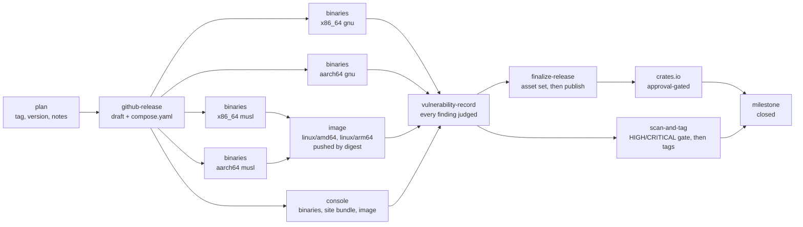

<!-- SPDX-FileCopyrightText: Cadasto B.V. -->
<!-- SPDX-License-Identifier: BUSL-1.1 -->

# Cutting a release

A milestone is a delivery promise, and a release is cut when its milestone
reaches zero open issues. This page is the checklist the cut follows, in order,
and the record of what a published release is and is not protected against.

No specification governs this; it is FerroBRIDGE's own design. The lane it
describes is `.github/workflows/release.yml`, and the discipline every workflow
here obeys is `.claude/rules/ci-cd.md`.

## What the lane does

`release.yml` is dormant until a `v*` tag is pushed. It does not run on a push
to `main`, on a pull request, or in a merge group. `workflow_dispatch` re-runs
it for a tag that already exists and has to be dispatched at that tag.



- **plan** validates the tag shape, refuses a dispatch that is not at the tag
  it names, and runs `scripts/release/plan.sh checks`, the one list of
  release facts ([Preflight](#preflight-the-plan-job-before-the-tag)): it
  refuses the tag when no milestone is titled exactly as it or that
  milestone still holds an open issue or pull request (naming each one),
  checks the tag against every file that declares the product version,
  checks the changelog's structure and the Security rules of the section
  being cut, refuses a tree that still holds a fragment under `changelog.d/`,
  and extracts the `## [X.Y.Z]` section of `CHANGELOG.md` as the
  release notes with the support period and the link to the CRA user
  information appended. A missing or empty section
  fails the release, so a cut can never ship with notes generated from the
  commit range standing in for the changelog. It also emits the target
  matrix, which the build jobs and the asset check both read, so the two
  cannot drift apart.
- **github-release** creates the release as a draft carrying those notes and
  attaches `compose.yaml`. A draft is mutable and invisible to anyone browsing
  releases, which is the window the asset uploads need.
- **build-binaries** calls `release-build.yml` once per target, on a runner of
  the target's own architecture. There is no cross-compilation and no
  emulation.
- **build-image** calls `release-image.yml` once the musl binaries exist, and
  builds `ghcr.io/ferrohealth/ferrobridge` for `linux/amd64` and `linux/arm64`
  from them. It pushes the image by digest with no tag.
- **build-console** calls `release-console.yml` once the draft exists. It
  builds the operator console's musl binaries and its site bundle, attaches
  them to the draft, and builds `ghcr.io/ferrohealth/ferrobridge-console` for
  `linux/amd64` and `linux/arm64` from them, pushed by digest with no tag.
- **vulnerability-record** scans both images on both platforms and the four
  server tarballs with Trivy at every severity, unfixed findings included,
  with an empty configuration so the gate's floor and exceptions stay out.
  `scripts/checks/vex-coverage.sh` joins every finding with the OpenVEX
  statement under `security/vex/` that judges it and refuses the release
  while one has none (CRA Annex I Part I(2)(a)). It attaches
  `ferrobridge-vX.Y.Z-vulnerability-record.json` and the raw reports
  (`ferrobridge-vX.Y.Z-trivy-reports.tar.gz`) to the draft, and keeps them as
  a run artifact when it refuses.
- **scan-and-tag** calls `scan-and-tag.yml` once the record passes. It scans
  each pushed digest against `trivy.yaml` (HIGH and CRITICAL, fixed findings
  only, `.trivyignore.yaml`) and only then applies the tags, so a refused
  image is never referencable by tag. `imagetools create` re-tags the same
  digest, so the attestations hold, and each tag is verified as a consumer
  would.
- **finalize-release** waits for the vulnerability record, checks that the
  draft carries every asset this version promises, the record included, then
  publishes. Publishing last means a half-assembled release is
  never visible. A pre-release publishes with `--latest=false`, so it never
  becomes the repository's latest release.
- **crates** uploads the `crates/*` members to crates.io once the release is
  public, so a refused upload never leaves a release half-cut. It runs in the
  `crates-io` environment, whose required reviewer pauses it until the owner
  approves, authenticates with Trusted Publishing (OIDC, no stored token), and
  calls `scripts/release/publish-crates.sh`, which publishes each member in
  dependency order and then reads the registry back. Re-running the same leg is
  safe: a version already on the index counts as done. The between-releases
  path for the same script is `.github/workflows/publish-crates.yml`, a manual
  dispatch that is a dry run unless `publish` is set. The rules are
  `.claude/rules/crates-publishing.md`.
- **milestone** closes the milestone titled as the tag once every other job
  has succeeded, the approval-gated crates leg included, with the workflow
  token and job-level `issues: write`. When a leg fails or the owner refuses
  the crates approval, the job still runs, names the leg in its log, and
  leaves the milestone open; re-running the failed jobs closes it. An
  already-closed milestone counts as done. Both milestone steps call
  `scripts/release/milestone.sh`, and a pre-release finishes no milestone,
  so neither step reads or changes one for an `-rc.N` tag.

Concurrency is `cancel-in-progress: false`. A second tag push queues behind the
first, because a release cancelled part-way through publishing is worse than a
slow one.

## The staging layout the image build expects

`docker/Dockerfile` compiles nothing. It copies one already-built binary out of
the build context, at `dist/${TARGETOS}_${TARGETARCH}/ferrobridge`, so
`build-binaries` stages the static musl binary it produced and attested at
`dist/linux_amd64/ferrobridge` and `dist/linux_arm64/ferrobridge` before the
image lane runs `docker buildx build -f docker/Dockerfile --platform
linux/amd64,linux/arm64 .`. `.dockerignore` denies everything but `dist/`, so
nothing else reaches the builder, and `.gitignore` keeps the staged tree out of
git. The same two commands reproduce the build on a laptop from a locally
cross-compiled binary.

`docker/console/Dockerfile`, the operator console's recipe, compiles nothing
either. It copies `dist/console/${TARGETOS}_${TARGETARCH}/ferrobridge-console`
and the site bundle at `dist/console/site/`, which `release-console.yml`
stages from its own attested tarballs. The same `.dockerignore` applies.

## Why the build jobs are reusable workflows

`build-binaries`, `build-image` and `build-console` carry a `uses:` line and
nothing else. That
shape is load-bearing.

SLSA v1.2 Build Level 3 requires that the secret material authenticating the
provenance is out of reach of the environment running the user-defined build
steps ([build requirements](https://slsa.dev/spec/v1.2/build-requirements)). An
`actions/attest-*` step inside an ordinary job does not meet that: every step
of a job shares one runner VM, so a build step could reach the signing
material. GitHub's documented remedy is to move the build and its attestation
into a reusable workflow, which runs on its own VM and whose steps a caller
cannot add to ([using artifact attestations and reusable workflows to achieve
SLSA v1 Build level
3](https://docs.github.com/en/actions/security-for-github-actions/using-artifact-attestations/using-artifact-attestations-and-reusable-workflows-to-achieve-slsa-v1-build-level-3)).
A job that carries `uses:` cannot also carry `steps:`, so the regression is
unrepresentable rather than merely discouraged.

The consumer-visible prize is `--signer-workflow`: the Fulcio certificate names
the reusable workflow as the signer, so a verifier can insist an artifact came
from that lane rather than from any workflow in this repository. The commands
are in `SECURITY.md`.

`contents: write`, `id-token: write` and `attestations: write` are declared on
the caller job and on the called workflow's job, because a called workflow
receives the caller's token permissions and the guide asks for the set in both
places. The image job trades `contents: write` for `contents: read` and adds
`packages: write`.

## What release-build.yml produces, per target

The four targets are `x86_64-unknown-linux-gnu`, `x86_64-unknown-linux-musl`,
`aarch64-unknown-linux-gnu` and `aarch64-unknown-linux-musl`, each built on a
runner of its own architecture. Linux only, because the deliverable is a
server.

The build restores no cache. A cache an untrusted run could poison must never
feed a release, and a cache is an input the build did not declare. The binary
is built with `cargo auditable`, which embeds the compressed dependency list in
the binary's own `.dep-v0` section, so the shipped artifact self-describes to a
scanner even when no SBOM travelled with it.

Every name below is prefixed `ferrobridge-vX.Y.Z-<target>`.

| Asset | What it is |
|---|---|
| `.tar.gz` | the stripped binary with `LICENSE`, `NOTICE` and `README.md` |
| `.tar.gz.sha256sum` | corruption detection, and not a signature |
| `.cdx.json` | the CycloneDX SBOM of the source dependency graph, spec version 1.5 |
| `.spdx.json` | the syft SBOM of the shipped binary, read from its `.dep-v0` section |
| `.tar.gz.sigstore.json` | the Sigstore bundle of the build provenance |
| `.tar.gz.sbom.sigstore.json` | the Sigstore bundle of the CycloneDX SBOM attestation |
| `.tar.gz.build-sbom.sigstore.json` | the Sigstore bundle of the syft SBOM attestation |
| `.tar.gz.intoto.jsonl` | the provenance DSSE envelope, one per line |

`compose.yaml` is attached once, by `github-release`. `finalize-release` checks
that whole set for all four targets, matched whole-line, and names every
missing file rather than publishing a short release.

Two properties of the list are deliberate. The two SBOMs answer different
questions: CycloneDX records the direct and transitive edges of the source
graph, and the syft document records what the shipped binary actually carries.
The `.sigstore.json` and `.intoto.jsonl` suffixes are what OpenSSF Scorecard's
[signed-releases
check](https://github.com/ossf/scorecard/blob/main/docs/checks.md#signed-releases)
matches, the second scoring higher than the first. The lane refuses to upload a
`.intoto.jsonl` whose `payloadType` is not `application/vnd.in-toto+json` or
whose `predicateType` is not `https://slsa.dev/provenance/v1`, rather than
attaching a file that looks like provenance and is not.

## What release-image.yml produces

The image lane takes the two musl tarballs from this run's artifacts rather
than from the draft release: an artifact is bound to the run that uploaded it,
while a release asset is whatever happens to be attached when the job reads it.
It runs `gh attestation verify --signer-workflow` on each tarball before
extracting it, so the image provenance chains to attested inputs.

It stages `dist/linux_amd64/ferrobridge` and `dist/linux_arm64/ferrobridge`,
which is what `docker/Dockerfile` copies, and builds both platforms in one
buildx build. No QEMU: emulation is what runs commands for a foreign
architecture, and that Dockerfile runs none, being a single distroless stage
that copies a binary already built for each platform ([multi-platform
builds](https://docs.docker.com/build/building/multi-platform/)).

The index is pushed by digest with no tag. The lane computes the tags (the
version, and for a release that is not a pre-release also its major.minor and
`latest`) and hands them to `scan-and-tag`, which applies them once the
vulnerability record and the image scan pass. BuildKit's own
provenance and SBOM attestations are off, because the GitHub attestations carry
both, keyless-signed through Sigstore, while BuildKit's are unsigned
attestation manifests inside the index. Five attestations are pushed as OCI
referrers: provenance for the index, and provenance plus an SPDX SBOM for each
platform manifest. The lane then verifies its own output the way a consumer
would, so a broken attestation fails the release instead of the first
deployment.

## What release-console.yml produces

The console ships as an image on distroless static, so its binary is built
for the two musl targets alone, `x86_64-unknown-linux-musl` and
`aarch64-unknown-linux-musl`, each on a runner of its own architecture. The
`plan` job names them once, and both the console lane's matrix and the asset
check read that list. The site bundle is the same for every architecture and
is built once, by `scripts/release/console-site.sh` with the tools
`scripts/release/console-tools.sh` installs at their pinned digests, so
cargo-leptos downloads nothing in the attested job. No job restores a cache.

Every name below is prefixed `ferrobridge-console-vX.Y.Z-`:

| Asset | What it is |
|---|---|
| `<target>.tar.gz` | the stripped console binary with `LICENSE`, `NOTICE` and the console's `README.md` |
| `<target>.tar.gz.sha256sum` | corruption detection, and not a signature |
| `<target>.spdx.json` | the syft SBOM of the shipped binary, read from its `.dep-v0` section |
| `<target>.tar.gz.sigstore.json` | the Sigstore bundle of the build provenance |
| `<target>.tar.gz.sbom.sigstore.json` | the Sigstore bundle of the SBOM attestation |
| `<target>.tar.gz.intoto.jsonl` | the provenance DSSE envelope |
| `site.tar.gz` | the site bundle: the WebAssembly, its JavaScript glue and the stylesheet under `site/pkg/` |
| `site.tar.gz.sha256sum` | corruption detection, and not a signature |
| `site.tar.gz.sigstore.json` | the Sigstore bundle of the bundle's provenance |
| `site.tar.gz.intoto.jsonl` | the provenance DSSE envelope |

`finalize-release` checks the whole set beside the bridge's. The image job
takes the tarballs from this run's artifacts, verifies each against
`release-console.yml`'s own signer identity, stages them for
`docker/console/Dockerfile`, and from there runs the steps `release-image.yml`
runs: one buildx build for both platforms with no QEMU, pushed by digest
with the version and, for a release that is not a pre-release, the
major.minor and `latest` tags left for `scan-and-tag` to apply, five
attestations pushed as OCI referrers (provenance for the index, provenance
plus an SPDX SBOM per platform manifest), and a verification of its own
output as a consumer would run it.

## Between releases: the weekly image scan

`.github/workflows/image-scan.yml` scans both published images at `latest`
every Monday, both platforms, with `trivy.yaml` and every OpenVEX document
under `security/vex/` passed as `--vex`. A finding files or comments on one
tracking issue and the run stays green; the run goes red only when the scan
itself fails. `scripts/security/scan-images.sh` replays the same scan
locally, and `--candidate <image>` scans a local build before you release
it. The Trivy version of all three lanes is the `trivy` row of
`docs/VERSIONS.md`.

## The pre-release rule

A tag carrying a suffix after a hyphen (`v0.0.2-rc.1`) is a pre-release, and a
bare `vX.Y.Z` is an official release. The suffix decides three things by
itself: the GitHub release is marked as a pre-release, it publishes with
`--latest=false`, and the image carries its version tag alone, without
`major.minor` and without `latest`. Nothing else in the lane changes, so a
pre-release rehearses the whole pipeline and is how a change to it is tried
before a real cut.

## Before the tag

1. **The milestone is empty.** `gh issue list --milestone vX.Y.Z --state open`
   answers nothing, or the cut is called and the stragglers move to the
   next milestone. The `plan` job refuses the tag otherwise, and
   `GITHUB_REPOSITORY=FerroHEALTH/FerroBRIDGE bash scripts/release/milestone.sh
   check vX.Y.Z` asks the same question before you tag.
2. **The version moves in every file the pin matrix names:** the root
   `Cargo.toml` `[workspace.package]` `version`, `CITATION.cff`, the
   product-version row of `docs/VERSIONS.md`, and the
   `ghcr.io/ferrohealth/ferrobridge` and `ghcr.io/ferrohealth/ferrobridge-console`
   image tag defaults in `compose.yaml`.
   `scripts/checks/versions.sh` fails on any file left behind, and the `plan`
   job checks the first three against the tag and refuses the release when one
   of them is missing.
3. **The release pages name the release.** `README.md` (the latest release,
   its date, what it shipped and the image tag), the landing page
   `website/landing/index.html` (the two meta descriptions, the hero status
   and the status panel) and the book's `website/book/src/evaluate/build-order.md`
   (a row under Released, and the release gone from Next). The versions guard
   compares each claim with the workspace version and the date of its
   `CHANGELOG.md` section, so it fails until the pages and the changelog move
   with the version.
4. **The console screenshots show the release.** After the version moves,
   take the book's operator console screenshots again on the release
   commit's tree: `scripts/release/journey-tools.sh target/journey-tools`,
   the release site bundle (`scripts/release/console-site.sh --release`), then
   `FERROBRIDGE_SCREENSHOTS=1 cargo nextest run -p ferrobridge-testkit -E
   'test(/screenshots::the_book_shows/)'`. The capture writes the version it
   ran at to `website/book/src/operate/img/console/captured-version.txt`, and
   the screenshot guard of the ordinary suite fails until that names the
   workspace version. Read every image before the bump merges.
5. **The changelog names the release.** Run
   `scripts/release/changelog.sh --assemble X.Y.Z YYYY-MM-DD` on the release
   branch: it writes `## [X.Y.Z] - YYYY-MM-DD` under the empty `[Unreleased]`
   from every fragment under `changelog.d/`, section by section in the Keep a
   Changelog order, moves the link references on and `git rm`s the fragments
   (`changelog.d/README.md`). Then write the release summary under the new
   heading. `scripts/release/changelog.sh --preview` shows the section before
   you cut. What sits under the version heading is what the release notes
   say, so read it as the release notes before you tag. The heading carries
   the date, because the support period in the notes counts from it.
6. **Every Security entry names its advisory.** Each `### Security` entry
   carries the `GHSA-` id of the draft advisory on this repository, or the
   path of a VEX statement under `security/vex/`, and a Security section
   beside other change subsections opens with
   `Shipped with functional changes because: <reason>`
   (`.claude/rules/changelog.md`). The drafted advisories are published in
   the same hour as the release (`post-market.md`).
7. **The gates pass on the release commit.** The tier-1 set is
   `zizmor --min-severity=low .github/`, `actionlint`, `shellcheck
   --severity=style` over every tracked shell program, `hadolint` over every
   tracked Dockerfile, `scripts/checks/comment-style.sh --all`,
   `scripts/checks/versions.sh`, and `mdbook build website/book`, beside the
   Rust lanes (`docs/ci-cd.md`).
8. **A pre-release has rehearsed any change to the lane itself.** Tag
   `vX.Y.Z-rc.1`, watch the whole graph run, and read what it produced. A
   pre-release takes the same path and is never marked latest.
9. **The preflight passes** at the commit you are about to tag
   (below).

## Preflight: the plan job, before the tag

The `plan` job verifies every release fact at the tagged commit before
anything is built or published. Its checks are one list,
`scripts/release/plan.sh`, and `scripts/release/preflight.sh` runs the same
list on your machine:

```sh
bash scripts/release/preflight.sh v0.0.11
bash scripts/release/preflight.sh v0.0.11 --notes /tmp/notes.md   # keep the notes
```

Run it on the release branch once the release pull request is ready, and
again on `main` after the merge, at the commit you are about to tag. It exits
0 when the plan job would pass, names every check that refuses, and prints the
path of the release notes it composed so you can read them before they are
published.

The checks, in the order the plan job runs them:

| Check | Script |
|---|---|
| The milestone titled as the tag holds no open item | `scripts/release/milestone.sh check` |
| The tag equals the version in `Cargo.toml`, `CITATION.cff` and `docs/VERSIONS.md` | `plan.sh` |
| The changelog has only Keep a Changelog types, each once per section | `scripts/checks/changelog-structure.sh` |
| The section being cut opens its `### Security` with the reason when it mixes security and functional changes, and every Security entry names a GHSA id or a `security/vex/` path | `scripts/checks/changelog-security.sh --section X.Y.Z` |
| No fragment is left under `changelog.d/` for the notes to miss | `plan.sh` (`check_changelog_fragments`, with `scripts/release/changelog.sh --check`) |
| The previous release resolves from the pushed tags | `plan.sh prev-tag` |
| The changelog section becomes the notes, with the support period, the CRA user information link and the pinned EHDS system documents | `plan.sh notes` |
| The information sheet and the instructions for use at the pinned FerroHEALTH commit carry the pinned revision, are written with this release's facts, and the notes name the pinned revisions | `plan.sh` (`check_ehds_documents`, with `scripts/release/system-documents.sh`) |

The previous release is resolved from `git ls-remote --tags origin 'v*'`, by
version order. A tag that was pushed but whose release never published still
counts, and ancestry plays no part (`bash scripts/release/plan.sh prev-tag
vX.Y.Z` prints it). The support period is the month and year five years
after the date on the release heading (CRA Art 13(8) and (19)), computed in
bash so the preflight gives the same month on macOS as the plan job on Linux.
The notes end with a link to the book's
[CRA information for users](https://ferrobridge.eu/docs/evaluate/cra-user-information.html)
page, the Annex II information CRA Art 13(18) has accompany each release. The
book is published from `main`, so every release links the same address, and
`plan.sh notes` refuses when `website/book/src/SUMMARY.md` does not list the
page.

The EHR system Cadasto B.V. declares under the EHDS is FerroEHR with
FerroBRIDGE, and its information sheet, instructions for use, readiness
record and technical documentation are pages of the FerroHEALTH book.
`docs/ehds/system-documents.env` pins the FerroHEALTH commit a release takes
them from and the revision date of each page there. The plan fetches the
information sheet and the instructions for use at that commit, refuses a page
whose `Revised` line differs from the pin, makes the family book's relative
links absolute, stamps the release's version and date under the title, and
replaces the page's "This copy" section with FerroBRIDGE's facts: the system
version (this release with the FerroEHR release its end-to-end tests run
against, the FerroEHR CDR image row of `docs/VERSIONS.md`), the release date
(EHDS Art. 38(2)(b)), and the versions of the standards in
`docs/ehds/standards.tsv`, read from `docs/VERSIONS.md` (Art. 38(2)(e)). The
`github-release` job attaches both copies, `finalize-release` refuses a draft
without them, and the notes name the four pinned revisions. To move the pin,
set the commit and the four dates together, read from the pages at that
commit.

You need `gh` logged in, because the milestone check reads the tracker. A
missing tool refuses its check; it is never skipped.

To add a release fact, add a function and a line to the list in
`scripts/release/plan.sh`. The plan job and the preflight both pick it up.

## The tag

The tag is signed and pushed from the working session that carried the
milestone, right after the version-bump pull request merges; it is never a
step handed to someone else:

```sh
git tag -s vX.Y.Z -m "vX.Y.Z" <the merged release commit>
git push origin vX.Y.Z
```

The `release-tags` ruleset requires a signature on `refs/tags/v*`, so an
unsigned tag is refused at push time. `release.yml` takes it from there.

## After the tag

1. **Read the published release.** Its notes are the changelog section, and its
   asset list is what `finalize-release` verified.
2. **Verify one asset and the image as a stranger would**, with the commands in
   `SECURITY.md`. The image lane already ran them against its own output, so
   this confirms the published release rather than the run.
3. **The GHCR packages are public.** A package pushed for the first time is
   private, which hides the image from everyone and breaks a
   `docker pull`. The owner sets each one public once, in the package
   settings: `ferrobridge`, and `ferrobridge-console` after the first release
   that carries the console.
4. **Post the board status update** with what shipped and what the next
   milestone targets (`.claude/rules/project-board.md`).
5. **The milestone is closed.** The `milestone` job closes it at the end of
   the run, because a released milestone left open still reads as pending
   work on the board. After a manual or recovery release (a re-run, a
   `publish-crates.yml` dispatch), check that it is closed, and close it with
   `GITHUB_REPOSITORY=FerroHEALTH/FerroBRIDGE bash scripts/release/milestone.sh
   close vX.Y.Z` when it is not.

## What a published release is protected against

Two protections cover different things, and both are on.

**The release is frozen.** GitHub's repository-level immutable-releases setting
is enabled, so once a release is published its notes and its assets cannot be
edited. That is why the lane assembles a draft and publishes last: the draft is
the only window in which assets can still be attached.

**The tag is protected.** The `release-tags` ruleset is active on
`refs/tags/v*` and blocks `deletion` and `non_fast_forward` updates, and
requires signatures. A pushed `vX.Y.Z` cannot be moved to another commit and
cannot be deleted, so the commit a release names stays the commit it was cut
from.

Read the notes before you tag. Once the release publishes, the text you wrote
is the text that stands.

**The no-retag rule is ours, not the platform's.** A bad cut ships forward as a
new patch version. Never move a tag, never delete a release and recreate it,
and never edit a published release's notes to fix what the changelog got wrong;
fix the changelog and cut the next version. The lane enforces the half it can:
`github-release` refuses to reopen an already-published release for the same
tag, and fails with that message instead.

## Sources

- Available rules for rulesets:
  <https://docs.github.com/en/repositories/configuring-branches-and-merges-in-your-repository/managing-rulesets/available-rules-for-rulesets>
- Managing releases:
  <https://docs.github.com/en/repositories/releasing-projects-on-github/managing-releases-in-a-repository>
- Automatically generated release notes:
  <https://docs.github.com/en/repositories/releasing-projects-on-github/automatically-generated-release-notes>
- GitHub Actions security hardening:
  <https://docs.github.com/en/actions/security-for-github-actions/security-hardening-for-github-actions>
- Artifact attestations and reusable workflows for SLSA v1 Build level 3:
  <https://docs.github.com/en/actions/security-for-github-actions/using-artifact-attestations/using-artifact-attestations-and-reusable-workflows-to-achieve-slsa-v1-build-level-3>
- SLSA v1.2 build requirements: <https://slsa.dev/spec/v1.2/build-requirements>
- OpenSSF Scorecard checks:
  <https://github.com/ossf/scorecard/blob/main/docs/checks.md#signed-releases>
- Docker multi-platform builds:
  <https://docs.docker.com/build/building/multi-platform/>
- cargo-auditable: <https://github.com/rust-secure-code/cargo-auditable>
