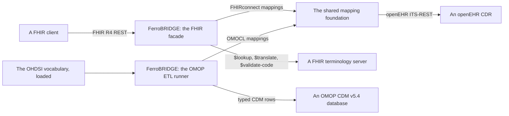

<!-- SPDX-FileCopyrightText: Cadasto B.V. -->
<!-- SPDX-License-Identifier: BUSL-1.1 -->

# Architecture

FerroBRIDGE is a standalone bridge between openEHR and two interoperability
targets: HL7 FHIR through the FHIRconnect specification, and the OMOP Common
Data Model through the OMOCL specification. It runs beside an openEHR CDR and
reaches it only over the openEHR ITS-REST API, so it works against a CDR it did
not build. This page is the short tour. The design authority, with the ground
for every decision, is
[`docs/architecture.md`](https://github.com/FerroHEALTH/FerroBRIDGE/blob/main/docs/architecture.md)
in the repository.

<!-- toc -->

## The shape

Both sides read openEHR content the same way and write to different places. The
FHIR side answers requests one at a time and keeps no clinical data of its own.
The OMOP side runs as a batch job, queries the CDR with AQL, and writes rows.
[How FerroBRIDGE maps](../explanation/how-ferrobridge-maps.md) explains each
part, from mapping files compiled into programs to the facade, the OMOP ETL,
the inbound engine, the outbound lane and the state store, and which
specification governs each.

## Who owns what in the server

Each concern of the `ferrobridge` server has exactly one owning module under
`app/ferrobridge-server/src`. Every other module reaches the concern through
its owner, and each module's doc comment names what it owns. No
specification governs this split: it is FerroBRIDGE's own design.

### Requests

| Concern | Owner | Callers |
|---|---|---|
| FHIR R4 REST interactions, search and `CapabilityStatement` | `facade` | `state` mounts it; `hl7v2`, `outbound`, `shl` and `consent` use its services |
| The SMART permission each facade route needs | `facade::guard` | every facade handler |
| The FHIRconnect `$tofhir` and `$toopenehr` operations | `operations` | `state` mounts it; `operator` swaps its programs on reload |
| The operator API | `operator` | the operator console, over HTTP |
| The HL7 v2 MLLP listener and its acknowledgments | `hl7v2` | `lanes` starts it; it writes through `facade::ingest` |
| Inbound events from every transport | `inbound` | `hl7v2`, `lanes`, `operator` |
| SMART Health Links | `shl` | `lanes`, `state` |
| Access tokens and the resource-server checks | `smart` | `facade`, `operator`, `shl` |
| The eIDAS assurance level per route class | `assurance` | `smart`, `shl` |
| Problem details outside the FHIR routes | `problem` | `inbound`, `operator`, `sources` |
| Routes more than one module serves | `mount` | `facade`, `smart` |

### State

| Concern | Owner | Callers |
|---|---|---|
| The PostgreSQL pool, migrations, row claims, lane leases and change notification | `store` | every module that keeps state |
| The identity map, the subject link and the EHR resolution | `identity` | `facade`, `inbound`, `outbound`, `sources`, `lanes` |
| Facade-owned resources (`owned_resource`) | `facade::owned` | `facade` |
| The outbound lane's delivery record (`outbound_delivered`) | `outbound::delivered` | `outbound` |
| Change-feed watermarks and dead letters | `change_feed` | `operator`, `lanes` |
| Inbound sources, tenants and MLLP routes | `sources` | `hl7v2`, `inbound`, `operator`, `lanes` |
| The inbound inbox, work items, slots and cursors | `inbound::store` | `inbound` |
| Mapping revisions and blobs | `mappings::revisions` | `operator`, `lanes` |
| Runtime settings registers | `settings` | `audit`, `facade`, `operator` |
| SMART Health Link records | `shl::store` | `shl` |
| The audit outbox and its quarantine | `audit::outbox` | `audit` |

### Outbound calls

| Concern | Owner | Callers |
|---|---|---|
| The openEHR CDR over ITS-REST 1.1.0 | `cdr` (`CdrClient`) | `facade`, `change_feed`, `etl`, `mappings`, `operator`, `inbound`, `identity` |
| The bridge's own client-credentials token | `credentials` | `cdr`, `smart` |
| The FHIR terminology server | `terminology` over `ferrobridge-term` | `facade`, `operations`, `lanes` |
| The identity source over ITI-83 and ITI-104 | `identity_source` | `identity`, `facade`, `inbound` |
| FHIR delivery of changed compositions | `outbound::sink` | `outbound` |
| The ITI-20 ATX: FHIR Feed | `audit::feed` | `audit` |
| Inbound recovery calls per source | `inbound::clients` | `inbound` |
| The OMOP CDM database | `etl` over `omop-cdm` | `jobs`, `operator` |

### Background work

| Concern | Owner | Callers |
|---|---|---|
| Starting every lane `serve` runs | `lanes` | `boot` |
| Waiting for the CDR at boot | `boot` | `lib`, `lanes` |
| Reading commit events and following each reader | `change_feed` | `outbound`, `events`, `lanes` |
| Republishing commit events to AMQP | `events` | `lanes` |
| Mapping and delivering changed compositions | `outbound` | `lanes` |
| Applying inbound work on every replica | `inbound::worker` | `lanes` |
| The OMOP ETL run | `etl` | `jobs`, `operator` |
| The batch jobs beside `serve` | `jobs` | `lib`, from the `cli` subcommands |
| One leader per lane across replicas | `store::lease` | `change_feed`, `inbound`, `shl`, `lanes` |
| Backoff and the retry or park verdict of the bridge's own loops | `retry` | `boot`, `change_feed`, `inbound`, `outbound`, `operator` |

### Configuration

| Concern | Owner | Callers |
|---|---|---|
| Reading the configuration tree into one typed `Settings` | `config` | every lane |
| The configured AQL, checked at load | `aql` | `config`, `etl` |
| Loading and compiling a mapping set | `mappings` (`mappings::compile`) | `facade`, `operations`, `check`, `operator`, `etl` |
| Walking a mapping directory | `walk` | `mappings`, `check`, `etl`, `operator` |
| Checking a mapping set | `check` | `jobs`, `operator` |

### Audit

| Concern | Owner | Callers |
|---|---|---|
| The access record of each facade access | `audit` (the layer in `facade::audit`) | `facade`, `hl7v2`, `inbound`, `shl`, `lanes` |
| The installation report | `usage_report` | `state`, `boot` |
| The startup summary | `startup` | `lanes`, `state`, `usage_report` |
| The boot banner | `banner` | `lib` |

## Generated and hand-written

Two models are generated, because both are published in machine-readable form
and a hand-transcribed copy drifts from its source with no way to detect it.
The FHIR model, the `fhir-types` crate, is emitted by `fhir-codegen` from the
HL7 FHIR packages and published to crates.io. The OMOP CDM v5.4 row types are
emitted from the OHDSI `CommonDataModel` field definitions, with the OHDSI
PostgreSQL DDL vendored verbatim beside them. The openEHR model, and the
ITS-REST client the bridge calls the CDR through, come from the published
`openehr-*` crates. Everything that makes FerroBRIDGE a bridge is
hand-written: the mapping foundation, both mapping languages' types, validators
and interpreters, the FHIR path model, the terminology client, the facade, and
the ETL runner.

## Where the specifications are silent

FerroBRIDGE labels its own decisions as its own, in the code and in these
pages. The FHIRconnect engine chapter is explicitly a set of recommendations,
and no specification governs FHIR search, identity, extension ordering, or
failure policy. Each of those is pinned as a FerroBRIDGE decision on the
[failure and identity](../operate/failure-and-identity.md) page and in the
architecture document.
