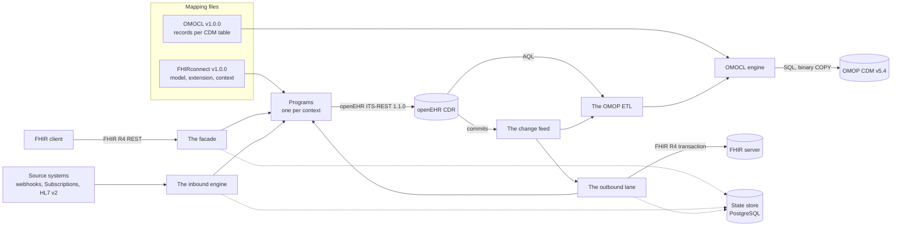
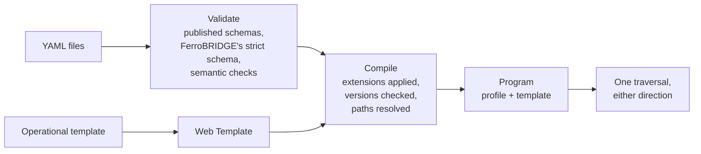
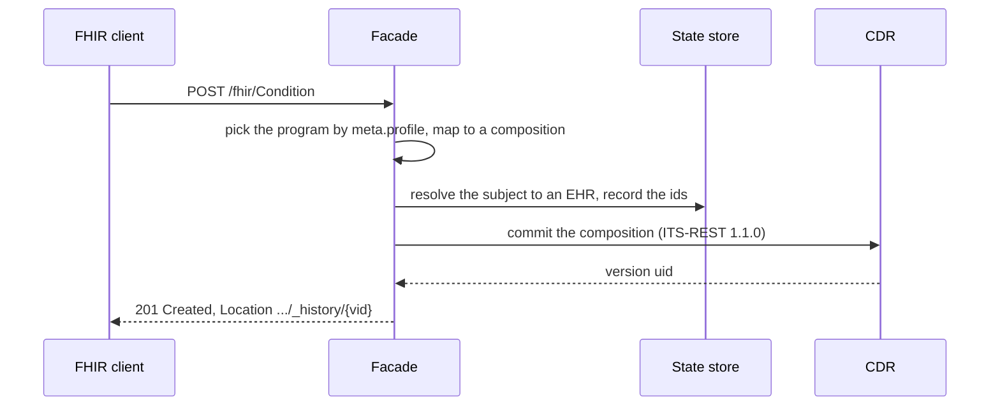
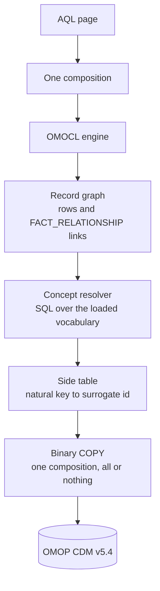
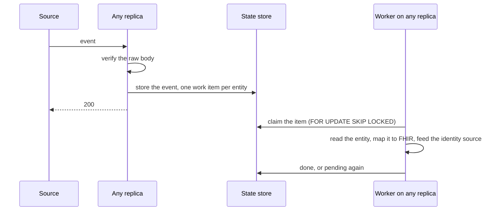

<!-- SPDX-FileCopyrightText: Cadasto B.V. -->
<!-- SPDX-License-Identifier: BUSL-1.1 -->

# How FerroBRIDGE maps

**Audience:** integrators, mapping authors and operators who want the model
behind the how-to pages; decision makers who want to know which parts a
specification governs and which are FerroBRIDGE's own.

FerroBRIDGE moves clinical data between an openEHR CDR and two targets: HL7
FHIR R4 and the OMOP Common Data Model v5.4. Mapping files decide every
value; the code decides only how the files are compiled, run and delivered.
This page explains the parts and how they relate. Each part names the
specification that governs it, and says so where none does.

<!-- toc -->

## The parts at a glance

Solid arrows carry clinical data; dotted arrows carry the bridge's own
state: identifiers, cursors, leases and records of what it delivered, never
clinical content in clear.

## One foundation, two languages

FHIRconnect and OMOCL share one header: `grammar`, `type`, `metadata` and
`spec`, with `spec.openEhrConfig` pinning the archetype and its revision. The
FHIRconnect specification states that the header "is standardized for both
FHIRconnect and OMOCL" (FHIRconnect v1.0.0, Basics). Below the header the two
languages differ. FHIRconnect is bidirectional and tree-shaped against FHIR
paths. OMOCL is one-directional, openEHR to OMOP, and flat: a list of records
keyed by CDM table, each column taking ordered `alternatives`.

FerroBRIDGE shares what the two have in common, the header model, the YAML
loader with anchors and source positions, the registry by mapping name and
archetype id, and the openEHR path model, and gives each language its own
parser, validator and interpreter. [The two mapping
specifications](../evaluate/mapping-specifications.md) compares them in
detail.

Both languages address openEHR content by RM and archetype path, such as
`$archetype/data[at0001]/items[at0077]`. A path alone does not say which RM
type sits at its end or which node identifiers a template gives it, so every
path is resolved against the template: the operational template is fetched
from the CDR (or read from `[mappings] templates`), the Web Template is built
from it, and only then is the path resolved and the composition read or
built. Compositions cross the wire as canonical JSON.

## From mapping files to programs

FHIRconnect organises mappings in three kinds of file (FHIRconnect v1.0.0,
Types of mapping files):

- a **model** mapping relates one archetype to an unprofiled FHIR resource;
- an **extension** mapping adds, overwrites or appends rules to a model
  mapping, to fit a profile or a template;
- a **context** mapping names the profile, the template, the model and
  extension mappings it imports, and the mapping to start from. The
  specification requires one context per profile and template mapped.

At start, FerroBRIDGE compiles each context into one immutable **program**.
Compiling applies the extensions in their declared order, checks the
mapping, grammar, archetype, template and profile versions against each
other, and resolves every path on both sides, the FHIR side against the
element table of the generated `fhir-types` crate and the openEHR side
against the Web Template. A request then runs a program and parses no path.

Every file is checked three ways before it compiles: against the two
published draft-07 JSON schemas, against FerroBRIDGE's own strict schema,
which admits exactly what the prose defines, and against the rules no schema
can express (sub-context rules, slot resolution, unique names, every path
resolving). A file that does not pass stops the start, so a mapping fault
never surfaces on the first request that touches it. `ferrobridge mapping
check` runs the same load without serving ([Writing and loading
mappings](../integrate/mappings.md)).

A request picks its program by the profiles the resource claims in
`meta.profile`, narrowed by a template id when one is given. No match and
several matches are two distinct refusals.

## The facade over the CDR

The FHIR facade is a FHIR R4 REST server whose storage is the openEHR CDR.
It keeps no clinical data: a read maps a composition out of the CDR, and a
write maps a resource into a composition and commits it over openEHR
ITS-REST 1.1.0. A transaction Bundle maps every entry first and commits them
in one ITS-REST contribution, so it succeeds or fails as one unit, as FHIR R4
defines a transaction (FHIR R4, RESTful API, transaction).

A FHIR resource id must never change once assigned (FHIR R4, Resource, id),
and the FHIRconnect engine chapter asks the engine to keep the ids it issues
stable and to resolve an external id to the same internal one (FHIRconnect
v1.0.0, Engine, ID-Management). The facade derives each id from the
composition's versioned object id and the entry path, so a new version of a
composition reads back under the same id with a new `meta.versionId`. The
identity map in the state store records each external id, each patient's EHR
and each source resource's version, which makes a re-sent create commit
nothing. The engine chapter's text is a set of recommendations, so the exact
derivation, the replay rule and the status each CDR answer becomes are
FerroBRIDGE's own design ([Failure and identity
behaviour](../operate/failure-and-identity.md)).

FHIRconnect "does not focus specifically on AQL and FHIRsearch" (FHIRconnect
v1.0.0, Engine, FHIRsearch and AQL), so FHIR search over the CDR is
FerroBRIDGE's own design: a search declaration beside a context names the
parameters and the openEHR path each compares, and the facade writes the AQL,
runs it over ITS-REST `POST /query/aql`, and maps each matching composition
back as a read would. The `CapabilityStatement` names exactly the types and
parameters the loaded programs and declarations serve. [The FHIR
facade](../integrate/fhir-facade.md) has every interaction.

The same programs serve the two operations the FHIRconnect REST API chapter
defines, `$tofhir` and `$toopenehr`, which transform a payload and reach no
CDR ([The FHIRconnect operations](../integrate/operations.md)).

## The OMOP ETL

OMOP is a relational analytics schema, so the OMOP side writes rows. The ETL
is a batch job: it reads compositions with AQL over ITS-REST
`POST /query/aql`, runs each through the OMOCL files, and writes typed CDM
v5.4 rows into PostgreSQL. openEHR ITS-REST 1.1.0 defines no change
notification, so the batch run over AQL is the conformant baseline; the
incremental load follows the change feed below.

Concept resolution is SQL over the OHDSI vocabulary loaded into the same
database: the CONCEPT table, the standard concept flag, the domain and the
"Maps to" relationship. It never asks the FHIR terminology server. An
unmapped code lands as `concept_id = 0`, which the CDM defines as "no
matching concept", with the source value kept, and the run report counts it.
The domain of the resolved concept must agree with the table the OMOCL
record names. Each composition's rows commit together through binary `COPY`,
and a side table in the bridge's own schema maps each row's natural key to
its id, so a re-run replaces rows instead of adding them. The CDM leaves
key assignment, visits, observation periods and deletions to the ETL, so
those rules are FerroBRIDGE's own design ([The OMOP ETL](../integrate/omop-etl.md)).

## The inbound engine

The inbound engine takes events from systems that are not FHIR clients:
webhooks, FHIR Subscription notifications and HL7 v2 messages over MLLP. Each
source is a versioned document in the state store, so a source is data, never
code of its own in the bridge. No specification governs a bridge's intake, so
its shape is FerroBRIDGE's own design, built on the standard of each step
(Standard Webhooks, the Subscriptions R5 Backport IG for R4, MLLP).

The engine stores every event before it answers, then workers on every
replica claim one item per entity, read the entity from the source, map it
to an R4 resource through the source's map, and apply it: the patient goes
to the identity source and gets one EHR. An HL7 v2 message is mapped by the
HL7 v2-to-FHIR guide's structure maps and committed through the facade's
ingest as one transaction, so the facade's identity and replay rules apply
to it ([The inbound intake](../integrate/inbound.md), [The HL7 v2
face](../operate/hl7v2-face.md)).

## The change feed and the outbound lane

The change feed hands each commit of the CDR to the consumers that follow
it: the events lane, the incremental OMOP load and the outbound FHIR lane.
openEHR ITS-REST 1.1.0 defines no change notification, so the feed is
FerroBRIDGE's own design. It reads either an AQL poll that any ITS-REST CDR
answers or the reference CDR's outbox feed. Each consumer keeps its own
watermark and moves it only over events it finished, so delivery is at
least once ([The change feed](../integrate/change-feed.md)).

The outbound lane maps each changed composition through the facade's
programs and identity map, so a resource it delivers has the id and content
a facade read answers, and posts one FHIR R4 transaction Bundle per event:
a `PUT` per resource, and a `DELETE` for each resource the composition no
longer maps to, was deleted or was erased. Every entry is idempotent, and the
delivery record and the watermark move in one state-store transaction after
the endpoint answers, so each effect lands once. The lane is FerroBRIDGE's
own design ([The outbound FHIR lane](../integrate/fhir-outbound.md)).

## The state store

Clinical data stays in the CDR and the CDM database. The bridge's own
working state lives in one PostgreSQL database every replica shares: the
identity map, SMART Health Links, App State and launch Tasks, the change-feed
watermarks and parked events, the audit outbox, the mapping revisions, the
settings registers, the inbound sources and the inbound work. Identifier
values are stored as an HMAC under a lookup key, and stored bodies are
sealed with AES-256-GCM.

Most work runs on every replica and coordinates through row claims. A lane
that needs one leader, a change-feed reader or a source's recovery, holds a
lease whose fencing generation every write checks, so a former leader paused
past its lease moves no cursor. No specification governs a bridge's state:
it is FerroBRIDGE's own design ([The state store and high
availability](../operate/high-availability.md)).

## Where the specifications stop

| Part | Governed by | FerroBRIDGE's own design |
|---|---|---|
| Mapping files and their validation | FHIRconnect v1.0.0 with its JSON schemas; OMOCL v1.0.0 | The strict schema, the OMOCL JSON schema (OMOCL publishes none), the column projection of OMOCL keys |
| The facade's wire | FHIR R4 RESTful API | Search over AQL, the id derivation, the status table, replay |
| CDR access | openEHR ITS-REST 1.1.0 | Retry and failure policy |
| The OMOP rows | OMOP CDM v5.4 and its conventions | Keys, visits, observation periods, deletions |
| The inbound engine, the change feed, the outbound lane, the state store | Each step's standard | The whole of their shape |

The pinned versions and the reason for each are on [Pinned
versions](../evaluate/versions.md).
