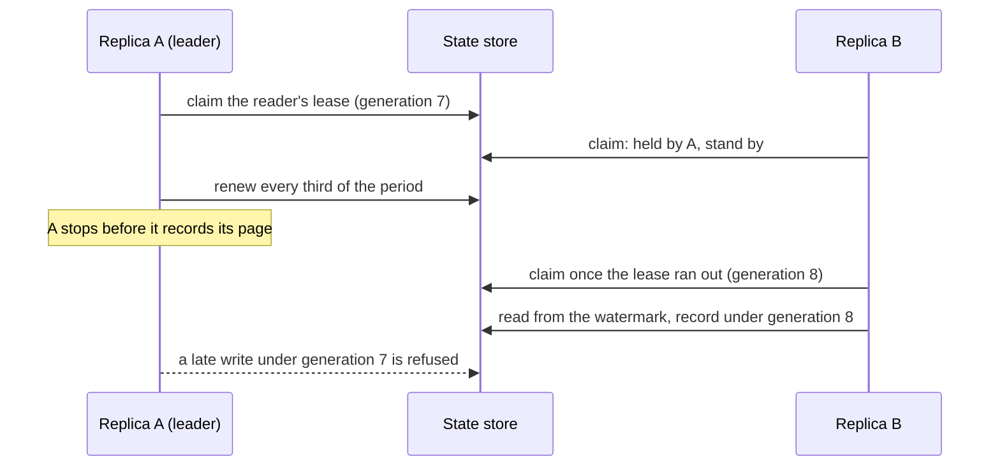

<!-- SPDX-FileCopyrightText: Cadasto B.V. -->
<!-- SPDX-License-Identifier: BUSL-1.1 -->

# The change feed

The change feed hands each commit of the CDR to the consumers that follow it,
so a consumer acts on a change without a batch run. openEHR ITS-REST 1.1.0
defines no change notification, subscription or bulk export, so no
specification governs the feed: it is FerroBRIDGE's own design. The batch ETL
over AQL stays the conformant baseline. An event names what changed, and a
consumer reads the change itself over ITS-REST.

The `[change_feed]` section picks one of two sources
([configuration](../operate/configuration.md#change_feed)). Every consumer
runs on either source. The consumers are the [events lane](events.md), the
incremental OMOP load and the [outbound FHIR lane](fhir-outbound.md).

## How a consumer follows the feed

Each consumer reads under its own reader name, and the reader's watermark is
how far the consumer has finished. A consumer reads a page of events after its
watermark, finishes them in order, and then moves the watermark to the last
event it finished:

- the watermark moves only forward, and only over events the consumer
  finished;
- a failed read, a refused acknowledgement or an event the consumer could not
  finish leaves the watermark where it was, and the event is read again on
  the next pass, so delivery is at least once and a consumer deduplicates;
- a restart resumes at the first event the consumer had not finished.

## One leader per reader

Every replica of the bridge runs the same consumer sections, and each reader
has one leader across them, held by a lease in the state store
([`[state]`](../operate/configuration.md#state)). Only the leader reads; the
other replicas stand by and report the consumer `up` with the state
`standby`. The leader renews its lease every third of `[change_feed] lease`,
and once a lease runs out (the leader stopped, lost its database or paused)
another replica takes the reader over. Each take moves the lease to a new
generation, and every write of the reader's watermark or dead letters checks
it in the same transaction, so a former leader that wakes after its lease ran
out moves no watermark: its write is refused and it stands by. The new
leader resumes at the first event the watermark does not cover, so a takeover
skips no event; an event the former leader finished but had not recorded is
offered again, as after a restart.



While a consumer cannot follow (the CDR is down, it refuses the credentials,
or the consumer's own sink refuses), its health indicator reports `degraded`
with the reason, and readiness stays up: the events wait at the source.

## Several consumers

Every consumer section that is on follows the one `[change_feed]` source on
its own task, under its own reader name: its own cursor on the reference
CDR's feed, or its own watermark row in the state store for the AQL source. Each
consumer acknowledges only the events it finished, so a consumer that stalls
never holds another one back, and each has its own health indicator. Give
every consumer a reader name of its own; on FerroEHR, name each one in
`[outbox] readers`.

## Poisoned events and the dead-letter store

A consumer reports each failure as transient or poisoned. A transient
failure (the sink is unreachable, a call timed out) leaves the watermark
where it was, and the event is offered again on the next pass for as long as
it takes; it never counts towards parking. A poisoned failure is a fault of
the event itself, which fails the same way every time it is offered.
FerroBRIDGE counts the poisoned passes of each event in the state store. On
the pass that reaches `max_attempts` (5 by default), the event is parked
there with its cause and the number of passes, and the consumer moves past
it. A parked event is never dropped: it stays open until an operator settles
it, and the settled row keeps who decided, the decision and the reason.

An operator settles a parked event in one of two ways:

- **Retry** offers it to its consumer again before the consumer's next page:
  a finished one is settled, one that fails poisoned again is parked again
  with the new cause and waits for another decision, and a transient failure
  keeps the retry pending for the next pass. A retry offers the event out of
  its commit order, so retry an event once whatever made it fail is fixed.
- **Discard** settles it without offering it again.

The [Events page](../operate/operator-console.md) of the operator console
lists the open parked events of each consumer with their cause, each with a
reason field and a Retry and a Discard button. The same is on the operator
API: `GET /operator/events` lists every consumer with its open parked events
and the last decision on each, and
`POST /operator/events/{consumer}/parked/{id}/retry` (`202`) or
`…/discard` (`204`) records the decision, with the operator's reason in the
`ferrobridge-reason` header (one line, at most 200 characters) and the
subject of the operator's token as who decided. A settlement without a
reason answers `400`, and one of an event that is not open answers `404`.
The store holds the event's identifiers and provenance as the feed served
them, never clinical content.

## The AQL source (`source = "aql"`)

The AQL source works against any CDR that serves ITS-REST 1.1.0. It polls
`POST /query/aql` with this query, binding `$since` to the watermark instant:

```text
SELECT e/ehr_id/value, v/uid/value, v/contribution/id/value,
       v/commit_audit/time_committed/value,
       v/commit_audit/change_type/defining_code/code_string,
       c/archetype_details/template_id/value
FROM EHR e CONTAINS VERSION v[ALL_VERSIONS] CONTAINS COMPOSITION c
WHERE v/commit_audit/time_committed/value >= $since
ORDER BY v/commit_audit/time_committed/value ASC, v/uid/value ASC
```

Each row is one composition version and one event. FerroBRIDGE keeps each
reader's watermark itself, in the state store: the last
commit instant the reader finished, with the version uids it finished at that
instant. Two versions can share one `time_committed`, so the query reads the
watermark instant again and skips only the versions already finished; a
version committed at the same instant after the watermark moved is still read.
A reader with no watermark starts where `start` says, recorded when its
first leader takes it: `now` (the default)
offers nothing committed before its first read, `beginning` offers every
version, and an RFC 3339 instant offers what was committed from then on.

The AQL source has limits a consumer has to accept:

- **Polling latency.** A change is seen on the next poll, up to
  `poll_interval` after its commit.
- **No commit order across EHRs.** Events come in order of
  `time_committed`. Commits whose instants tie, or a CDR whose nodes' clocks
  differ, give an order that is not the commit order, and a version that
  becomes visible after the watermark passed its instant is not read.
- **Deletions only where the CDR answers them.** A deletion is a version with
  the `deleted` change type, and it is read only when the CDR answers that
  version under `CONTAINS COMPOSITION c`.
- **Compositions only.** EHR status, folder and demographic changes are not
  read.

## The reference CDR's outbox feed (`source = "ferroehr"`)

FerroEHR, the reference CDR, writes each commit into a transactional outbox in
the commit's own transaction and serves it over a cursor feed outside
ITS-REST. It keeps two outboxes, `clinical` and `party`, each with its own
`seq` and its own cursor per reader, and FerroBRIDGE reads both on every pass
so neither holds back the CDR's pruning. Any CDR may serve the same contract:

- `GET {url}/admin/outbox/{reader}?limit=<1..1000>&domain=<clinical|party>`
  answers `200` with `{"reader": "<name>", "events": [...]}`, the events
  after the reader's cursor in `seq` order, and `404` for an unknown or
  inactive reader;
- `POST {url}/admin/outbox/{reader}/ack?domain=<clinical|party>` with
  `{"last_seq": <n>}` answers `204` and moves that outbox's cursor, and `409`
  when `n` lies below the cursor or above the last event.

Each event carries the contribution, the EHR (`null` in the party outbox),
the commit instant and one entry per changed versioned object (`vo_id`,
`kind`, `sys_version`, `version_tree_id`, `change_type`, `template_id`),
identity and provenance only. `change_type` is the openEHR audit change type
code as text, such as `249` for a creation or `523` for a deletion. An
erasure arrives as a tombstone, `"event": "erase"`, which names the erased
EHR or party objects and carries no contribution and no commit instant.

Over this source each outbox cursor on the CDR is the watermark, so
FerroBRIDGE keeps none of its own and needs only the reader's lease, and a consumer acknowledges each outbox
over the prefix it finished. The feed adds what the AQL source cannot give:
one commit order per outbox, every kind of versioned object, deletions and
erasures. The reader names come from the CDR's own configuration
(`[outbox] readers` on FerroEHR), and the `[cdr]` credentials need the scope
the CDR names for the outbox routes (`__ferroehr.outbox` on FerroEHR). The
CDR leaves out the events of an EHR under a restriction and serves them once
the restriction is lifted, as long as the cursor has not passed them.
