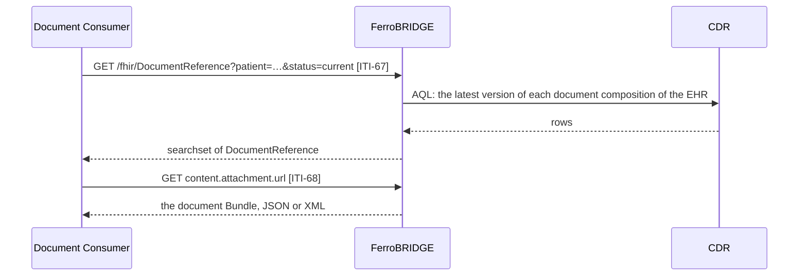

<!-- SPDX-FileCopyrightText: Cadasto B.V. -->
<!-- SPDX-License-Identifier: BUSL-1.1 -->

# Documents and the patient summary

**Audience:** integrators who read documents from the facade, and compliance
readers checking the EEHRxF document routes.

How the facade assembles a document Bundle, serves the IHE MHD Document
Responder, writes the patient summary and serves the EEHRxF Annex X data
groups.

<!-- toc -->

## `Composition/$document` assembles a document

FHIR R4 defines `Composition/$document`
(<https://hl7.org/fhir/R4/composition-operation-document.html>) and leaves the
assembly to the server. For a Composition a loaded context maps, such as
`Composition-eu-lab`, the facade reads the Composition as a read would and
answers a Bundle of `type` `document`:

- its `identifier` is a name-based UUID of the composition version the
  content came from, so one version always names one document, and its
  `timestamp` is the moment of assembly;
- entry 0 is the Composition, and every resource the context's outbound run
  creates follows it, in the order the run creates them, each with the URL a
  read answers it at as its `fullUrl`.

How the Bundle is assembled is FerroBRIDGE's own design. The server stores no
document and reads no `GraphDefinition`, so `persist=true` and any `graph` are
refused with a `400` `OperationOutcome` rather than ignored; `persist=false`
is honoured. A Composition named by the URL of another server is refused the
same way. The operation is declared on `Composition` in the
`CapabilityStatement`. The R4 `OperationDefinition` describes the document as
wrapped inside a search Bundle; the facade answers the document Bundle itself.
The document is the one MHD Retrieve Document [ITI-68] reads, so it answers in
`application/fhir+xml` when `_format` or `Accept` asks for XML, and `406` for
a media type that is neither FHIR format (ITI TF-2: 3.68.4.1.3).

## The IHE MHD Document Responder

With `[facade.mhd]` on, the facade is the IHE MHD 4.2.3 Document Responder and
answers all three of its transactions, each Required (ITI TF-1: Table
33.1-1). It serves `DocumentReference` and `List` itself, and its
`CapabilityStatement` instantiates
`https://profiles.ihe.net/ITI/MHD/CapabilityStatement/IHE.MHD.DocumentResponder`.
That statement also lists `Binary` read, which the facade does not serve: a
Consumer retrieves each document at the `$document` URL its
`DocumentReference` names, so the facade's own statement lists no `Binary`.

- **The documents** are the compositions of every template a Composition
  context maps, at their latest version. A `DocumentReference` describes one
  of them: its `id` is the Composition's, its content the draft EEHRxF Annex
  III Table 1 description `eehrxf` writes of the document `$document`
  assembles, its document category the Composition's first `category`, and
  its `content.attachment.url` the full `$document` URL. A Composition with
  no `category` cannot be described and answers `500` naming it.
- **Find Document References [ITI-67]** takes every parameter the Responder
  SHALL process (ITI TF-2: 3.67.4.1.2.1) by `GET` and by `POST _search`, and
  matches each against the element the description fills; an element the
  description leaves empty, such as `content.attachment.creation` or
  `context.facilityType`, matches no value. `author.given` and
  `author.family` read the name of each author the document holds.
- **Find Document Lists [ITI-66]** answers one SubmissionSet per CONTRIBUTION
  that committed the latest version of a document composition: its `id` the
  CONTRIBUTION's uid, its `date` the commit time, its `ihe-sourceId` the
  committing system, and an entry per document. No Folder is kept, so
  `code=folder` finds none. Mapping a CONTRIBUTION to a SubmissionSet is
  FerroBRIDGE's own design.
- **Parameters** this server does not support are ignored, as MHD asks
  (ITI TF-2: 3.66.4.1.2, 3.67.4.1.2), and named in an `OperationOutcome`
  entry of the searchset; the `self` link names only the parameters the
  search applied. `Prefer: handling=strict` refuses them with a `400`
  (<https://hl7.org/fhir/R4/search.html>). A search names `patient` or
  `patient.identifier`, or reaches the compartment of a `patient/` token; any
  other search is a `400`, since documents are listed one EHR at a time.
- **Both formats.** Each answer is FHIR JSON, or FHIR XML when `_format` or
  `Accept` asks (ITI TF-2: 3.67.4.1.2.2). The facade's other resources stay
  JSON only.
- **The endpoint.** With `[facade.endpoint]` on as well, `Endpoint/mhd` names
  the Responder, its `payloadType` the IHE format code
  `urn:ihe:iti:xds:2017:mimeTypeSufficient` and its `payloadMimeType`
  `application/fhir+json` and `application/fhir+xml`.

## `Patient/$summary` writes the patient summary

With `[facade.summary]` on, `GET /fhir/Patient/{id}/$summary` answers the
IPS operation (HL7 IPS 2.0.1, `OperationDefinition/summary`): a `document`
Bundle generated on demand from the latest information the CDR holds.

- The patient is the party the loaded `Patient` party context renders, so
  its identifiers, name, date of birth and sex come from the CDR's
  demographic `PERSON`.
- The record is every patient summary composition of the patient's EHR
  (the `eehrxf` template `openEHR-EHR-COMPOSITION.ferrobridge_patient_summary.v1.0.0`),
  each mapped by the `eehrxf` EPS project. A code in no preferred system of
  the eHealth Network Guidelines on Patient Summary is asked of the
  terminology server's `ConceptMap/$translate`, and every `equivalent` or
  `equal` match is added beside the recorded code.
- The project feeds the problems, the allergies and intolerances, the
  medication summary, the history of procedures, the medical devices and the
  immunisations, which covers every section either form requires. A section
  the project feeds and the record holds nothing for carries the empty
  reason `nilknown`. A required section no openEHR content feeds would carry
  `unavailable`, with a narrative saying this server does not supply it. A
  patient with no EHR has an empty record.
- `profile` selects the `Composition` profile: the IPS
  `Composition-uv-ips` (2.0.1) by default, the HL7 Europe Patient Summary
  `composition-eu-eps` (1.0.0-ballot), or the MyHealth@EU Core
  `composition-myhealtheu-core` (1.0.1). The MyHealth@EU profile answers
  the HL7 Europe form, which it constrains, and asks the terminology server
  for the ICD-10 coding of each problem and the ATC coding of each allergen
  (the value sets Core binds `Condition.code` and `AllergyIntolerance.code`
  to), added beside the recorded code. A concept the server maps to neither
  keeps its recorded codes and is counted in the log. Any other profile, and
  the `identifier` input, answer `400` with `not-supported`.
- Before it is served, the document is validated in process against the
  `Bundle` profile of its form over the packages `[facade.summary] packages`
  names. A document that breaks it answers `422` with the validator's
  issues and is never served.
- The CDR is read as the caller: under `[cdr.endpoint.credentials.onward]`
  a patient's token is exchanged for the CDR's own (a `patients` issuer,
  FerroSMART in a FerroHEALTH deployment: [Running behind FerroSMART](../operate/behind-ferrosmart.md#the-patient-summary-reads-ferroehr-as-the-patient)),
  so the CDR applies the patient's own access rules. A `patient/` token
  launched for another patient answers `404`, and the CDR is never asked.
  Each access writes one access record that names the caller and the
  patient's EHR.

The read path, the empty reasons, the `404` for another patient and the
refusal of an invalid document are FerroBRIDGE's own design.

## The EEHRxF Annex X data groups as resources

Art 7(2) of the draft EEHRxF implementing act (Have your say initiative
17512, 2026-11-23) exchanges the 33 common data groups of its Annex X as
individual resources as well as inside documents. The `eehrxf` crate ships
the FHIRconnect project that serves them, `crates/eehrxf/mappings/annex-x/`
(`eehrxf::mappings::ANNEX_X`), with a search declaration beside each
context. Point `[mappings] directory` at a copy of it
(`ANNEX_X.write_to(dir)` writes one) and load its templates into the
CDR: FerroBRIDGE's patient summary template, its EHDS record and EHDS
medication administration templates and the published `KDS_Laborbericht`
and `KDS_Laborauftrag`. The party groups are party contexts, so
the project needs `[cdr] demographic`, the reference CDR's patient and
healthcare professional `PERSON` definitions, FerroBRIDGE's related person
`PERSON` definition (`openEHR-DEMOGRAPHIC-PERSON.ferrobridge_related_person.v1.0.0`)
and an `ORGANISATION` template; each party resource claims the profile its context names, as an
entry's resource does.

| Annex X group | Resource | Profile | Search (IHE QEDm 3.0.0 PCC-44) |
|---|---|---|---|
| EHDSAllergyIntolerance | `AllergyIntolerance` | `allergyIntolerance-eu-core` | `patient` (2:3.44.4.1.2.2) |
| EHDSCondition | `Condition` | `condition-eu-core` | `patient`, `onset-date` (2:3.44.4.1.2.1.3) |
| EHDSMedicationUse | `MedicationStatement` | `medicationStatement-eu-core` | `patient` with `_include=MedicationStatement:medication` (2:3.44.4.1.2.1.5) |
| EHDSMedication | `Medication` | `medication-eu-core` | read, and included by the statement that references it |
| EHDSImmunisation | `Immunization` | `immunization-eu-core` | `patient`, `date` (2:3.44.4.1.2.1.6) |
| EHDSObservation | `Observation` | FHIR R4 `bodyweight` | `patient` with `category`, `code` and `date` (2:3.44.4.1.2.1.1) |
| EHDSProcedure | `Procedure` | `procedure-eu-core` | `patient`, `date` (2:3.44.4.1.2.1.7) |
| EHDSLaboratoryObservation | `Observation` | `Observation-resultslab-eu-lab` | `patient` with `category`, `code` and `date` (2:3.44.4.1.2.1.1) |
| EHDSSpecimen | `Specimen` | `Specimen-eu-lab` | `patient` |
| EHDSServiceRequest | `ServiceRequest` | `ServiceRequest-eu-lab` | `patient` |
| EHDSDeviceUse | `DeviceUseStatement` | `deviceUseStatement-eu-eps` | `patient` with `_include=DeviceUseStatement:device` |
| EHDSDevice | `Device` | `device-eu-eps` | read, and included by the statement that names it |
| EHDSDosage | the `dosage` of a `MedicationStatement` | | as its statement |
| EHDSEndpoint | `Endpoint` | FHIR R4 `Endpoint` | `_id`, `connection-type`, `status`; read-only from the configuration |
| EHDSPatient | `Patient` | `patient-eu-core` | read, from the reference CDR's patient `PERSON` |
| EHDSHumanName | the `name` of a `Patient` or `Practitioner` | | as its party |
| EHDSAddress | the `address` of a `Patient` | | as its patient |
| EHDSTelecom | the `telecom` of a `Patient` | | as its patient; the system is the coded name of the electronic `ADDRESS` |
| EHDSHealthProfessional | `Practitioner` | `practitioner-eu-core` | read, from the reference CDR's healthcare professional `PERSON` |
| EHDSOrganisation | `Organization` | `organization-eu-core` | read, from an `ORGANISATION` |
| EHDSRelatedPerson | `RelatedPerson` | FHIR R4 `RelatedPerson` | read, from FerroBRIDGE's related person `PERSON` |
| EHDSAlert | `Flag` | `flag-patient-eu-core` | `patient`, `date`; from the CKM precaution |
| EHDSAdvanceDirective | `Consent` | `consent-eu-eps` | `patient` with `scope=adr`, `date` |
| EHDSAttachment | the `sourceAttachment` of an advance directive's `Consent` | | as its consent |
| EHDSBodyStructure | `BodyStructure` | `bodyStructure-eu-core` | `patient` |
| EHDSCarePlan | `CarePlan` | `carePlan-eu-hdr` | `patient`, `date` |
| EHDSCurrentPregnancyStatus | `Observation` | `Observation-pregnancy-status-uv-ips` | `patient` with `category`, `code` and `date` (2:3.44.4.1.2.1.1) |
| EHDSPregnancyHistory | `Observation` | `Observation-pregnancy-outcome-uv-ips` | `patient` with `category`, `code` and `date` (2:3.44.4.1.2.1.1) |
| EHDSTravelHistory | `Observation` | `observation-travel-eu-eps` | `patient` with `category`, `code` and `date` (2:3.44.4.1.2.1.1) |
| EHDSMedicationAdministration | `MedicationAdministration` | `medicationAdministration-eu-hdr` | `patient`, `effective-time` |
| EHDSAdministeredDosage | the `dosage` of a `MedicationAdministration` | | as its administration |
| EHDSEncounter | `Encounter` | `encounter-eu-hdr` | `patient`, `date` |
| EHDSLocation | `Location` | `location-eu-core` | `name`; read-only from the encounter's context |
| (a laboratory report) | `DiagnosticReport` | `DiagnosticReport-eu-lab` | `patient` with `category`, `code` and `date`, `_include=DiagnosticReport:result` (2:3.44.4.1.2.1.4) |

A related person's `patient` is the target of the `PARTY_RELATIONSHIP` its
`PERSON` holds and its `relationship` the codes in that relationship's
details. HL7 Europe publishes only the HDR 1.0.0 obligation profile for
RelatedPerson, so the context names the FHIR R4 profile. Every relationship
a party holds has the party as its source (RM Demographic IM, `PARTY`
invariant `Relationships_validity`), and the CDR assigns the uid when it
commits the party, so a create commits the person, then a second version
whose relationship names it as the source. FerroEHR refuses a relationship
in a new party's first version, because the commit assigns the uid its
source must name. When the second write fails, the facade deletes the
person again and answers the CDR's refusal, so a failed create leaves no
person behind. When the deletion fails as well, the answer is a `500`
naming the person's version and both refusals. An update sources the
relationship before its one write.

The laboratory profiles are HL7 Europe Laboratory Report 2.0.0, the device,
consent and travel profiles HL7 Europe Patient Summary 1.0.0-ballot, the
care plan, administration and encounter profiles HL7 Europe Hospital
Discharge Report 1.0.0, the pregnancy profiles the HL7 International Patient
Summary 2.0.1 ones the `eehrxf` crosswalk names, and the others but
`bodyweight` HL7 Europe Base and Core 2.0.1. A group QEDm names no search
for answers the FHIR R4 base `patient` parameter and `_id`. A laboratory report
carries the v2-0074 category `LAB` and each analyte the category
`laboratory`, both `fixed`. The report's code is the test name under the
repeating event of `KDS_Laborbericht`, so its `code` binds the event inside
the result with `contains`, and a report matches when any of its events
carries the code.
No openEHR content carries a technical endpoint, so the facade serves
EHDSEndpoint from its own configuration, FerroBRIDGE's own design: `fhir`,
its FHIR base (`hl7-fhir-rest`), and `dicom-wado-rs`, the DICOMweb service
[`[facade.endpoint]`](../operate/configuration.md#facadeendpoint) names. HL7 Europe
gives Endpoint no profile. No patient compartment holds an `Endpoint`, so a
`patient/` token reaches none.
A body weight observation carries the category `vital-signs` and the LOINC
code `29463-7` the profile fixes, so both are `fixed` tokens. The pregnancy
and travel observations carry the category `social-history` and their LOINC
codes, `82810-3`, `11636-8` (live births) and `94651-7`, as `fixed` tokens
too.

The CKM publishes no alert archetype, so the precaution
(`EVALUATION.precaution.v1`), a warning to heed in the care of the patient,
carries EHDSAlert: FerroBRIDGE's own choice. The facade serves the access
directives of the CDR as `Consent` too. A search returns every matching
`Consent` (FHIR R4 search, §3.1.1), so a `Consent` search without `scope`
answers the patient's access directives first and then the advance
directives, paged as one searchset; it takes `patient`, `scope` and the
paging parameters, and refuses any other parameter, since the access
directives cannot match it. `scope=adr` reaches the advance directives
alone, with their `date`, and `scope=patient-privacy` the access directives
alone (R4 `Consent.scope`). A read reaches the access directives for a
64-hex-digit id and the advance directives for any other: an advance
directive's id is a 52-character FHIRconnect deterministic id, so the two
never meet. A search of both answers FHIR R4 only. A medication administration has a template
of its own, because the EHDS record template holds `ACTION.medication.v1`
for an immunisation and a template overlay leaves no trace in the data that
would tell the two apart. openEHR has no party class for a place, so each
encounter composition gives one read-only Location from its
`EVENT_CONTEXT`: its `location` as the name and its `health_care_facility`
as the managing organization, FerroBRIDGE's own design; a write of a
Location answers `405`, and a type whose contexts only read declares no
write. Draft Annex X gives `EHDSPatient.identifier.type` the cardinality
1..1, so a `Patient` write whose identifier has no type answers `422`. NI
and SS take HL7 v2-0203, and HI, HIN, REGPID and REGION the FerroTERM code
system `https://ferroterm.eu/fhir/CodeSystem/ehds-identifier-type`, since no
code system for them is published. The
`conformance/eehrxf-annex-x` pass list records the groups served, and its
badge counts them out of 33.
