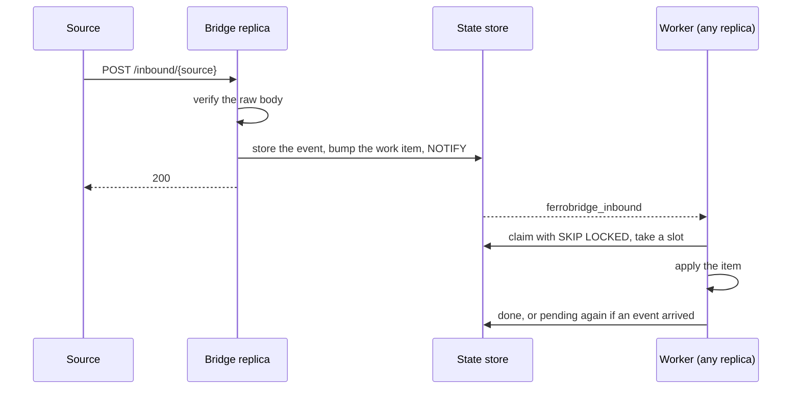

<!-- SPDX-FileCopyrightText: Cadasto B.V. -->
<!-- SPDX-License-Identifier: BUSL-1.1 -->

# The inbound intake

The inbound intake receives patient events from a source system, such as a
care organisation's record system, and stores each one before it answers.
Workers on every replica then apply the stored work. openEHR ITS-REST 1.1.0
defines no change notification, so no specification governs the intake: it
is FerroBRIDGE's own design, built on the standard of each step. Turn it on
with [`[inbound]`](../operate/configuration.md#inbound) and declare each
source through the [operator API](../operate/operator-api.md#inbound-sources).

## Receive and verify

`POST /inbound/{source}` names the source. A source that does not exist, is
disabled or is not a webhook answers `404`. The body is read within the
source's `limits.body_limit` and `[inbound] body_limit`; a larger body
answers `413`. The verifier runs over the raw bytes before anything is
parsed, compares in constant time, and tries every key the source lists, so
a key rotates by adding the new one first. A request that fails answers
`401` and is not stored.

| Verifier | What it checks |
|---|---|
| `hmac` | An HMAC (RFC 2104) of the body with SHA-256 or SHA-512, in hex or base64, in one header, after an optional prefix |
| `standard-webhooks` | The `webhook-id`, `webhook-timestamp` and `webhook-signature` headers of [Standard Webhooks](https://github.com/standard-webhooks/standard-webhooks): `v1` (HMAC-SHA-256) and `v1a` (Ed25519) as release v1.3.0 defines them, and `v2a` (Ed25519 over the SHA-256, with the endpoint id) as its main branch defines it; the timestamp must lie within `tolerance` seconds of now |
| `static-header` | A header that carries one of the listed values |
| `mtls` | The verified TLS client certificate carries one of the listed DNS names |

## Read the event

The event map selects the tenant, the entity and the source's stamp by JSON
Pointer (RFC 6901) and picks the action by the first rule whose every pointer
holds its value: `upsert`, `remove`, `ignore` or `probe`. A probe, an ignored
event and an event for a tenant the source does not serve are answered `200`
and not stored. An event that lacks a part the map selects answers `400`.

The de-duplication key is the SHA-256 of the parts `dedupe` declares: the
source's event id where it sends one (`webhook-id`, the CloudEvents 1.0.2
`source` and `id`), or the fields that together tell one event from another
where it does not.

## Store first

One transaction stores the event, moves its entity's work item to a new
generation and notifies `ferrobridge_inbound`; then the source gets its
`200`. A repeat of a stored event changes nothing. Above the source's
`limits.max_pending` waiting items, or with the state store down, the intake
answers `503` with `Retry-After`, stores nothing, and the source sends again.

## Coalesce, claim and apply

The work is one item per entity, so ten events for one patient cost one
fetch. A worker claims a due item with `FOR UPDATE SKIP LOCKED` under a
lease, makes its remote calls with no transaction open, and gives the item
back at the generation it saw. An event that arrived during the work leaves
the item pending, so it runs again. A source that is fetched for the current
record ends in the same state whatever order its events arrive in.

The remote calls in flight per source and tenant are bounded by
`limits.concurrency` across every replica: each call holds one leased slot
row in the state store, taken and given back in two short statements.

## Retry, park and replay

A transient failure (the network, a `5xx`, `429` or `423`) runs again after
`backoff`, doubled for each repeat up to `max_backoff`, with jitter, until
`max_attempts`; then the item parks. A refusal parks at once. A parked item
carries a fixed reason that names no value of the record, and an operator
settles it:

- `GET /operator/sources/{id}/parked` lists the parked items.
- `POST /operator/sources/{id}/settle` with `tenant`, `entity`,
  `settlement` (`retry` or `discard`) and a `reason` settles one; the
  operator's subject and the reason are recorded.
- `POST /operator/sources/{id}/replay` with `tenant` and `entity`, or with
  `from` and `to` (RFC 3339, the last exclusive), runs the work of one entity,
  or of every entity an event received in that range named, again.
