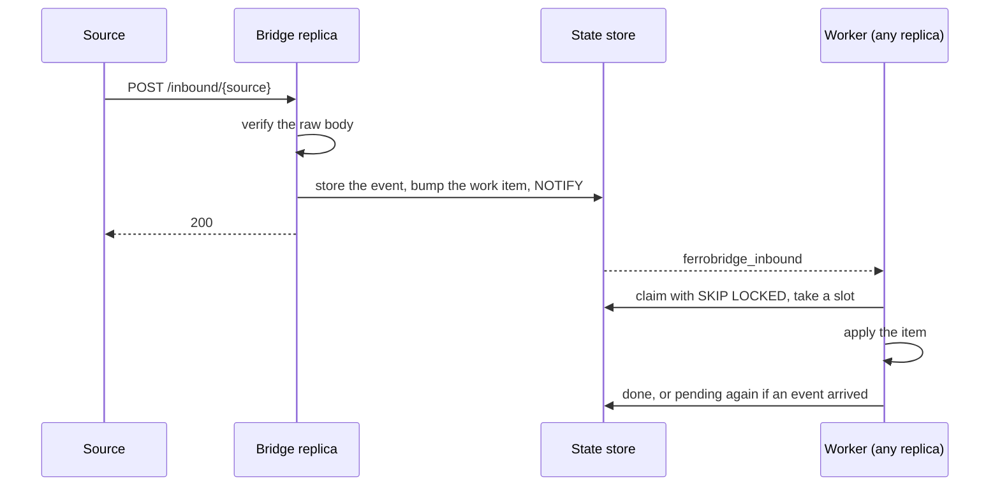

<!-- SPDX-FileCopyrightText: Cadasto B.V. -->
<!-- SPDX-License-Identifier: BUSL-1.1 -->

# The inbound intake

The inbound intake receives patient events from a source system, such as a
care organisation's record system, and stores each one before it answers.
Workers on every replica then apply the stored work. openEHR ITS-REST 1.1.0
defines no change notification, so no specification governs the intake: it
is FerroBRIDGE's own design, built on the standard of each step. Turn it on
with [`[inbound]`](../operate/configuration.md#inbound) and declare each
source through the [operator API](../operate/operator-api.md#inbound-sources).

## Receive and verify

`POST /inbound/{source}` names the source. A source that does not exist, is
disabled or is not a webhook answers `404`. The body is read within the
source's `limits.body_limit` and `[inbound] body_limit`; a larger body
answers `413`. The verifier runs over the raw bytes before anything is
parsed, compares in constant time, and tries every key the source lists, so
a key rotates by adding the new one first. A request that fails answers
`401` and is not stored.

| Verifier | What it checks |
|---|---|
| `hmac` | An HMAC (RFC 2104) of the body with SHA-256 or SHA-512, in hex or base64, in one header, after an optional prefix |
| `standard-webhooks` | The `webhook-id`, `webhook-timestamp` and `webhook-signature` headers of [Standard Webhooks](https://github.com/standard-webhooks/standard-webhooks): `v1` (HMAC-SHA-256) and `v1a` (Ed25519) as release v1.3.0 defines them, and `v2a` (Ed25519 over the SHA-256, with the endpoint id) as its main branch defines it; the timestamp must lie within `tolerance` seconds of now |
| `static-header` | A header that carries one of the listed values |
| `mtls` | The verified TLS client certificate carries one of the listed DNS names |

## Read the event

The event map selects the tenant, the entity and the source's stamp by JSON
Pointer (RFC 6901) and picks the action by the first rule whose every pointer
holds its value: `upsert`, `remove`, `ignore` or `probe`. A probe, an ignored
event and an event for a tenant the source does not serve are answered `200`
and not stored. An event that lacks a part the map selects answers `400`.

The de-duplication key is the SHA-256 of the parts `dedupe` declares: the
source's event id where it sends one (`webhook-id`, the CloudEvents 1.0.2
`source` and `id`), or the fields that together tell one event from another
where it does not.

## Store first

One transaction stores the event, moves its entity's work item to a new
generation and notifies `ferrobridge_inbound`; then the source gets its
`200`. A repeat of a stored event changes nothing. Above the source's
`limits.max_pending` waiting items, or with the state store down, the intake
answers `503` with `Retry-After`, stores nothing, and the source sends again.

## Coalesce, claim and apply

The work is one item per entity, so ten events for one patient cost one
fetch. A worker claims a due item with `FOR UPDATE SKIP LOCKED` under a
lease, makes its remote calls with no transaction open, and gives the item
back at the generation it saw. An event that arrived during the work leaves
the item pending, so it runs again. A source that is fetched for the current
record ends in the same state whatever order its events arrive in.

The remote calls in flight per source and tenant are bounded by
`limits.concurrency` across every replica: each call holds one leased slot
row in the state store, taken and given back in two short statements.

## Resolve and apply

A worker reads the entity through the source's declared resolution and
applies it through one handler, which feeds the identity source and ensures
the patient's one EHR. [Inbound sources](inbound-sources.md) describes the
resolution and the source templates.

## Source templates

A template is a source document ready to create through
`POST /operator/sources`, shipped inert (`enabled: false`) under
`inbound-templates/`. Each one is the source's published behaviour written
as data: no source has code of its own in the bridge.

### Nedap Ons

`inbound-templates/nedap-ons.json` reads the Ons API webhooks
(<https://ons-api.nl/english/technical/Webhooks.html>):

- One URL per stage serves every customer, so the tenant is the
  notification's `customerCode`.
- The verifier is the HMAC-SHA512 of the body with the connector secret, in
  lowercase hex in `X-Signature-SHA512`. The NOP pair Ons sends when you
  configure the URL is answered as a probe: `200` for the good signature and
  `401` for the bad one.
- A `client` `CREATE` or `UPDATE` is an upsert and a `DELETE` a remove; every
  other model and event is ignored. A notification carries no event id, so
  the de-duplication key covers `customerCode`, `modelType`, `eventType`,
  `id` and `timestamp`.
- The resolution reads `/v0/administration/clients/{id}` and its `/bsn` below
  the tenant's `base` with an `X-Field-Whitelist` of the identity fields, and
  a `404` reads as removed. Ons allows 4 parallel requests per certificate,
  the template's `limits.concurrency`.
- `recovery.redeliver` is `PUT https://api.ons.io/webhooks/redeliver` with
  the environment certificate, and `recovery.reconcile` polls
  `/v0/xstream/clients/updates` and `/v0/xstream/clients/deletes` with
  `since` every 15 minutes, each answer's `clients` array read by `id`.
- The logical models are generated from `components/schemas/Client` and
  `components/schemas/Bsn` of the Ons API OpenAPI document
  (<https://ons-api.nl/assets/openapi.json>), and the gender ConceptMap maps
  the four values of `components/schemas/ons_administration.Gender`.

Before you create a source from it:

1. Put the connector secret and each certificate in the `[secrets]`
   directory under the names the template uses
   (`nedap-ons-connector-secret`, `nedap-ons-environment-certificate`) and
   one per tenant for its `credentials`.
2. Load the FHIR package `terminology/nedap-ons-values/` into the
   terminology server: the map translates the client's gender through its
   ConceptMap.
3. Save the map `inbound-templates/nedap-ons/client-patient.map` and the
   logical models `client.json` and `bsn.json` under the `structuremap` root
   of the mapping revision.
4. Add each customer as a tenant with its `identifier_system`, `base`
   (`https://api.ons.io` for production, `https://api-staging.ons.io` for a
   customer's test environment) and `credentials`, set `enabled`, and create
   the source.

## Retry, park and replay

A transient failure (the network, a `5xx`, `429` or `423`) runs again after
`backoff`, doubled for each repeat up to `max_backoff`, with jitter, until
`max_attempts`; then the item parks. A refusal parks at once. A parked item
carries a fixed reason that names no value of the record, and an operator
settles it:

- `GET /operator/sources/{id}/parked` lists the parked items.
- `POST /operator/sources/{id}/settle` with `tenant`, `entity`,
  `settlement` (`retry` or `discard`) and a `reason` settles one; the
  operator's subject and the reason are recorded.
- `POST /operator/sources/{id}/replay` with `tenant` and `entity`, or with
  `from` and `to` (RFC 3339, the last exclusive), runs the work of one entity,
  or of every entity an event received in that range named, again.

## Recover what an outage lost

A webhook source may retry nothing on its own, so the receiver recovers. A
source declares two steps under `recovery` in its document, and one replica
runs them per source under the lane lease `inbound-recover:<source id>`:

- `redeliver` (`method`, `url`, optional `credentials`, a secret holding the
  PEM client certificate and key, and `after_unavailable`, one when left
  out) asks the source to send its failed events again. It runs when a
  replica first leads the source, and when an accepted event ends a run of
  at least `after_unavailable` `503` answers.
- `reconcile` (`every`, `overlap`, `first`, in seconds, and `polls`) reads
  what changed since a cursor, per enabled tenant with the tenant's
  `credentials`. Each poll names its `url`, the `cursor` query parameter the
  RFC 3339 instant travels in, the `items` pointer to the array of changed
  entities, the `entity` pointer within one item, and the `change` it marks
  (`upsert` or `remove`). Every returned entity's work item is due again at
  a new generation. A tenant's first poll reads from `first` seconds back;
  each next cursor is the instant the poll started, less `overlap`. A
  cursor moves only under the lease generation that read it, so a former
  leader paused past its lease cannot move it.

Each replica looks for due recovery every `[inbound] recovery_tick`.
`POST /operator/sources/{id}/reconcile` runs every poll at once, and
`POST /operator/sources/{id}/redeliver` calls the redelivery step.

## FHIR Subscription notifications

A `fhir-subscription` source receives R4 notifications of the Subscriptions
R5 Backport IG STU 1.1.0 on the same `POST /inbound/{source}`, the
`rest-hook` channel the NL Generic Functions notification page asks for.
The source authenticates with the `header` its `Subscription.channel.header`
carries, with a verified client certificate carrying one of its `mtls`
names, or both. A notification is a `history` Bundle whose first entry is the
`Parameters` subscription status; one that is not answers `400`.

- `subscriptions` maps each subscription reference to the tenant it
  serves; a notification for another subscription answers `200` unstored.
- A handshake records the subscription. Every notification records its
  status.
- Each event of an `id-only` or `full-resource` notification becomes one
  work item: the focus when it is a `Patient`, else the carried resource's
  `subject` or `patient`, else the focus, which the worker reads. The key is
  the subscription and the event number, so an event sent twice is stored
  once.
- An event count beyond the highest event stored, from a heartbeat or a
  notification, and an `empty` event, which names no focus, are a gap. The
  replica that leads the source's recovery calls
  `Subscription/{id}/$events` with `eventsSinceNumber`, `eventsUntilNumber`
  and `content=id-only` for each gap and stores what it returns. A relative
  subscription reference resolves against `base`, and the call presents the
  tenant's `credentials`.
