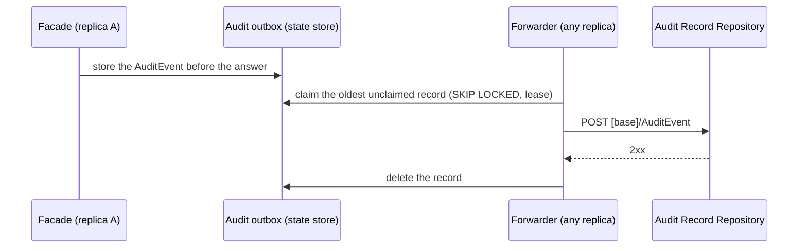

<!-- SPDX-FileCopyrightText: Cadasto B.V. -->
<!-- SPDX-License-Identifier: BUSL-1.1 -->

# The access record

Regulation (EU) 2025/327 Annex II 3.2 asks an EHR system to record, on every
access to personal electronic health data, who accessed it, which natural
person, the categories of the data, when, and where the data came from. The
CDR records each call the bridge makes, but ITS-REST carries no end-user
identity on a read, so the CDR's record names the bridge's own credential.
For an access through the FHIR facade, the bridge is the one system that
knows the person, so it writes the record itself when `[audit]` is on
([configuration](configuration.md#audit)).

## Where each surface's record lives

| Surface | Record | Where it lives |
|---|---|---|
| The FHIR facade | One Annex II 3.2 access record per access an authenticated caller makes: read, vread, search, history, create, update, delete, transaction, batch, `Composition/$document`, `$tofhir` and `$toopenehr` | The Audit Record Repository `[audit] base_url` names, as an IHE BALP `AuditEvent` |
| The HL7 v2 face | One system import record per message it commits (ITI-20 "PHI-import", the DICOM "Import" event), naming the sending facility and no person | The same repository |
| The OMOP ETL (`etl run`, `etl fhir`, `dq check`) and the incremental load | None of the bridge's own: these read in batch under the bridge's CDR credential, with no person behind the read | The CDR's own access log, which names the bridge's ETL client |
| The operator API | None of the bridge's own: it serves mapping files and no health data | The request log line of `ferrohealth-smart` |

Every guarded surface also keeps its request log line, which names the caller
the token verified, the route and the status, and never a body.

## What a facade record holds

- **Who accessed (3.2(a), (b)):** the token's issuer, subject, client and
  `jti`, or the Basic user, and the roles the token grants.
- **The categories (3.2(c)):** classified from the template and archetype ids
  of every composition and party the request read or wrote, through the
  `[audit.categories]` map. An id the map does not name leaves the record
  unclassified, and the record says so.
- **When (3.2(d)):** the moment the access was answered.
- **The origin (3.2(e)):** the CDR at `[cdr] base_url`, with each `ehr_id`
  the access reached and the patient the identity map binds to it.
- **The request:** the interaction, the resource it named, the search query,
  and the `X-Request-Id` the request log carries.

Each record states how long the repository keeps it, at least the three years
of Art 9(2), and the security labels of its categories.

## When a record cannot be taken

Recording fails closed. Each record is stored in the audit outbox of the
state store ([`[state]`](configuration.md#state)) before the answer. Before
an access runs, the bridge checks that the outbox answers; when it does not,
the access is refused with `503` and an `OperationOutcome` of code
`transient` before the CDR is called. When the record of a finished access
cannot be stored, the answer is withheld with the same `503`. The HL7 v2
face answers `AR` in both cases, and the sender's resend is safe, since the
identity map recognises a message it already committed.

A record waits in the outbox until the repository answers `2xx`. Every
replica runs a forwarder over the one outbox: a forwarder claims the oldest
record no other forwarder holds, for two minutes, and deletes it once the
repository took it, so two replicas never send one record, and a record a
replica stored or claimed before it stopped is sent by another. The bridge
retries an unreachable repository in rounds of `[audit.endpoint] retry`
tries, `max_backoff` apart, and a record the repository refuses with a `4xx`
is moved to the `audit_quarantine` table for an operator. The outbox grows
with a repository outage and refuses nothing for want of room.

