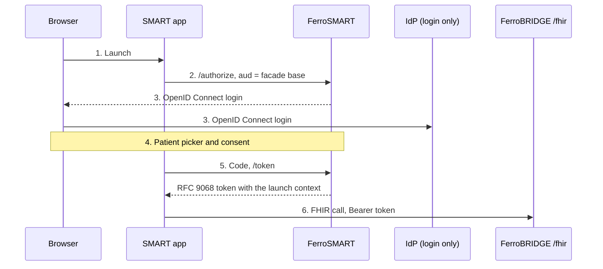

<!-- SPDX-FileCopyrightText: Cadasto B.V. -->
<!-- SPDX-License-Identifier: BUSL-1.1 -->

# Running behind FerroSMART

FerroSMART is the FerroHEALTH SMART App Launch 2.x authorization server. It
logs a person in at any OpenID Connect provider upstream, for login only, and
issues plain RFC 9068 access tokens for the FerroHEALTH products. FerroBRIDGE
then runs as a resource server: an app takes its token from FerroSMART and
calls the facade with it, and the bridge never sees the provider's tokens.
FerroSMART's architecture describes the whole deployment in
[§13.21 A product behind FerroSMART](https://github.com/FerroHEALTH/FerroSMART/blob/main/docs/architecture.md#1321-a-product-behind-ferrosmart);
this page is FerroBRIDGE's side of it.



## FerroSMART's resource table

FerroSMART issues a token only for a resource it names, so it lists the
facade's base as a FHIR resource:

```toml
[[ferrosmart.resource]]
base = "https://bridge.example.org/fhir"
kind = "fhir"
```

The base is the facade's [`[facade] base_url`](configuration.md#facade), and
it is the `aud` of every token the bridge admits.

## The bridge's issuer table

The bridge trusts FerroSMART with one named issuer table that names only
the issuer:

```toml
[auth.issuer.ferrosmart]
issuer = "https://smart.example.org"
```

The issuer is a SMART App Launch 2.2 authorization server, and its audience
is the facade's `base_url`, so neither needs a key. FerroSMART's client
registry is the one list of clients: a token FerroSMART signs whose `aud`
names the facade admits its client, and the bridge keeps no client list of
its own. A token's `typ` is `at+jwt` or `application/at+jwt` (RFC 9068 §4),
and `scope` is a required claim. The caller is read from the token's
standard claims:

| Token | Read as |
|---|---|
| A user's token (`sub` names the user, `client_id` the app) | a user, by the resource type of the `fhirUser` claim: `Patient`, `Practitioner`, `PractitionerRole`, `RelatedPerson` or `Person`, or a user of no stated type without `fhirUser` |
| A patient's own token: `fhirUser` is `Patient/<x>` (relative, or an absolute URL ending in `/Patient/<x>`), the `patient` claim is `x`, and it carries no `act` | the patient, the person's own access |
| A `RelatedPerson` token with a `patient` claim | the patient's representative (Regulation (EU) 2025/327 Art 4(2)) |
| A token with an RFC 8693 `act` | the user, with the actor that acts for them |
| A SMART Backend Services token (`sub` equals `client_id`, RFC 9068 §2.2) | a machine, with the `system/` scopes it carries |
| A token whose `aud` names another server, with no `scope`, or with another `typ` | refused: `401` |

Use one table for FerroSMART: two issuer tables naming one issuer refuse the
start. Every other key of the issuer table (`algorithms`, `clock_skew`,
`jwks_max_age` and the rest) and every profile key is on the
[`[auth]`](configuration.md#auth) page.

The launch context FerroSMART puts in the token (`patient`, `encounter` and
`fhirUser`) needs no key. A `patient/` scope holds the caller to the patient
its `patient` claim names, as the [facade's Security section](../integrate/fhir-facade.md#security)
describes.

A patient's own token is the person's own access (Regulation (EU) 2025/327
Art 9). The bridge reads it as `ferrohealth-smart` classifies it
(`Caller::is_the_person`), so a professional who holds `patient/` scopes
stays a professional held to the launch context. For the patient's own
token, the facade's access record carries the binding `self`.

## The patient summary reads FerroEHR as the patient

`Patient/$summary` ([`[facade.summary]`](configuration.md#facadesummary))
reads FerroEHR with the patient's own token, exchanged at FerroSMART
(RFC 8693 §2.1), so FerroEHR applies the patient's own access rules and its
access record names the person. FerroSMART is then also the CDR lane's
onward issuer:

```toml
[cdr.endpoint.credentials.onward]
issuer = "https://smart.example.org"
token_endpoint = "https://smart.example.org/token"
audiences = ["https://ehr.example.org/openehr/v1"]
indicators = ["https://ehr.example.org/openehr/v1"]

[cdr.endpoint.credentials.onward.profile]
max_onward_lifetime = "5min"
```

At FerroSMART, register the bridge as a confidential client with
`grant_types = ["token_exchange"]` and both the facade's base and FerroEHR's
openEHR base in its `resources`. The token FerroSMART issues names the
patient as `sub`, the openEHR base as `aud` and the bridge as `client_id`
with no `act`; it carries `fhirUser`, `patient`, `ehrId`, the scopes
`patient/composition-*.r` and `patient/aql-*.s`, and the subject token's
`acr` and `auth_time`, and lives at most five minutes. FerroEHR trusts
FerroSMART the same way, with an issuer table that names only the issuer.

## The discovery document

An app that starts at the bridge reads `GET /fhir/.well-known/smart-configuration`
and must find FerroSMART there. With FerroSMART as the bridge's one SMART
issuer, the [described-issuer rule](configuration.md#the-described-issuer)
picks it, and the document names FerroSMART's `authorization_endpoint` and
`token_endpoint`. With other issuers beside it, set
`[auth] described_issuer = "ferrosmart"`, the name of its table. The document and
`GET /fhir/metadata` answer any origin with CORS, and the REST routes answer
the origins [`[facade.cors] allowed_origins`](configuration.md#facadecors)
lists, so list the origin of every browser app.

No specification governs this deployment shape: it is FerroHEALTH's own
design, built from SMART App Launch 2.2.0, RFC 9068 and OpenID Connect.
