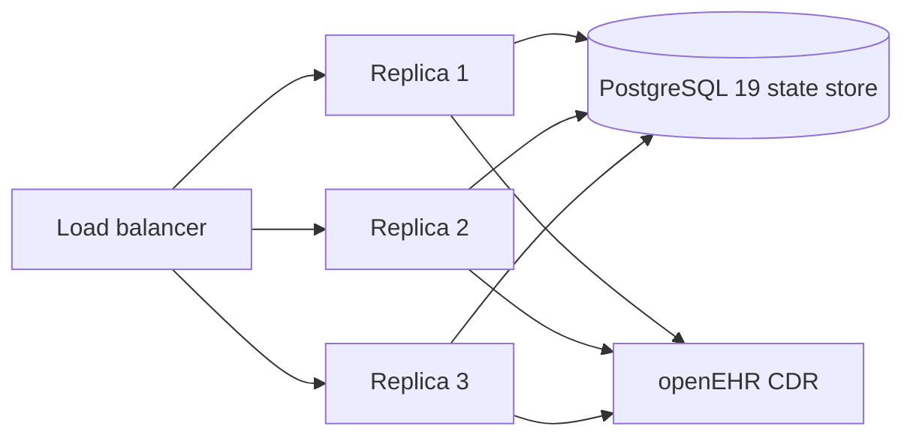

<!-- SPDX-FileCopyrightText: Cadasto B.V. -->
<!-- SPDX-License-Identifier: BUSL-1.1 -->

# The state store and high availability

FerroBRIDGE keeps its own working state in one PostgreSQL database that
every replica shares, the `[state]` store
([`[state]`](configuration.md#state)). Clinical data stays in the CDR and the
CDM database. With the state in one place you run as many replicas as you
need behind one address, and a replica that stops loses nothing another
replica cannot take over. No specification governs a bridge's state or how
its replicas share work: this page describes FerroBRIDGE's own design.

## PostgreSQL 19 is the floor

The server refuses to start against a PostgreSQL older than 19. `serve` opens
the store at start and applies the migrations the binary carries under an
advisory lock, so replicas that start together migrate once. Readiness
carries a `state` indicator, so a replica whose store does not answer leaves
the load balancer's pool.

Give the bridge a role that owns its database, apart from the CDM database.
The store needs `[state.seal]` for the areas that keep identifiers or bodies:
values are sealed with AES-256-GCM under a listed key, and identifier values
are stored as an HMAC-SHA-256 under the `lookup_key`, whose fingerprint the
store pins ([`[state.seal]`](configuration.md#stateseal)).

## What the store holds

| Area | Configured by | What it keeps |
|---|---|---|
| The identity map | `[facade]` | Each binding of a pseudonym, an EHR and a resource id, recorded once |
| SMART Health Links, App State, launch `Task`s | `[shl]`, `[facade.app_state]`, `[facade.launch_task]` | The links and the facade's own resources |
| The change feed | `[change_feed]` | The watermarks, the parked events and their decisions |
| The audit outbox | `[audit]` | Each BALP `AuditEvent`, committed before the answer, until the repository takes it |
| Mapping revisions | `[operator]` | The console's mapping files and every revision of them |
| Settings registers | `/operator/registers` | Runtime settings such as `audit-categories` |
| Inbound sources | `/operator/sources` | Each source document at every version, with its tenants and HL7 v2 routes |
| The inbound intake | `[inbound]` | The stored events, one work item per entity, the slots and the recovery cursors |

## What runs on every replica and what runs on one

Most work runs on every replica at once and coordinates through row locks:

- The FHIR facade, the HL7 v2 face and the inbound intake answer on every
  replica.
- The inbound workers claim due items with `FOR UPDATE SKIP LOCKED`, so two
  replicas never work one entity at once, and a source's
  `limits.concurrency` bounds its remote calls across every replica.
- The audit forwarders claim the oldest unsent record the same way, so a
  record is sent once.

A lane that must have one leader holds a lease in the store, renewed while
the leader lives. Every write the leader makes carries the lease's fencing
generation, so a former leader paused past its lease moves no cursor:

| Lane | Lease |
|---|---|
| Each change-feed reader (the events lane, the incremental OMOP load, the outbound FHIR lane) | `change-feed:<reader>`, renewed every third of `[change_feed] lease` |
| Each inbound source's recovery: redelivery, reconciliation, FHIR Subscription `$events` | `inbound-recover:<source id>`, for `[inbound] lease` |
| The SMART Health Link expiry sweep | `shl-sweep` |

A replica that stands by for a change-feed reader reports it as `standby`.
When a leader's lease runs out, another replica takes the lane over and
resumes where the leader's last fenced write left it.

## Changes reach every replica

Each replica holds one `LISTEN` session. A write of a source, a register or a
mapping revision notifies the others, which reload what changed behind one
pointer swap. While a replica's session is down it reads the store on every
lookup instead of its copy, so it never answers from a stale one.
